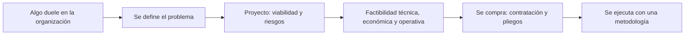
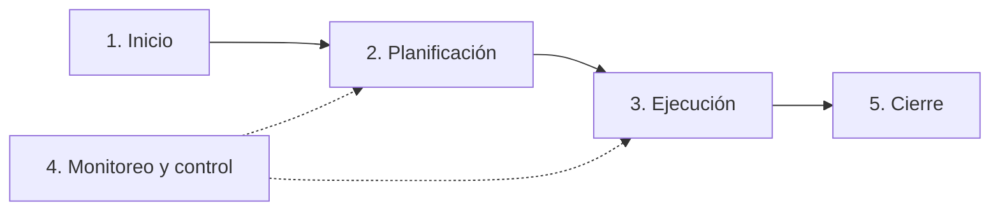
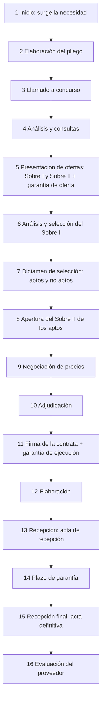

# ADSI 2026: resumen hablado de la Unidad 5, Administración de Recursos TI

[TOC]

## Cómo leer este resumen

La idea es que esto se lea como si te lo estuviera explicando en voz alta, antes de entrar al parcial. La unidad tiene tres partes, igual que el resumen de Simulación:

1. **Los temas**, contados en criollo, con lo que hay que saber decir de memoria.
2. **Un ejemplo resuelto**, paso a paso. Sale del TP 10 (NovaRetail) y de un cálculo de factibilidad económica armado para practicar.
3. **Relaciones y preguntas típicas**: cómo se conecta todo y qué te pueden preguntar.

> **Fuentes.** El apunte "Unidad Nº5 – Administración de Recursos TI" (UTN FRVT), las diapositivas "Unidad N° 5 – Primera Parte", el caso NovaRetail y el TP 10 del Grupo 3. Los números del ejemplo de factibilidad económica son inventados para practicar.

El hilo de la unidad, en un dibujo:



La frase que resume todo: **la U5 es cómo una organización que ya existe decide y lleva adelante un cambio con TI**. Su par es la Unidad 6, que cuenta cómo nace una organización nueva alrededor de una oportunidad tecnológica; el resumen está en [`ADSI_Unidad_6_Emprendimientos.md`](ADSI_Unidad_6_Emprendimientos.md).

---

## La unidad en 30 segundos

Las organizaciones viven con problemas. Cuando uno de esos problemas se decide atacar, arranca un **proyecto**. Antes de gastar plata se hace un **estudio de viabilidad** (¿vale la pena?) y un **estudio de factibilidad** en tres patas: **técnica** (¿se puede?), **económica** (¿conviene?) y **operativa** (¿la gente y los procesos lo van a poder llevar a la práctica?). Mientras tanto se gestionan **riesgos** y **stakeholders**. Si se aprueba, hay que **comprar** lo necesario, y eso se hace con un proceso formal de **contratación**, cuyo documento clave es el **pliego**.

## Por qué cambiar: de dónde sale un proyecto

Arrancamos por lo más simple. Ninguna organización está quieta: todos los días aparecen situaciones problemáticas, y cada una es una oportunidad de cambio. A veces el cambio es un ajuste chico en un proceso y a veces es una transformación radical. Y todo cambio tiene una motivación: a veces está clarísima (queremos crecer) y a veces es el síntoma de un problema que está más abajo.

Los ejemplos que da el apunte, y que conviene saber:

- Lograr **mayor eficiencia** en un proceso.
- **Reducir tiempos de respuesta** al cliente.
- Hacer un **cambio tecnológico** o de equipamiento.
- Cumplir con una **normativa externa**.
- Cumplir con **nuevos objetivos** que se puso la organización.
- **Resolver disfunciones** que traban el logro de objetivos.

Frente a cualquiera de esos síntomas, las TIC son el **habilitador estratégico**: la situación actual de la tecnología y lo que ofrece define qué tan bien se puede responder. Y todo ese proceso de cambio, para nosotros, **es un proyecto**.

## Qué es un proyecto (y qué es un proyecto IT)

La definición de examen es la del **PMBOK** (la guía del PMI, que es un marco de referencia flexible, no una metodología rígida): un proyecto es **un esfuerzo temporal que se emprende para crear un producto, servicio o resultado único**.

Tres palabras clave, y si te las acordás tenés la definición:

- **Temporal**: tiene fecha de inicio y fecha de fin. Duración finita.
- **Único**: el resultado no se hizo de forma idéntica antes.
- **Recursos escasos**: personas, tecnología y plata. Como son escasos, no se pueden hacer todos los proyectos aunque todos convengan. Por eso existe la **evaluación de proyectos**: elegir el más conveniente para el momento de la organización.

Un **proyecto informático** es un sistema de acciones simultáneas o secuenciales que integra personas, hardware, software y comunicaciones para obtener resultados sobre un sistema de información.

Y acá viene la frase que la cátedra marca en mayúsculas: **"IT Project" es un concepto simplista, porque no existe un proyecto sin el negocio que reciba su resultado**. Un proyecto de TI siempre es un proyecto del negocio.

## Dónde puede iniciarse un proyecto

| Origen | Qué tener en cuenta |
|---|---|
| Gerentes de departamento | Ver si hay otras áreas involucradas, para buscar una solución de conjunto y no un parche local |
| Ejecutivos de alto nivel | Suelen tener objetivos más amplios, que tocan varias áreas |
| Área de sistemas | Detecta mejoras (tecnologías, metodologías), pero conviene que el pedido lo haga el gerente del área afectada |
| Grupos externos | Clientes, usuarios, proveedores o entes oficiales (AFIP/ARCA, gobierno) |

Un detalle que suelen preguntar: aunque sistemas tiene que estar atento, **las personas que usan el sistema todos los días son la mejor fuente** para saber qué mejorar.

## Proyectos y transformación digital

Digitalizar no es "meter herramientas". La transformación digital se centra en que el cambio sea **sostenible** y en construir una **cultura digital**. Dos pilares:

- **Gestión del cambio**: afecta a toda la empresa; necesita que participen empleados, directivos y ejecutivos, con concientización, capacitación y coaching.
- **Colaboración**: comunicación constante entre equipos, estructura interfuncional y software colaborativo para trabajar en tiempo real.

## Definición del problema

Esto es más importante de lo que parece. Definir bien el problema exige **distinguir causas, síntomas y necesidades**. Si confundís síntoma con causa, resolvés lo que no era. Y de esta definición sale el **alcance** del proyecto.

Las tareas son:

1. Estudiar el sistema y el contexto actual.
2. Analizar lo que se desea obtener.
3. Clarificar qué áreas se verán afectadas.
4. Definir el problema y sus componentes, priorizando en tres niveles: **fundamental** (indispensable), **deseable** (mucho valor) y **opcional** (secundario o a futuro).
5. Identificar a los responsables del proyecto.
6. Definir con claridad qué se propone solucionar.
7. **Validar** la definición con los interesados.

## Factores que transforman la gestión de proyectos

El apunte los agrupa en tres dimensiones. Si te piden "factores impulsores", contestás con esta tabla:

| Procesos y capacidades | Factores externos | Factores tecnológicos |
|---|---|---|
| Metodologías formales (PMBOK, PRINCE2) | Globalización: operar en varios mercados | Ciberseguridad |
| Herramientas de software de gestión | Equipos dispersos geográficamente | Trabajo remoto |
| Más formalización y estándares | Responder rápido a crisis | Riesgos digitales que cambian |
| Más inversión en proyectos estratégicos | Más regulaciones | Nube y automatización |

## Gestión tradicional vs. gestión ágil

**Tradicional (cascada o waterfall).** Etapas secuenciales: no se pasa a la siguiente sin terminar la anterior. La idea es **bajar la incertidumbre planificando todo al principio**, con requisitos claros desde el inicio. Mucha documentación, procesos formales y gobernanza; marcos como **PMBOK** y **PRINCE2**; el **director del proyecto** en el centro; herramientas como **Gantt**, cronogramas y control de cambios. Sirve para **entornos estables con requisitos claros**.

**Ágil.** No es para todo. Sirve cuando **los requisitos o la solución no se conocen del todo**. Para decidir se usa la **matriz de complejidad de Stacey**: un eje es qué tan claros están los requisitos (el "qué") y el otro qué tan clara está la tecnología o la solución (el "cómo").

| Tipo de proyecto | Qué se sabe | Enfoque |
|---|---|---|
| Simple | Requisitos y solución conocidos | Tradicional |
| Complicado | Qué y cómo parcialmente conocidos | Punto intermedio |
| Complejo | Alta incertidumbre, cambios frecuentes, mucho contacto con el cliente | **Ágil** |
| Caótico | Ni requisitos ni solución | Ni uno ni otro: primero estabilizar |

Los marcos que nombra la unidad: **Waterfall** (secuencial), **Agile/Scrum** (iterativo e incremental) y **Kanban** (gestión visual continua). El objetivo de trabajar con cualquier metodología es el mismo: **resultados de calidad predecible con actividades ordenadas y eficientes**.

## Ciclo de vida del proyecto: las cinco fases

Esto se pregunta mucho, así que vale aprenderse qué se hace en cada fase.



| Fase | Qué se hace |
|---|---|
| **1. Inicio** | Análisis de la situación inicial, de los afectados, definición del producto o servicio, hitos, estimación inicial de costos, evaluación de riesgos, acuerdo con el cliente y **constitución del proyecto** |
| **2. Planificación** | Plan detallado, plan de comunicación, presupuesto, **reunión de arranque (kick-off)** y gestión del cambio |
| **3. Ejecución** | Ejecutar actividades, dirigir y gestionar, informes de avance y revisión del comité de dirección |
| **4. Monitoreo y control** | Control del trabajo, del alcance, del cronograma, de costos y recursos, y monitoreo de riesgos |
| **5. Cierre** | **After Action Review**, resumen de aprendizaje, transferencia de conocimientos y cierre formal |

El monitoreo y control no es "después" de la ejecución: corre en paralelo y realimenta a la planificación. Por eso en el dibujo va con líneas punteadas.

## Stakeholders y el director del proyecto

Un **stakeholder** (interesado) es cualquier persona, grupo u organización que **puede afectar, verse afectado o sentirse afectado** por el proyecto. Fijate que alcanza con que *se perciba* afectado. La lista: clientes y usuarios finales, patrocinadores (sponsors), equipo del proyecto, proveedores y contratistas, reguladores, comunidades locales, alta dirección y otros proyectos relacionados.

El **director del proyecto** tiene que lograr que el resultado salga:

- dentro del **alcance** acordado,
- según las **especificaciones**,
- en los **plazos**,
- con la **calidad** requerida,
- dentro del **presupuesto**,
- y manejando bien la **variable social** (los conflictos).

Para eso necesita habilidades técnicas **y** blandas: comunicación, negociación, liderazgo, toma de decisiones, y sobre todo **equilibrar la tensión entre calidad, costo y tiempo**. Sus tareas, en tres verbos: **planificar, organizar y controlar**.

Y tiene que documentar. La lista de documentos: acta de iniciación, especificación del alcance, registro de incidencias, minutas, plan de trabajo, cronograma, línea base de documentos, informes de avance (tiempo, costo, alcance, calidad), incidentes clave, aceptación del producto y **acta de cierre**.

## Matriz de stakeholders: poder vs. interés

Se cruzan dos ejes y salen cuatro tipos. Cada uno pide una estrategia distinta:

| | **Interés alto** | **Interés bajo** |
|---|---|---|
| **Poder alto** | **Promotores** → *Involucrar*: presentarles el proyecto y sus beneficios, que colaboren. Ej.: ayuntamientos | **Latentes** → *Informar* de forma proactiva: reuniones periódicas, empatizar, integrar sus preocupaciones. Ej.: ONG ambientales |
| **Poder bajo** | **Defensores** → *Reportar* avances, casi unidireccional. Ej.: comercios locales | **Apáticos** → *Monitorizar*: ver si cambian de cuadrante. Ej.: vecinos |

Truco para no confundir latentes con defensores: **los latentes tienen poder** (por eso hay que escucharlos aunque no les interese), **los defensores tienen interés** (por eso alcanza con contarles cómo va).

## Viabilidad y riesgos

**Estudio de viabilidad.** Un proyecto nuevo siempre es un riesgo y se lleva recursos importantes. El apunte dice que es común que las empresas no respeten "las mínimas normas de prudencia" y que los proyectos queden a mitad de camino. El estudio de viabilidad sirve para **averiguar si vale la pena convertir una idea en proyecto**: si de verdad va a dar los beneficios que se esperan. Es una herramienta de **decisión estratégica**: aprobar o rechazar.

Su profundidad depende de la envergadura (riesgo, inversión, impacto interno, impacto en el cliente, aspectos legales). La regla: **se avanza cuando hay un grado de confianza razonable de que el resultado va a ser satisfactorio**.

Además de bajar el riesgo, ayuda a: ver alternativas, descubrir oportunidades e innovar, detectar señales de que conviene no seguir, aumentar la probabilidad de éxito, decidir con datos y conseguir **financiación**.

Las actividades para hacerlo: identificar limitaciones, restricciones y supuestos; detectar oportunidades; analizar cómo funciona hoy la organización; definir requisitos; establecer el alcance; evaluar alternativas; y acordar la línea de acción.

**Riesgo.** Es un **evento o condición incierta que, si ocurre, tiene un efecto positivo o negativo** sobre los objetivos. Ojo con esto que es de examen: **el riesgo puede ser positivo** (una oportunidad) o negativo (una amenaza). Tiene tres características: **concierne al futuro**, **implica cambios** e **implica elegir** (métodos, herramientas, cuánta gente, cuánta calidad).

Las categorías de riesgos de proyecto: **técnicos** (requerimientos, tecnología, calidad), **externos** (proveedores, normativa, mercado, cliente), **organizacionales** (recursos, financiamiento) y **de gestión** (estimación, planificación, control).

**Gestión del riesgo.** Con la descripción, la **probabilidad** y el **impacto** de cada riesgo, se busca bajar una u otra. El ejemplo del apunte es la rotación de personal:

1. Determinar las causas.
2. Mitigarlas antes de que empiece el proyecto.
3. Asegurar la continuidad aunque haya rotación.
4. Definir estándares de documentación de uso obligatorio.
5. Hacer revisiones en equipo, para que más de una persona siga la marcha del proyecto.
6. Asignar una persona de apoyo para cada tarea crítica.

**Supervisión del riesgo**, con tres objetivos: **detectar** si ocurrió un riesgo previsto, **asegurar** que se estén aplicando los pasos de gestión y **recopilar** información para futuros análisis.

## Factibilidad: las tres preguntas

Acá está el corazón de la unidad. El estudio de factibilidad analiza la **necesidad, conveniencia y oportunidad** de poner en marcha un sistema, y busca una **seguridad razonable** de éxito. Se estudia en tres dimensiones. La forma fácil de acordártelas es como tres preguntas:

| Factibilidad | La pregunta | Qué mira |
|---|---|---|
| **Técnica** | ¿Se puede hacer? | Tecnología, capacidad, configuraciones de HW y SW |
| **Económica** | ¿Conviene hacerlo? | Costos, beneficios, rentabilidad |
| **Operativa** | ¿La organización lo va a poder llevar a la práctica? | Personas, procesos, apoyo, adopción |

Y van en cadena: **la técnica define un rango de soluciones posibles, la económica elige la más conveniente de ese rango, y la operativa confirma que se pueda poner en práctica**.

## Factibilidad técnica

Trata de demostrar que el proyecto **se puede concretar**:

- ¿Existe la tecnología necesaria?
- ¿Alcanza la capacidad de almacenamiento?
- ¿Soporta el crecimiento de la demanda?
- ¿Hay garantías de exactitud, confiabilidad, acceso y seguridad de los datos?
- ¿Hay **proveedores alternativos**?

Después mira tres grupos de requerimientos:

- **De la organización**: volumen de datos y cómo fluctúa (por hora, día, momento del mes), oportunidad (qué tan rápido necesitan la información los usuarios), urgencia, complejidad (interrelaciones, interfaces) y equipamiento.
- **Del funcionamiento de Sistemas**: tiempo de equipo para programar y testear, fallas de equipo, tareas especiales y **tiempos de reproceso**. El reproceso crece cuanto más integrados están los procesos (un error se propaga más), y baja con buenos controles de consistencia, capacitación y programación confiable.
- **De capacidad de equipos**: estimar lo que se necesita para las transacciones diarias, semanales y mensuales y el almacenamiento que generan. Con eso se arman las configuraciones posibles y se descartan las que no sirven. La regla: **la configuración elegida tiene que superar con holgura la necesidad actual, para absorber el crecimiento**. Y puede pasar que la empresa ya tenga la infraestructura.

## Factibilidad económica

Compara **costos y beneficios** de cada alternativa técnica para elegir la más conveniente. Lo que se considera:

- El costo de hacer la investigación de sistemas.
- El costo de hardware y software.
- Los beneficios (o la reducción de costos y de errores).
- **El costo de no hacer nada** (si nada cambia). Este se olvida mucho y es clave: no hacer nada también cuesta.

**CapEx vs. OpEx**, que en TI es fundamental:

- **CapEx** (capital): inversión inicial. Hardware, licencias perpetuas, red, desarrollo.
- **OpEx** (operativo): gastos recurrentes. Nube (SaaS/IaaS), soporte, mantenimiento, energía, internet, sueldos de TI.

Pasar a la nube es, en el fondo, cambiar CapEx por OpEx: no comprás el servidor, pagás por mes.

**Evaluación financiera**: la **inversión** (activos fijos, activos nominales y capital de trabajo), la proyección de **ingresos y gastos** anuales, el **financiamiento** (recursos propios, préstamos; si es externo, armar el servicio de la deuda) y los **estados proyectados**: Estado de Resultados, Flujo de Efectivo y Balance General. Con el **flujo de fondos netos** se calculan los criterios de rentabilidad: **VAN**, **TIR** y **relación beneficio/costo**.

**Tipos de costos y beneficios.** Tres pares para clasificar:

| Par | Costo | Beneficio |
|---|---|---|
| Tangible / intangible | Desgaste de un equipo / caída de la imagen de la empresa | Reducción de un gasto / mejor servicio al cliente |
| Fijo / variable | Costo de un equipo / tinta de impresora | Ahorro de papel / ventas por internet |
| Directo / indirecto | Equipo para operar el sistema / seguridad, aire acondicionado | Menos colas de clientes / saber qué producto usan más |

**Categorías de costos.** Por elemento: **equipos**, **instalaciones** (sitio, cableado, aire), **personal** (desarrollo y operación) y **suministros y varios** (papel, viajes, capacitación). Por instancia del proyecto:

- **Desarrollo**: investigación, análisis, diseño, programación y pruebas.
- **Operativos de inicio**: migración y carga de datos, conversión, **ejecución en paralelo**, puesta en marcha.
- **Operacionales**: los recurrentes (HW, licencias, mantenimiento, personal).
- **Financieros**: intereses del financiamiento.
- **Hereditarios**: ya los pagó otro proyecto, **se restan**.
- **Residuales**: lo que vale lo que queda al final de la vida útil, **se resta**.

**Beneficios.** Se estiman y se les pone un valor en plata. Los **tangibles se comparan con los costos**; los **intangibles sirven para "vender" el proyecto**. Un truco del apunte para encontrarlos: buscá los problemas del sistema actual y lo que cuestan; si el sistema nuevo los elimina, ese costo es tu beneficio. Se agrupan en **beneficios de desempeño** (velocidad, acceso a información, mejor atención, flexibilidad, más servicios) y **beneficios por evitar costos** (menos errores administrativos, personal, papel, conteo de inventario).

**Las tres estrategias para comparar costos y beneficios:**

- **Punto de equilibrio**: compara el costo acumulado del sistema actual con el del nuevo. El punto de equilibrio es el instante en que se igualan; de ahí en adelante el nuevo sistema da beneficio neto.
- **Período de recuperación (payback)**: cuánto tiempo pasa hasta que los beneficios acumulados igualan a los costos. **Cuanto más corto, menos riesgo**.
- **Valor presente**: un peso de hoy no vale lo mismo que un peso dentro de tres años. Se usa una **tasa de descuento**, que es el **costo de oportunidad** de la plata: lo que la empresa ganaría poniéndola en otro lado. El ejemplo del apunte: si un plazo fijo paga 20 % anual, meter la plata en el proyecto es renunciar a ese 20 %. Se multiplican costos y beneficios de cada año por un factor y se comparan; **si los beneficios a valor presente superan a los costos, la inversión es buena**.

Las fórmulas que conviene tener (son las estándar; el apunte las nombra sin desarrollarlas):

$$VAN = -I_0 + \sum_{t=1}^{n} \frac{B_t - C_t}{(1+i)^t}$$

La **TIR** es la tasa $i$ que hace $VAN = 0$. Si la TIR supera la tasa de descuento, el proyecto conviene.

$$\frac{B}{C} = \frac{\text{VP de los beneficios}}{\text{VP de los costos}}$$

Si $B/C > 1$, conviene.

## Factibilidad operativa

Esta es la del TP 10, así que vale contarla bien. Una solución puede ser técnicamente posible y económicamente conveniente y aun así fracasar. La pregunta es: **¿se va a poder llevar a la práctica en el momento y las circunstancias deseadas? ¿La organización tiene capacidad para operarlo?**

La definición que la cátedra resalta con signos de admiración: la factibilidad operativa evalúa **si la organización cuenta con los recursos humanos, los procesos operativos y las capacidades necesarias** para llevar el proyecto adelante con éxito, y si puede **superar los obstáculos** que aparezcan.

Las preguntas que hay que hacerse, casi textuales del apunte:

- ¿Hay suficiente apoyo de la **gerencia**? ¿Y de los **usuarios**?
- ¿Van a **usar** el sistema cuando esté instalado?
- ¿Los usuarios **participaron** en la planeación y el desarrollo?
- ¿Aumenta la **productividad**?
- ¿Mejora la **integración** con otras áreas?
- ¿**Causa daño**? Resultados más pobres en algún área, pérdida de control, pérdida de acceso a información, trabajo más lento en algún sector, clientes afectados.

Y los aspectos concretos de puesta en marcha: recursos humanos clave, horas y equipos, almacenamiento, adecuación del **sitio**, **capacitación** de sistemas y de usuarios, y **conversión de datos** del sistema viejo al nuevo. El apunte advierte que el estudio teórico simplifica: hay que contrastarlo con la realidad, porque **detalles chicos al principio pueden terminar en problemas operativos graves**.

## Herramientas de gestión de proyectos

Son aplicaciones para seguir tareas, recursos y equipos. Le sirven a todo el equipo y sobre todo al director, que sabe en todo momento cómo está el proyecto.

Para elegir una, que sea: **fácil de usar** (baja curva de aprendizaje), **flexible** (cada área trabaja distinto), con **temporizador y cargas de trabajo**, con **plantillas** e **informes** de horas por tarea. Las funciones típicas: **planificación**, **colaboración**, **documentación** (versiones, almacenamiento) y **evaluación**.

## Contrataciones: pública y privada

Una vez que el proyecto se aprueba, hay que comprar. Y comprar en serio tiene un proceso.

**Contratación pública** es un acuerdo bilateral donde una de las partes está ejerciendo la **función administrativa** (el Estado), para hacer una obra, prestar un servicio o comprar o vender un bien, con el fin de satisfacer necesidades generales. Se regula para que el Estado sea **eficiente y transparente** con los recursos públicos.

Entran: compraventa, suministros, servicios, locaciones, consultoría, alquileres con opción a compra, permutas, concesiones, obras públicas y licencias. **Quedan afuera**: empleo público, compras por **caja chica**, contratos con estados extranjeros, con organismos internacionales o multilaterales de crédito (y lo que ellos financien) y operaciones de crédito público.

Para elegir el procedimiento se mira: economicidad, eficiencia y eficacia; características del bien o servicio; **monto estimado**; condiciones del mercado; y **urgencia o emergencia**.

Una contratación típica tiene **tres etapas**:

1. **Previa a la licitación**: se definen los requerimientos.
2. **Proceso de licitación**: desde que se arma el pliego hasta la **adjudicación**.
3. **Posterior a la licitación**: desde la adjudicación hasta que se cumple la obligación.

## El cronograma de una contratación, evento por evento

Esto es largo pero tiene lógica. Contalo como una historia:



Lo importante de cada paso:

- **[1] Inicio.** Aparece la necesidad (la "causa" del contrato).
- **[2] Pliego.** La entidad licitante (el **comitente**) arma el **Pliego de Bases y Condiciones**: forma, cantidades, fechas y cómo se va a elegir a los oferentes. Participan Compras y el área que pide (cliente interno), y a veces expertos y abogados.
- **[3] Llamado.** Dos modalidades:
  - **Concurso privado de precios (licitación privada)**: se **invita** a proveedores elegidos de la base de datos.
  - **Licitación pública**: se **publica** en medios masivos o el Boletín Oficial, sin preselección.
  - La diferencia es **el grado de competencia**; el proceso es el mismo. El privado es más rápido, pero la pública es obligatoria en algunos casos: servicios públicos privatizados que superan cierto monto, productos innovadores sin proveedores conocidos, o productos clave para un sector del país.
- **[4] Análisis y consultas.** Toda consulta de un oferente se responde **a todos** mediante una **circular con consulta**, por transparencia. Se puede corregir el pliego, pero solo en este período y comunicándolo a todos. Si se modifica después, el proceso puede quedar **viciado de nulidad**.
- **[5] Presentación de ofertas.** Dos sobres cerrados y separados:
  - **Sobre I**: pliego firmado, documentación técnica, legal y societaria, certificados. **Sin precios**.
  - **Sobre II**: la **oferta económica** (planilla de cotización y ofertas alternativas si se admiten).
  - **Oferta básica** cumple el 100 % de las especificaciones; **oferta alternativa** no cumple alguna.
  - Todo foliado y firmado: la firma es una **declaración jurada** de que conocés el pliego. Si falta un documento, quedás descalificado.
  - Se deposita la **garantía de oferta**: entre el **1 % y el 2 %** del monto ofertado.
- **[6] Análisis y selección.** Análisis interdisciplinario del **Sobre I** únicamente. Se pueden pedir aclaraciones o correcciones de errores formales, siempre de forma transparente.
- **[7] Dictamen de selección.** Lista de **aptos** y **no aptos**. Es interno: los oferentes saben si son aptos, pero no leen el dictamen; a los no aptos se les dice por qué.
- **[8] Apertura del Sobre II**, solo de los aptos.
- **[9] Negociación** de precios y condiciones (o subasta), conducida por Compras.
- **[10] Adjudicación.** Carta al ganador. Tiene unos **5 días** para constituir la **garantía de ejecución** y firmar la contrata.
- **[11] Firma de la contrata.** El oferente pasa a ser **proveedor**. Desde esta fecha corren los plazos. Se devuelven las garantías de oferta.
- **[12] Elaboración.** El proveedor fabrica o prepara el servicio.
- **[13] Recepción.** Control de calidad verifica y emite el **acta de recepción**, sin la cual no se puede facturar. Si hay rechazos o **mora**, se aplica la **cláusula penal** (multas descontadas de la garantía de ejecución).
- **[14] Plazo de garantía.** El proveedor repara o reemplaza a su costo.
- **[15] Recepción final.** **Acta de recepción definitiva**; se devuelve la garantía de ejecución menos las multas. En locaciones de obra, la responsabilidad civil por **vicios ocultos** sigue después.
- **[16] Evaluación del proveedor.** Se registra su desempeño en la base de proveedores, para futuras adjudicaciones.

**¿Por qué dos sobres y en fechas distintas?** Por dos razones: cada área analiza lo suyo (Técnica y Legal el Sobre I, Compras el Sobre II), y si ves los precios antes de evaluar lo técnico, **te sesgás** y tentás a saltear etapas. Es una pregunta clásica.

## Pliegos, garantías y cláusula penal

El **pliego** es el documento clave del contrato: fija derechos, obligaciones y responsabilidades, cómo se selecciona, cómo se define el producto, cómo se resuelven conflictos, causales de rescisión, forma de pago, plazos, penalidades y garantías.

Se divide en:

1. **Pliego general**: cláusulas amplias, **se repite** en todos los concursos del contratante.
2. **Pliego de condiciones particulares**: **específico e irrepetible** para cada contrato. Es "la clave del contrato". Lo que no dice, lo rige el general.
3. **Documentación técnica** (anexos): especificaciones de requisitos, normas técnicas, métodos de instalación u operación. Define **qué** se compra.

**Orden de prelación** (qué manda cuando dos documentos dicen distinto):

1. Notas aclaratorias y circulares.
2. Pliego de condiciones particulares.
3. Pliego general.

La regla para acordarte: **cuanto más general es un documento, menos prioridad tiene**.

**Contrata vs. orden de compra.** Las dos tienen el mismo efecto jurídico. En la **contrata** las partes firman **en el mismo momento** (a veces ante escribano). En la **orden de compra u orden de trabajo** firman **en momentos distintos**: el acuerdo vale cuando el proveedor la devuelve firmada.

**Garantías:**

| Garantía | Cuánto | Para qué | Cuándo se devuelve |
|---|---|---|---|
| **De oferta** | 1 % a 2 % de lo ofertado | Que el oferente no abandone: es una barrera de salida | Al terminar la adjudicación |
| **De ejecución** | En general 10 % del contrato | Asegurar que cumpla | Al cumplir, menos las multas |

Formas de constituirlas: efectivo, cheque de pago diferido, títulos o bonos, fianza bancaria, **seguro de caución**, pagaré, caución juratoria o créditos a favor del proveedor.

**Cláusula penal.** Si vence el plazo y no se cumplió, el proveedor entra en **mora**. La cláusula penal fija una multa automática, descontada de la garantía de ejecución. Es **accesoria** (solo actúa si hay incumplimiento) y su objetivo es **asegurar el cumplimiento a término sin tener que rescindir**.

## Ejemplo resuelto 1: factibilidad operativa de NovaRetail (TP 10)

**El caso.** NovaRetail es una distribuidora mayorista del sur de Santa Fe: 120 empleados (45 operarios de depósito, 35 preventistas, 22 administrativos, 15 choferes y solo 3 de TI), 3 depósitos (central y dos satélites a 120 y 250 km), 1.200 comercios clientes y entre 350 y 500 pedidos por día.

**Paso 1: diagnóstico, buscando causas y no solo síntomas.**

| Síntoma | Causa |
|---|---|
| Pedidos tardan 48 a 72 h en llegar a preparación | Preventistas toman pedidos en libreta o WhatsApp; 6 administrativos los transcriben de noche |
| 12 % de errores de digitación | Carga manual sin validaciones |
| Depósitos satélites paralizados cuando se corta la luz o internet en Casa Central | Un único servidor de 2017, VPN sobre internet hogareña, UPS gastada: **punto único de falla** |
| Riesgo de perder todos los datos | Backup manual semanal a un disco USB, sin verificar |
| Central telefónica colapsada (250 llamadas, 70 % del tiempo de los operadores) y clientes que se van | Los clientes no tienen otra forma de consultar estado, saldo o stock |

**Paso 2: el objetivo IT** (que viene de la Unidad 3, SMART): en 4 meses, nube + CRM móvil + agente de IA + licencias de desarrollo, con disponibilidad ≥ 99,5 %, 500 pedidos/día y errores de carga < 1 %.

**Paso 3: impacto humano, actor por actor.** Esta es la parte que hace "operativa" a la factibilidad:

- **Preventistas.** Barreras: costumbre, sensación de que la app agrega pasos, distintos niveles digitales y **conectividad inestable en ruta**. Medidas: capacitación con pedidos reales y referentes por zona; **piloto** con un grupo antes de extender; app con formularios simples y validaciones; y verificar con el proveedor que funcione **offline**, porque no se puede suponer.
- **Administrativos.** **Se reconvierten, no se despide automáticamente.** Pasan de transcribir a gestionar excepciones, conciliar stock y facturación, cobranzas proactivas, mantener datos maestros y dar soporte de primer nivel.
- **Atención telefónica.** El chatbot responde lo repetitivo; los humanos atienden lo que requiere criterio. **Derivación obligatoria** a una persona: reclamos, diferencias de saldo, acuerdos de pago, excepciones comerciales, datos sensibles o cuando no se puede verificar la identidad.
- **Depósitos.** Para que el "stock en tiempo real" sea verdad, los 45 operarios tienen que **registrar cada movimiento cuando ocurre**: recepción, reservas, despacho, transferencias entre depósitos, conteos cíclicos y ajustes autorizados.

**Paso 4: riesgos con matriz probabilidad × impacto** (escala 1 a 3, prioridad = P × I):

| Riesgo | P × I | Prioridad |
|---|---|---|
| Conectividad inestable en ruta y depósitos | 3 × 3 = 9 | Crítica |
| Desfase entre stock físico y sistema | 3 × 3 = 9 | Crítica |
| Resistencia de los preventistas | 3 × 2 = 6 | Alta |
| Sobrecarga de los 3 de TI | 2 × 3 = 6 | Alta |
| Errores en la migración | 2 × 3 = 6 | Alta |
| Caída del proveedor cloud | 1 × 3 = 3 | Moderada |

**Paso 5: plan de contingencia** si se cae la nube o el enlace: declarar la contingencia → registros alternativos en papel prenumerado → solo despachar lo que se verifica físicamente → autorización del jefe de depósito → al volver, reconciliar con control de duplicados → registrar el incidente y mejorar el procedimiento.

**Paso 6: dictamen.** *Factible de forma condicionada.* La organización puede adoptar el cambio, pero 4 meses con 3 personas de TI es exigente. Se aprueba si hay liderazgo de la Dirección, soporte externo, capacitación, piloto y criterios medibles para pasar a producción.

> **Lo que te tenés que llevar del ejemplo:** la factibilidad operativa no pregunta si la tecnología funciona, pregunta si **las personas y los procesos** van a funcionar con ella. Por eso el análisis se hace por actor, se mide la adopción y siempre termina con un plan de contingencia.

## Ejemplo resuelto 2: factibilidad económica con números

> Números inventados para practicar (en miles de pesos).

Una empresa evalúa reemplazar su sistema actual. El sistema actual le cuesta **1.800 por año** en errores, horas de carga y clientes perdidos. El nuevo requiere una inversión inicial (CapEx) de **3.000** y tiene un costo operativo (OpEx) de **500 por año**. Horizonte: 4 años. Tasa de descuento: **20 %** (el plazo fijo del apunte).

El beneficio anual del nuevo sistema es el costo que evita: 1.800. El flujo neto anual es $1.800 - 500 = 1.300$.

**a) Punto de equilibrio.** Costo acumulado de cada alternativa:

| Año | Sistema actual (acumulado) | Sistema nuevo (acumulado) |
|---|---|---|
| 0 | 0 | 3.000 |
| 1 | 1.800 | 3.500 |
| 2 | 3.600 | 4.000 |
| 3 | 5.400 | 4.500 |
| 4 | 7.200 | 5.000 |

Se igualan cuando $1.800\,t = 3.000 + 500\,t$, o sea $t = 3.000 / 1.300 \approx 2{,}3$ años.

```grafico
tipo: lineas
titulo: Punto de equilibrio: costo acumulado
unidad: miles de $

Año, Sistema actual, Sistema nuevo
0, 0, 3000
1, 1800, 3500
2, 3600, 4000
3, 5400, 4500
4, 7200, 5000
```

Antes de los 2,3 años el sistema nuevo es más caro; después, empieza a dar beneficio neto. Es exactamente lo que dice el apunte: "el período de recuperación comienza después del 2do año".

**b) Período de recuperación simple.** Flujo acumulado: −3.000, −1.700, −400, +900. Se recupera durante el año 3: $2 + 400/1.300 \approx 2{,}3$ años.

**c) Valor presente.** Factor de cada año: $1/(1{,}2)^t$.

| Año | Flujo neto | Factor (20 %) | Valor presente | Acumulado |
|---|---|---|---|---|
| 0 | −3.000 | 1 | −3.000 | −3.000 |
| 1 | 1.300 | 0,8333 | 1.083,3 | −1.916,7 |
| 2 | 1.300 | 0,6944 | 902,8 | −1.013,9 |
| 3 | 1.300 | 0,5787 | 752,3 | −261,6 |
| 4 | 1.300 | 0,4823 | 626,9 | **+365,4** |

**VAN ≈ +365 > 0: el proyecto conviene.** Fijate que descontando, la recuperación ya no es a los 2,3 años sino a los $3 + 261{,}6/626{,}9 \approx 3{,}4$ años. Por eso el valor presente es más exigente que el payback simple.

**d) TIR.** Probando tasas: al 25 % el VAN da +70; al 27 % da −36. La **TIR ≈ 26,3 %**, mayor que el 20 % de la tasa de descuento: conviene.

**e) Relación B/C** a valor presente: beneficios $1.800 \times 2{,}5887 = 4.659,7$; costos $3.000 + 500 \times 2{,}5887 = 4.294,4$; $B/C \approx 1{,}09 > 1$: conviene, aunque con poco margen.

> **Conclusión hablada:** el proyecto conviene por los tres criterios, pero el margen es chico (VAN de 365 sobre una inversión de 3.000, B/C de 1,09). Si la inversión se va un 15 % arriba, ya no conviene. Por eso la factibilidad económica nunca se mira sola: se cruza con los riesgos.

## Relaciones de la Unidad 5

- **Con la Unidad 3 (objetivos SMART y gobierno IT):** el objetivo IT de NovaRetail se valida con SMART antes de evaluar su factibilidad. Primero se fija el objetivo, después se pregunta si se puede, si conviene y si la gente lo va a adoptar.
- **Definición del problema → alcance → factibilidad:** si el problema está mal definido (síntoma en vez de causa), las tres factibilidades evalúan la solución equivocada.
- **Riesgos ↔ factibilidad económica:** un VAN chico con riesgos altos es una mala apuesta. El ejemplo 2 lo muestra.
- **Riesgos ↔ factibilidad operativa:** la resistencia al cambio es un riesgo, y se mitiga con lo que pide la operativa: participación de usuarios, capacitación y piloto.
- **Stakeholders ↔ factibilidad operativa:** la pregunta "¿hay apoyo de la gerencia y de los usuarios?" se responde con la matriz de poder e interés.
- **Factibilidad técnica ↔ contratación:** la técnica define los requisitos, y esos requisitos se convierten en la **documentación técnica del pliego**. Que haya "proveedores alternativos" es lo que hace posible un concurso con competencia.
- **Ciclo de vida ↔ contratación:** la contratación ocurre entre la planificación y la ejecución; la recepción y el acta definitiva son parte del cierre.

## Preguntas típicas de la Unidad 5

- Definí proyecto según el PMBOK y explicá sus tres características.
- ¿Por qué la cátedra dice que "IT Project" es un concepto simplista?
- ¿Cuándo conviene gestión ágil y cuándo tradicional? Usá la matriz de Stacey.
- Nombrá las cinco fases del ciclo de vida y dos actividades de cada una.
- Explicá la matriz de stakeholders con un ejemplo de cada cuadrante.
- ¿Qué es un riesgo? ¿Puede ser positivo?
- Diferenciá viabilidad de factibilidad.
- ¿Qué pregunta responde cada factibilidad y en qué orden se encadenan?
- Diferenciá CapEx de OpEx con ejemplos de TI.
- Explicá punto de equilibrio, período de recuperación y valor presente.
- ¿Qué son los costos hereditarios y residuales y por qué se restan?
- ¿Qué preguntas se hace la factibilidad operativa?
- Diferencia entre concurso privado de precios y licitación pública.
- ¿Por qué se usan dos sobres y se abren en fechas distintas?
- Pliego general vs. particular; orden de prelación.
- Garantía de oferta vs. garantía de ejecución. ¿Qué es la cláusula penal?
- Contrata vs. orden de compra.

---

## Repaso rápido de la unidad

| Concepto | En una línea |
|---|---|
| Proyecto (PMBOK) | Esfuerzo temporal para crear un resultado único, con recursos escasos |
| Matriz de Stacey | Cuanta más incertidumbre en qué y cómo, más ágil (hasta el caos) |
| Fases | Inicio, planificación, ejecución, monitoreo y control, cierre |
| Stakeholders | Promotores (involucrar), latentes (informar), defensores (reportar), apáticos (monitorizar) |
| Riesgo | Evento incierto con efecto positivo o negativo; se gestiona por probabilidad × impacto |
| Viabilidad | ¿Vale la pena convertir la idea en proyecto? |
| Factibilidad técnica | ¿Se puede? |
| Factibilidad económica | ¿Conviene? Punto de equilibrio, recuperación, VAN, TIR, B/C |
| Factibilidad operativa | ¿La gente y los procesos lo van a poder llevar a la práctica? |
| CapEx / OpEx | Inversión inicial / gasto recurrente |
| Licitación | Pliego, llamado, consultas, dos sobres, dictamen, adjudicación, contrata, recepción |
| Garantías | Oferta 1–2 %; ejecución ~10 % |
| Prelación | Circulares > particular > general |
