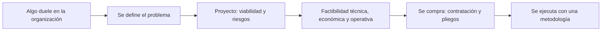
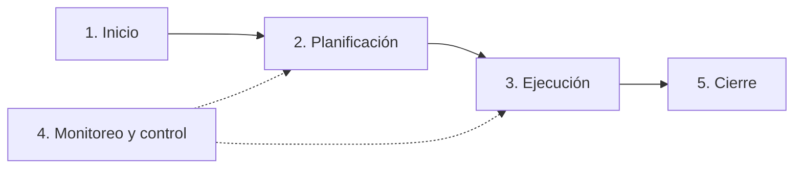
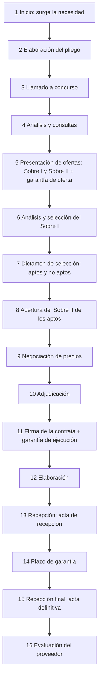

# Unidad 5. Administración de recursos TI

[TOC]

Vamos con la unidad cinco, administración de recursos TI. Es una unidad larga, así que el repaso también lo es.

La unidad cuenta cómo una organización que ya existe decide y lleva adelante un cambio con tecnología. Primero aparece un problema. Después se define bien. Después se pregunta si vale la pena, si se puede, si conviene y si la gente lo va a poder llevar a la práctica. Y si todo da que sí, hay que comprar, y comprar en serio tiene su propio proceso.

Ese recorrido, en un dibujo:



Si te llevás cuatro ideas, que sean estas.

La primera: un proyecto es temporal, único y con recursos escasos, y un proyecto de TI siempre es un proyecto del negocio.

La segunda: viabilidad y factibilidad no son lo mismo. La viabilidad pregunta si vale la pena. La factibilidad pregunta tres cosas: si se puede, si conviene y si la organización lo va a poder llevar a la práctica.

La tercera: los números no se miran solos. Punto de equilibrio, recuperación, valor presente, TIR y relación beneficio costo se cruzan con los riesgos.

Y la cuarta: comprar tiene reglas. Pliego, dos sobres, garantías, circulares y un orden de prelación que decide qué documento manda.

Y una advertencia sobre cómo está armado el repaso. Cada tema termina con dos cosas: "Lo importante", que es lo que tenés que poder decir de memoria, y "Ojo, trampa", que son las confusiones donde más se cae. Al final hay quince preguntas tipo multiple choice, con la opción correcta y dónde está la trampa.

## Por qué cambiar y qué es un proyecto

Arrancamos por lo más simple. Ninguna organización está quieta: todos los días aparecen situaciones problemáticas, y cada una es una oportunidad de cambio. A veces es un ajuste chico en un proceso y a veces es una transformación radical. Y todo cambio tiene una motivación: a veces está clarísima, como querer crecer, y a veces es el síntoma de un problema que está más abajo.

Los motivos que da el apunte son seis. Lograr más eficiencia en un proceso. Reducir los tiempos de respuesta al cliente. Hacer un cambio tecnológico o de equipamiento. Cumplir una normativa externa. Cumplir nuevos objetivos que se puso la organización. O resolver disfunciones que traban el logro de esos objetivos.

Frente a cualquiera de esos síntomas, las TIC son el habilitador estratégico: lo que la tecnología ofrece define qué tan bien se puede responder. Y todo ese proceso de cambio, para nosotros, es un proyecto.

La definición es la del PMBOK, la guía del PMI. Ojo con lo que es el PMBOK: un marco de referencia flexible, no una metodología rígida. Dice que un proyecto es un esfuerzo temporal que se emprende para crear un producto, servicio o resultado único.

Tres palabras clave, y si te las acordás tenés la definición. Temporal: tiene fecha de inicio y de fin. Único: el resultado no se hizo exactamente igual antes. Y recursos escasos: personas, tecnología y plata.

Como los recursos son escasos, no se pueden hacer todos los proyectos aunque todos convengan. Es como el presupuesto de una casa: no podés renovar la cocina, el baño y el techo el mismo año. Por eso existe la evaluación de proyectos: elegir el más conveniente para el momento de la organización.

Un proyecto informático es un sistema de acciones, simultáneas o secuenciales, que integra personas, hardware, software y comunicaciones para obtener resultados sobre un sistema de información.

Y la frase que la cátedra marca en mayúsculas: "IT Project" es un concepto simplista, porque no existe un proyecto sin el negocio que reciba su resultado.

**Lo importante.** Proyecto es temporal, único y con recursos escasos, según el PMBOK. Y un proyecto de TI siempre es un proyecto del negocio.

**Ojo, trampa.** Una tarea que se repite todos los meses no es un proyecto, porque no es temporal ni única. El PMBOK es un marco flexible, no una metodología rígida. Y "los proyectos de TI son del área de sistemas" es justo lo que la cátedra dice que es simplista.

## Dónde nace un proyecto y transformación digital

Un proyecto puede iniciarse en cuatro lugares, y cada uno tiene su detalle.

Los gerentes de departamento: hay que ver si hay otras áreas involucradas, para buscar una solución de conjunto y no un parche local. Los ejecutivos de alto nivel: suelen tener objetivos más amplios, que tocan varias áreas. El área de sistemas: detecta mejoras de tecnologías y metodologías, pero conviene que el pedido lo haga el gerente del área afectada. Y los grupos externos: clientes, usuarios, proveedores o entes oficiales, como ARCA o el gobierno.

Un detalle que suelen preguntar: aunque sistemas tiene que estar atento, las personas que usan el sistema todos los días son la mejor fuente para saber qué mejorar. Son como los pasajeros del colectivo: el chofer maneja, pero quien sabe dónde falta una parada es quien viaja todos los días.

Ahora, transformación digital. Digitalizar no es meter herramientas. La transformación digital se centra en que el cambio sea sostenible y en construir una cultura digital. Y tiene dos pilares.

El primero, la gestión del cambio: afecta a toda la empresa y necesita que participen empleados, directivos y ejecutivos, con concientización, capacitación y coaching. El segundo, la colaboración: comunicación constante entre equipos, estructura interfuncional y software colaborativo para trabajar en tiempo real.

**Lo importante.** Un proyecto nace en gerentes, ejecutivos, sistemas o grupos externos. Los usuarios diarios son la mejor fuente de mejoras. Y la transformación digital es cultura, con dos pilares: gestión del cambio y colaboración.

**Ojo, trampa.** Que el área de sistemas detecte la mejora no significa que ella haga el pedido: conviene que lo haga el gerente del área afectada. Y digitalizar no es comprar herramientas.

## Definición del problema

Esto es más importante de lo que parece. Definir bien el problema exige distinguir causas, síntomas y necesidades. Si confundís síntoma con causa, resolvés lo que no era. Es como tomar un analgésico para el dolor de muela: el síntoma se va, la caries sigue. Y de esta definición sale el alcance del proyecto.

Las tareas son siete. Estudiar el sistema y el contexto actual. Analizar lo que se desea obtener. Clarificar qué áreas se verán afectadas. Definir el problema y sus componentes, priorizando en tres niveles. Identificar a los responsables. Definir con claridad qué se propone solucionar. Y validar la definición con los interesados.

Los tres niveles de prioridad: fundamental, que es indispensable; deseable, que aporta mucho valor; y opcional, que es secundario o queda para más adelante.

**Lo importante.** El problema se define distinguiendo causas, síntomas y necesidades, se prioriza en fundamental, deseable y opcional, y se valida con los interesados. De ahí sale el alcance.

**Ojo, trampa.** Resolver un síntoma no es resolver el problema. Y si el problema está mal definido, las tres factibilidades evalúan la solución equivocada.

## Factores que transforman la gestión de proyectos

El apunte agrupa los factores en tres dimensiones. Si te piden factores impulsores, contestás con esta idea.

Primero, procesos y capacidades: metodologías formales como PMBOK y PRINCE2, herramientas de software de gestión, más formalización y estándares, y más inversión en proyectos estratégicos.

Segundo, factores externos: la globalización, que obliga a operar en varios mercados; los equipos dispersos geográficamente; la necesidad de responder rápido a las crisis; y más regulaciones.

Y tercero, factores tecnológicos: la ciberseguridad, el trabajo remoto, los riesgos digitales que cambian todo el tiempo, y la nube y la automatización.

**Lo importante.** Tres dimensiones: procesos y capacidades, factores externos y factores tecnológicos.

**Ojo, trampa.** Cuidado con cambiar un factor de columna: el trabajo remoto y la ciberseguridad son tecnológicos; la globalización y las regulaciones son externos; las metodologías formales son de procesos.

## Gestión tradicional y gestión ágil

La gestión tradicional, también llamada cascada o waterfall, trabaja en etapas secuenciales: no se pasa a la siguiente sin terminar la anterior. Es como construir un edificio: no ponés el techo antes de los cimientos. La idea es bajar la incertidumbre planificando todo al principio, con requisitos claros desde el inicio. Tiene mucha documentación, procesos formales y gobernanza, y marcos como PMBOK y PRINCE2. El director del proyecto está en el centro y se usan herramientas como el Gantt, los cronogramas y el control de cambios. Sirve para entornos estables con requisitos claros.

La gestión ágil no es para todo. Sirve cuando los requisitos o la solución no se conocen del todo. Para decidir se usa la matriz de complejidad de Stacey. Un eje es qué tan claros están los requisitos, el qué. El otro es qué tan clara está la tecnología o la solución, el cómo.

Con eso salen cuatro tipos de proyecto. El simple: requisitos y solución conocidos, y va con enfoque tradicional. El complicado: el qué y el cómo se conocen parcialmente, y va en un punto intermedio. El complejo: alta incertidumbre, cambios frecuentes y mucho contacto con el cliente, y ahí va el enfoque ágil. Y el caótico: no hay ni requisitos ni solución, y no sirve ni uno ni otro, primero hay que estabilizar.

Los marcos que nombra la unidad son Waterfall, que es secuencial; Agile y Scrum, que es iterativo e incremental; y Kanban, que es gestión visual continua. Y el objetivo de cualquier metodología es el mismo: resultados de calidad predecible con actividades ordenadas y eficientes.

**Lo importante.** Tradicional para entornos estables con requisitos claros; ágil para proyectos complejos, con incertidumbre. La matriz de Stacey cruza qué tan claro está el qué y qué tan claro está el cómo.

**Ojo, trampa.** El caótico no es el candidato ideal para lo ágil: primero se estabiliza. Y "ágil es mejor que tradicional" es falso: depende del tipo de proyecto. Tampoco confundas Kanban, que es gestión visual continua, con Scrum, que es iterativo e incremental.

## Ciclo de vida del proyecto

Esto se pregunta mucho, así que vale aprenderse qué se hace en cada una de las cinco fases.



En el inicio se analiza la situación inicial y a los afectados, se define el producto o servicio, se marcan hitos, se hace una estimación inicial de costos, se evalúan los riesgos, se llega a un acuerdo con el cliente y se constituye el proyecto.

En la planificación se arma el plan detallado, el plan de comunicación y el presupuesto, se hace la reunión de arranque, que en inglés es el kick-off, y se planifica la gestión del cambio.

En la ejecución se ejecutan las actividades, se dirige y gestiona, y se hacen los informes de avance y la revisión del comité de dirección.

En el monitoreo y control se controla el trabajo, el alcance, el cronograma, los costos y los recursos, y se monitorean los riesgos.

Y en el cierre se hace el After Action Review, un resumen de aprendizaje, la transferencia de conocimientos y el cierre formal.

Fijate que el monitoreo y control no es "después" de la ejecución: corre en paralelo y realimenta a la planificación. Por eso en el dibujo va con líneas punteadas. Es como el GPS del auto: no aparece al final del viaje, te va corrigiendo todo el camino.

**Lo importante.** Cinco fases: inicio, planificación, ejecución, monitoreo y control, y cierre. El monitoreo corre en paralelo. El kick-off es de la planificación y el After Action Review es del cierre.

**Ojo, trampa.** "El monitoreo y control es la fase que viene después de la ejecución" es falso. Y la estimación inicial de costos es del inicio; el presupuesto detallado, de la planificación.

## Stakeholders y director del proyecto

Un stakeholder, o interesado, es cualquier persona, grupo u organización que puede afectar, verse afectado o sentirse afectado por el proyecto. Fijate que alcanza con que se perciba afectado. La lista: clientes y usuarios finales, patrocinadores, equipo del proyecto, proveedores y contratistas, reguladores, comunidades locales, alta dirección y otros proyectos relacionados.

El director del proyecto tiene que lograr que el resultado salga dentro del alcance acordado, según las especificaciones, en los plazos, con la calidad requerida, dentro del presupuesto, y manejando bien la variable social, o sea, los conflictos.

Para eso necesita habilidades técnicas y también blandas: comunicación, negociación, liderazgo, toma de decisiones, y sobre todo equilibrar la tensión entre calidad, costo y tiempo. Sus tareas, en tres verbos: planificar, organizar y controlar.

Y tiene que documentar. La lista: acta de iniciación, especificación del alcance, registro de incidencias, minutas, plan de trabajo, cronograma, línea base de documentos, informes de avance, incidentes clave, aceptación del producto y acta de cierre.

**Lo importante.** Stakeholder es quien puede afectar, verse afectado o sentirse afectado. El director planifica, organiza y controla, y equilibra calidad, costo y tiempo, con habilidades técnicas y blandas.

**Ojo, trampa.** No hace falta estar realmente afectado: alcanza con sentirse afectado. Y las habilidades del director no son solo técnicas.

## Matriz de stakeholders: poder e interés

Se cruzan dos ejes, poder e interés, y salen cuatro tipos. Cada uno pide una estrategia distinta.

Poder alto e interés alto: los promotores. La estrategia es involucrarlos: presentarles el proyecto y sus beneficios y lograr que colaboren. El ejemplo del apunte: los ayuntamientos.

Poder alto e interés bajo: los latentes. La estrategia es informarlos de forma proactiva, con reuniones periódicas, empatizando e integrando sus preocupaciones. El ejemplo: las ONG ambientales.

Poder bajo e interés alto: los defensores. La estrategia es reportarles los avances, casi de forma unidireccional. El ejemplo: los comercios locales.

Y poder bajo e interés bajo: los apáticos. La estrategia es monitorizarlos, para ver si cambian de cuadrante. El ejemplo: los vecinos.

Un truco para no confundir latentes con defensores: los latentes tienen poder, por eso hay que escucharlos aunque no les interese. Los defensores tienen interés, por eso alcanza con contarles cómo va.

**Lo importante.** Promotores, involucrar. Latentes, informar. Defensores, reportar. Apáticos, monitorizar.

**Ojo, trampa.** Latentes y defensores se confunden todo el tiempo. Y los apáticos no se ignoran: se monitorizan, porque pueden cambiar de cuadrante.

## Viabilidad y riesgos

Primero, el estudio de viabilidad. Un proyecto nuevo siempre es un riesgo y se lleva recursos importantes. El apunte dice que es común que las empresas no respeten las mínimas normas de prudencia y que los proyectos queden a mitad de camino. El estudio de viabilidad sirve para averiguar si vale la pena convertir una idea en proyecto: si de verdad va a dar los beneficios que se esperan. Es una herramienta de decisión estratégica: aprobar o rechazar.

Su profundidad depende de la envergadura: el riesgo, la inversión, el impacto interno, el impacto en el cliente y los aspectos legales. Y la regla es avanzar cuando hay un grado de confianza razonable de que el resultado va a ser satisfactorio.

Además de bajar el riesgo, ayuda a ver alternativas, descubrir oportunidades, detectar señales de que conviene no seguir, aumentar la probabilidad de éxito, decidir con datos y conseguir financiación.

Ahora, el riesgo. Es un evento o condición incierta que, si ocurre, tiene un efecto positivo o negativo sobre los objetivos. Ojo con esto, que es de examen: el riesgo puede ser positivo, una oportunidad, o negativo, una amenaza. Tiene tres características: concierne al futuro, implica cambios e implica elegir, por ejemplo métodos, herramientas, cuánta gente y cuánta calidad.

Las categorías de riesgos de proyecto son cuatro. Técnicos: requerimientos, tecnología, calidad. Externos: proveedores, normativa, mercado, cliente. Organizacionales: recursos y financiamiento. Y de gestión: estimación, planificación y control.

La gestión del riesgo parte de la descripción, la probabilidad y el impacto de cada riesgo, y busca bajar una u otra. El ejemplo del apunte es la rotación de personal. Se determinan las causas, se mitigan antes de que empiece el proyecto, se asegura la continuidad aunque haya rotación, se definen estándares de documentación de uso obligatorio, se hacen revisiones en equipo para que más de una persona siga la marcha del proyecto, y se asigna una persona de apoyo para cada tarea crítica.

Y la supervisión del riesgo tiene tres objetivos: detectar si ocurrió un riesgo previsto, asegurar que se estén aplicando los pasos de gestión y recopilar información para futuros análisis.

**Lo importante.** La viabilidad decide si vale la pena convertir la idea en proyecto. El riesgo es un evento incierto con efecto positivo o negativo, y se gestiona por probabilidad e impacto.

**Ojo, trampa.** "Un riesgo siempre es negativo" es falso. Y la viabilidad no es la factibilidad: la viabilidad es la decisión estratégica de aprobar o rechazar la idea; la factibilidad, que viene después, analiza si se puede, si conviene y si se puede operar.

## Factibilidad: las tres preguntas

Acá está el corazón de la unidad. El estudio de factibilidad analiza la necesidad, la conveniencia y la oportunidad de poner en marcha un sistema, y busca una seguridad razonable de éxito. Se estudia en tres dimensiones, y la forma fácil de acordártelas es como tres preguntas.

La técnica pregunta si se puede hacer. Mira la tecnología, la capacidad y las configuraciones de hardware y software.

La económica pregunta si conviene hacerlo. Mira costos, beneficios y rentabilidad.

Y la operativa pregunta si la organización lo va a poder llevar a la práctica. Mira personas, procesos, apoyo y adopción.

Y van en cadena. La técnica define un rango de soluciones posibles, la económica elige la más conveniente de ese rango, y la operativa confirma que se pueda poner en práctica. Pensá en comprar un auto: primero ves cuáles existen y te sirven, después cuál podés pagar, y al final si lo vas a poder estacionar en tu garage.

**Lo importante.** Técnica: ¿se puede? Económica: ¿conviene? Operativa: ¿se va a poder llevar a la práctica? Y se encadenan en ese orden.

**Ojo, trampa.** No confundas el orden ni lo que mira cada una. Y recordá que una solución técnicamente posible y económicamente conveniente puede fracasar igual si la operativa falla.

## Factibilidad técnica

Trata de demostrar que el proyecto se puede concretar. Las preguntas: ¿existe la tecnología necesaria? ¿Alcanza la capacidad de almacenamiento? ¿Soporta el crecimiento de la demanda? ¿Hay garantías de exactitud, confiabilidad, acceso y seguridad de los datos? ¿Y hay proveedores alternativos?

Después mira tres grupos de requerimientos.

Los de la organización: el volumen de datos y cómo fluctúa, ya sea por hora, por día o por momento del mes; la oportunidad, o sea qué tan rápido necesitan la información los usuarios; la urgencia; la complejidad, con sus interrelaciones e interfaces; y el equipamiento.

Los del funcionamiento de sistemas: el tiempo de equipo para programar y testear, las fallas de equipo, las tareas especiales y los tiempos de reproceso. El reproceso crece cuanto más integrados están los procesos, porque un error se propaga más, y baja con buenos controles de consistencia, capacitación y programación confiable.

Y los de capacidad de equipos: estimar lo que se necesita para las transacciones diarias, semanales y mensuales y el almacenamiento que generan. Con eso se arman las configuraciones posibles y se descartan las que no sirven. La regla: la configuración elegida tiene que superar con holgura la necesidad actual, para absorber el crecimiento. Y puede pasar que la empresa ya tenga la infraestructura.

**Lo importante.** La técnica demuestra que se puede hacer. Define los requisitos que después van al pliego. Y la configuración elegida tiene que superar con holgura la necesidad actual.

**Ojo, trampa.** La configuración justa para hoy no sirve: hay que dejar margen para crecer. Y que haya proveedores alternativos es parte de la técnica y es lo que después permite una contratación con competencia.

## Factibilidad económica: qué se compara

La económica compara costos y beneficios de cada alternativa técnica para elegir la más conveniente. Lo que se considera: el costo de hacer la investigación de sistemas, el costo de hardware y software, los beneficios, que pueden ser ingresos o reducción de costos y de errores, y el costo de no hacer nada. Este último se olvida mucho y es clave: no hacer nada también cuesta.

Después viene lo que en TI es fundamental: CapEx contra OpEx. El CapEx es capital: la inversión inicial, como hardware, licencias perpetuas, red y desarrollo. El OpEx es operativo: los gastos recurrentes, como la nube, el soporte, el mantenimiento, la energía, internet y los sueldos de TI. Pasar a la nube es, en el fondo, cambiar CapEx por OpEx: no comprás el servidor, pagás por mes. Es la diferencia entre comprar el auto y alquilarlo.

La evaluación financiera suma la inversión, que son activos fijos, activos nominales y capital de trabajo; la proyección de ingresos y gastos anuales; el financiamiento; y los estados proyectados: estado de resultados, flujo de efectivo y balance general. Con el flujo de fondos netos se calculan los criterios de rentabilidad: el VAN, la TIR y la relación beneficio costo.

Los costos y beneficios se clasifican de tres maneras. Tangibles o intangibles: el desgaste de un equipo contra la caída de la imagen de la empresa. Fijos o variables: el costo de un equipo contra la tinta de la impresora. Y directos o indirectos: un equipo para operar el sistema contra la seguridad o el aire acondicionado.

Las categorías de costos por elemento son equipos, instalaciones, personal, y suministros y varios. Y por instancia del proyecto son seis. Los de desarrollo: investigación, análisis, diseño, programación y pruebas. Los operativos de inicio: migración y carga de datos, conversión, ejecución en paralelo y puesta en marcha. Los operacionales, que son los recurrentes. Los financieros, que son los intereses del financiamiento. Los hereditarios: ya los pagó otro proyecto y se restan. Y los residuales: lo que vale lo que queda al final de la vida útil, que también se resta.

Con los beneficios, igual: se estiman y se les pone un valor en plata. Los tangibles se comparan con los costos; los intangibles sirven para vender el proyecto. Un truco del apunte para encontrarlos: buscá los problemas del sistema actual y lo que cuestan. Si el sistema nuevo los elimina, ese costo es tu beneficio. Se agrupan en beneficios de desempeño, como velocidad, acceso a información y mejor atención, y beneficios por evitar costos, como menos errores administrativos, menos papel y menos conteo de inventario.

**Lo importante.** Se comparan costos y beneficios de cada alternativa, incluyendo el costo de no hacer nada. CapEx es la inversión inicial; OpEx, el gasto recurrente. Y los hereditarios y residuales se restan.

**Ojo, trampa.** "No hacer nada no cuesta" es falso. La nube es cambiar CapEx por OpEx, no al revés. Y no mezcles hereditarios, que ya pagó otro proyecto, con residuales, que es el valor que queda al final de la vida útil: los dos se restan, pero son distintos.

## Cómo se comparan costos y beneficios

Hay tres estrategias.

La primera, el punto de equilibrio. Compara el costo acumulado del sistema actual con el del nuevo. El punto de equilibrio es el instante en que se igualan, y de ahí en adelante el sistema nuevo da beneficio neto.

La segunda, el período de recuperación, o payback: cuánto tiempo pasa hasta que los beneficios acumulados igualan a los costos. Cuanto más corto, menos riesgo.

La tercera, el valor presente. Un peso de hoy no vale lo mismo que un peso dentro de tres años. Entonces se usa una tasa de descuento, que es el costo de oportunidad de la plata: lo que la empresa ganaría poniéndola en otro lado. El ejemplo del apunte: si un plazo fijo paga veinte por ciento anual, meter la plata en el proyecto es renunciar a ese veinte. Se multiplican los costos y beneficios de cada año por un factor y se comparan. Si los beneficios a valor presente superan a los costos, la inversión es buena.

Las fórmulas que conviene tener son las estándar. El apunte las nombra sin desarrollarlas.

$$VAN = -I_0 + \sum_{t=1}^{n} \frac{B_t - C_t}{(1+i)^t}$$

La TIR es la tasa $i$ que hace que el VAN sea cero. Si la TIR supera la tasa de descuento, el proyecto conviene.

$$\frac{B}{C} = \frac{\text{VP de los beneficios}}{\text{VP de los costos}}$$

Si $B/C$ es mayor que uno, conviene.

**Lo importante.** Equilibrio, recuperación y valor presente. VAN mayor que cero, TIR mayor que la tasa de descuento y beneficio costo mayor que uno: conviene. Cuanto más corto el payback, menos riesgo.

**Ojo, trampa.** La tasa de descuento es el costo de oportunidad, no el interés del préstamo. Y descontado, el payback sale más largo que el simple: el valor presente es más exigente. Lo vas a ver en el segundo ejemplo.

## Factibilidad operativa

Esta es la del TP diez, así que vale contarla bien. Una solución puede ser técnicamente posible y económicamente conveniente y aun así fracasar. La pregunta es si se va a poder llevar a la práctica en el momento y las circunstancias deseadas, y si la organización tiene capacidad para operarlo.

La definición que la cátedra resalta: la factibilidad operativa evalúa si la organización cuenta con los recursos humanos, los procesos operativos y las capacidades necesarias para llevar el proyecto adelante con éxito, y si puede superar los obstáculos que aparezcan.

Las preguntas, casi textuales del apunte: ¿hay suficiente apoyo de la gerencia, y de los usuarios? ¿Van a usar el sistema cuando esté instalado? ¿Los usuarios participaron en la planeación y el desarrollo? ¿Aumenta la productividad? ¿Mejora la integración con otras áreas? ¿Y causa daño? Daño es resultados más pobres en algún área, pérdida de control, pérdida de acceso a información, trabajo más lento en algún sector o clientes afectados.

Y los aspectos concretos de la puesta en marcha: recursos humanos clave, horas y equipos, almacenamiento, adecuación del sitio, capacitación de sistemas y de usuarios, y conversión de datos del sistema viejo al nuevo. El apunte advierte que el estudio teórico simplifica: hay que contrastarlo con la realidad, porque detalles chicos al principio pueden terminar en problemas operativos graves.

**Lo importante.** La operativa evalúa si la organización tiene los recursos humanos, los procesos y las capacidades para llevar el proyecto a la práctica. Se mira apoyo, uso, participación, productividad, integración y daño.

**Ojo, trampa.** La operativa no pregunta si la tecnología funciona, eso es la técnica. Pregunta si las personas y los procesos van a funcionar con ella. Y la resistencia al cambio no es un detalle: es un riesgo que se mitiga con participación de usuarios, capacitación y piloto.

## Herramientas de gestión de proyectos

Son aplicaciones para seguir tareas, recursos y equipos. Le sirven a todo el equipo y sobre todo al director, que sabe en todo momento cómo está el proyecto.

Para elegir una, que sea fácil de usar, o sea, con baja curva de aprendizaje; flexible, porque cada área trabaja distinto; con temporizador y cargas de trabajo; y con plantillas e informes de horas por tarea. Las funciones típicas son cuatro: planificación, colaboración, documentación, con versiones y almacenamiento, y evaluación.

**Lo importante.** Cuatro funciones: planificación, colaboración, documentación y evaluación. Y se elige por facilidad de uso y flexibilidad.

**Ojo, trampa.** La herramienta no reemplaza a la metodología ni al director: sirve para seguir lo que ya se planificó.

## Contrataciones: pública y privada

Una vez que el proyecto se aprueba, hay que comprar. Y comprar en serio tiene un proceso.

La contratación pública es un acuerdo bilateral donde una de las partes está ejerciendo la función administrativa, o sea el Estado, para hacer una obra, prestar un servicio o comprar o vender un bien, con el fin de satisfacer necesidades generales. Se regula para que el Estado sea eficiente y transparente con los recursos públicos.

Entran compraventa, suministros, servicios, locaciones, consultoría, alquileres con opción a compra, permutas, concesiones, obras públicas y licencias. Quedan afuera el empleo público, las compras por caja chica, los contratos con estados extranjeros, los contratos con organismos internacionales o multilaterales de crédito, y lo que ellos financien, y las operaciones de crédito público.

Para elegir el procedimiento se mira la economicidad, la eficiencia y la eficacia; las características del bien o servicio; el monto estimado; las condiciones del mercado; y la urgencia o emergencia.

Una contratación típica tiene tres etapas. La previa a la licitación, donde se definen los requerimientos. El proceso de licitación, desde que se arma el pliego hasta la adjudicación. Y la posterior, desde la adjudicación hasta que se cumple la obligación.

**Lo importante.** Contratación pública es el Estado ejerciendo la función administrativa. Tres etapas: previa, proceso de licitación y posterior. El procedimiento se elige según el monto, el mercado y la urgencia.

**Ojo, trampa.** La caja chica y el empleo público quedan afuera. Y el proceso de licitación termina en la adjudicación: lo que sigue ya es la etapa posterior.

## El cronograma de una contratación

Esto es largo pero tiene lógica. Contalo como una historia de dieciséis pasos.



Uno, el inicio: aparece la necesidad, la causa del contrato.

Dos, el pliego. La entidad licitante, que se llama comitente, arma el Pliego de Bases y Condiciones: la forma, las cantidades, las fechas y cómo se va a elegir a los oferentes. Participan Compras y el área que pide, el cliente interno, y a veces expertos y abogados.

Tres, el llamado. Hay dos modalidades. El concurso privado de precios, que es la licitación privada, donde se invita a proveedores elegidos de la base de datos. Y la licitación pública, donde se publica en medios masivos o en el Boletín Oficial, sin preselección. La diferencia es el grado de competencia; el proceso es el mismo. El privado es más rápido, pero la pública es obligatoria en algunos casos: servicios públicos privatizados que superan cierto monto, productos innovadores sin proveedores conocidos o productos clave para un sector del país.

Cuatro, análisis y consultas. Toda consulta de un oferente se responde a todos mediante una circular con consulta, por transparencia. Se puede corregir el pliego, pero solo en este período y comunicándolo a todos. Si se modifica después, el proceso puede quedar viciado de nulidad.

Cinco, presentación de ofertas, con dos sobres cerrados y separados. El Sobre uno lleva el pliego firmado, la documentación técnica, legal y societaria y los certificados, sin precios. El Sobre dos lleva la oferta económica, con la planilla de cotización y las ofertas alternativas si se admiten. La oferta básica cumple el cien por ciento de las especificaciones; la alternativa no cumple alguna. Todo va foliado y firmado: la firma es una declaración jurada de que conocés el pliego, y si falta un documento, quedás descalificado. Y se deposita la garantía de oferta, entre el uno y el dos por ciento del monto ofertado.

Seis, análisis y selección: un análisis interdisciplinario del Sobre uno solamente. Se pueden pedir aclaraciones o correcciones de errores formales, siempre de forma transparente.

Siete, el dictamen de selección: la lista de aptos y no aptos. Es interno: los oferentes saben si son aptos, pero no leen el dictamen, y a los no aptos se les dice por qué.

Ocho, la apertura del Sobre dos, solo de los aptos.

Nueve, la negociación de precios y condiciones, o una subasta, conducida por Compras.

Diez, la adjudicación: una carta al ganador. Tiene unos cinco días para constituir la garantía de ejecución y firmar la contrata.

Once, la firma de la contrata. El oferente pasa a ser proveedor, desde esta fecha corren los plazos y se devuelven las garantías de oferta.

Doce, la elaboración: el proveedor fabrica o prepara el servicio.

Trece, la recepción. Control de calidad verifica y emite el acta de recepción, sin la cual no se puede facturar. Si hay rechazos o mora, se aplica la cláusula penal, que son multas descontadas de la garantía de ejecución.

Catorce, el plazo de garantía: el proveedor repara o reemplaza a su costo.

Quince, la recepción final, con el acta de recepción definitiva. Se devuelve la garantía de ejecución menos las multas. En las locaciones de obra, la responsabilidad civil por vicios ocultos sigue después.

Y dieciséis, la evaluación del proveedor: se registra su desempeño en la base de proveedores, para futuras adjudicaciones.

Y una pregunta clásica: ¿por qué dos sobres y en fechas distintas? Por dos razones. Cada área analiza lo suyo: Técnica y Legal el Sobre uno, Compras el Sobre dos. Y si ves los precios antes de evaluar lo técnico, te sesgás y te tienta saltear etapas. Es como corregir un examen sabiendo de quién es: ya no sos neutral.

**Lo importante.** Dos sobres, abiertos en fechas distintas: el Sobre uno es técnico, legal y sin precios; el Sobre dos es económico y solo se abre a los aptos. Toda consulta se responde a todos con una circular. Sin acta de recepción no se factura.

**Ojo, trampa.** Privada y pública solo difieren en el grado de competencia, no en el proceso. El pliego solo se corrige en el período de consultas y comunicándolo a todos. La garantía de oferta se devuelve al terminar la adjudicación, cuando se firma la contrata, y la de ejecución, al cumplir y menos las multas. Y el dictamen es interno: los oferentes no lo leen.

## Pliegos, garantías y cláusula penal

El pliego es el documento clave del contrato. Fija derechos, obligaciones y responsabilidades, cómo se selecciona, cómo se define el producto, cómo se resuelven los conflictos, las causales de rescisión, la forma de pago, los plazos, las penalidades y las garantías.

Se divide en tres partes. El pliego general: cláusulas amplias que se repiten en todos los concursos del contratante. El pliego de condiciones particulares: específico e irrepetible para cada contrato, que es la clave del contrato. Lo que no dice, lo rige el general. Y la documentación técnica, que son los anexos con las especificaciones de requisitos, las normas técnicas y los métodos de instalación u operación. Esta define qué se compra.

El orden de prelación, o sea, qué manda cuando dos documentos dicen distinto: primero las notas aclaratorias y circulares, después el pliego de condiciones particulares, y al final el pliego general. La regla para acordarte: cuanto más general es un documento, menos prioridad tiene.

Contrata contra orden de compra. Las dos tienen el mismo efecto jurídico. En la contrata las partes firman en el mismo momento, a veces ante escribano. En la orden de compra o de trabajo firman en momentos distintos: el acuerdo vale cuando el proveedor la devuelve firmada.

Las garantías son dos. La de oferta: del uno al dos por ciento de lo ofertado, sirve para que el oferente no abandone, es una barrera de salida, y se devuelve al terminar la adjudicación. Y la de ejecución: en general el diez por ciento del contrato, sirve para asegurar que cumpla y se devuelve al cumplir, menos las multas. Se pueden constituir en efectivo, cheque de pago diferido, títulos o bonos, fianza bancaria, seguro de caución, pagaré, caución juratoria o créditos a favor del proveedor.

Y la cláusula penal. Si vence el plazo y no se cumplió, el proveedor entra en mora. La cláusula penal fija una multa automática, que se descuenta de la garantía de ejecución. Es accesoria, solo actúa si hay incumplimiento, y su objetivo es asegurar el cumplimiento a término sin tener que rescindir.

**Lo importante.** Prelación: circulares, después el particular, después el general. Garantía de oferta del uno al dos por ciento; de ejecución, alrededor del diez. Y la cláusula penal asegura el cumplimiento sin rescindir.

**Ojo, trampa.** La contrata y la orden de compra tienen el mismo efecto jurídico: cambia cuándo se firma. El pliego general no manda sobre el particular. Y la garantía de oferta no es para cubrir el incumplimiento del contrato: es para que el oferente no abandone el concurso.

## Ejemplo resuelto uno: factibilidad operativa de NovaRetail

Este sale del TP diez. NovaRetail es una distribuidora mayorista del sur de Santa Fe. Tiene ciento veinte empleados: cuarenta y cinco operarios de depósito, treinta y cinco preventistas, veintidós administrativos, quince choferes y solo tres de TI. Tiene tres depósitos, el central y dos satélites a ciento veinte y doscientos cincuenta kilómetros, mil doscientos comercios clientes y entre trescientos cincuenta y quinientos pedidos por día.

Paso uno, el diagnóstico, buscando causas y no solo síntomas. Los pedidos tardan de cuarenta y ocho a setenta y dos horas en llegar a preparación, porque los preventistas los toman en libreta o por WhatsApp y seis administrativos los transcriben de noche. Hay doce por ciento de errores de digitación, por la carga manual sin validaciones. Los depósitos satélites quedan paralizados cuando se corta la luz o internet en Casa Central, porque hay un único servidor de dos mil diecisiete, una VPN sobre internet hogareña y una UPS gastada: es un punto único de falla. Hay riesgo de perder todos los datos, porque el backup es manual, semanal, a un disco USB y sin verificar. Y la central telefónica está colapsada, con doscientas cincuenta llamadas que ocupan el setenta por ciento del tiempo de los operadores, y clientes que se van, porque no tienen otra forma de consultar estado, saldo o stock.

Paso dos, el objetivo IT, que viene de la Unidad tres, con criterio SMART: en cuatro meses, nube, CRM móvil, agente de IA y licencias de desarrollo, con disponibilidad de noventa y nueve coma cinco por ciento o más, quinientos pedidos por día y errores de carga menores a uno por ciento.

Paso tres, el impacto humano, actor por actor. Esta es la parte que hace operativa a la factibilidad.

Los preventistas. Las barreras: la costumbre, la sensación de que la app agrega pasos, los distintos niveles digitales y la conectividad inestable en ruta. Las medidas: capacitación con pedidos reales y referentes por zona, un piloto con un grupo antes de extender, una app con formularios simples y validaciones, y verificar con el proveedor que funcione offline, porque no se puede suponer.

Los administrativos. Se reconvierten, no se despide automáticamente. Pasan de transcribir a gestionar excepciones, conciliar stock y facturación, hacer cobranzas proactivas, mantener datos maestros y dar soporte de primer nivel.

La atención telefónica. El chatbot responde lo repetitivo y los humanos atienden lo que requiere criterio. Hay derivación obligatoria a una persona en reclamos, diferencias de saldo, acuerdos de pago, excepciones comerciales, datos sensibles, o cuando no se puede verificar la identidad.

Los depósitos. Para que el stock en tiempo real sea verdad, los cuarenta y cinco operarios tienen que registrar cada movimiento cuando ocurre: recepción, reservas, despacho, transferencias entre depósitos, conteos cíclicos y ajustes autorizados.

Paso cuatro, los riesgos, con una matriz de probabilidad por impacto, en una escala de uno a tres. La prioridad es probabilidad por impacto. La conectividad inestable en ruta y depósitos da tres por tres, nueve, crítica. El desfase entre el stock físico y el del sistema también da nueve, crítica. La resistencia de los preventistas da seis, alta; igual que la sobrecarga de los tres de TI y los errores en la migración. Y la caída del proveedor cloud da tres, moderada.

Paso cinco, el plan de contingencia si se cae la nube o el enlace: declarar la contingencia, usar registros alternativos en papel prenumerado, despachar solo lo que se verifica físicamente, pedir autorización al jefe de depósito, reconciliar al volver con control de duplicados, y registrar el incidente para mejorar el procedimiento.

Y paso seis, el dictamen: factible de forma condicionada. La organización puede adoptar el cambio, pero cuatro meses con tres personas de TI es exigente. Se aprueba si hay liderazgo de la Dirección, soporte externo, capacitación, piloto y criterios medibles para pasar a producción.

**Lo importante.** La operativa no pregunta si la tecnología funciona, pregunta si las personas y los procesos van a funcionar con ella. Por eso el análisis se hace por actor, se mide la adopción y siempre termina con un plan de contingencia.

**Ojo, trampa.** Los administrativos se reconvierten, no se despiden automáticamente. La conectividad offline no se supone: se verifica con el proveedor. Y "factible condicionada" no es un no: es un sí con condiciones.

## Ejemplo resuelto dos: factibilidad económica con números

Estos números son inventados para practicar, en miles de pesos.

Una empresa evalúa reemplazar su sistema actual. El actual le cuesta mil ochocientos por año, en errores, horas de carga y clientes perdidos. El nuevo requiere una inversión inicial, el CapEx, de tres mil y tiene un costo operativo, el OpEx, de quinientos por año. El horizonte es de cuatro años y la tasa de descuento, veinte por ciento, el plazo fijo del apunte.

El beneficio anual del sistema nuevo es el costo que evita: mil ochocientos. El flujo neto anual es mil ochocientos menos quinientos: mil trescientos.

Primero, el punto de equilibrio. El sistema actual acumula mil ochocientos más cada año. El nuevo arranca en tres mil y suma quinientos por año. Se igualan cuando mil ochocientos por $t$ es igual a tres mil más quinientos por $t$, o sea $t = 3000 / 1300$, que da unos dos coma tres años.

```grafico
tipo: lineas
titulo: Punto de equilibrio: costo acumulado
unidad: miles de $

Año, Sistema actual, Sistema nuevo
0, 0, 3000
1, 1800, 3500
2, 3600, 4000
3, 5400, 4500
4, 7200, 5000
```

Antes de los dos coma tres años el sistema nuevo es más caro; después, empieza a dar beneficio neto. Es exactamente lo que dice el apunte: el período de recuperación comienza después del segundo año.

Segundo, el período de recuperación simple. El flujo acumulado es menos tres mil, menos mil setecientos, menos cuatrocientos, y en el año cuatro más novecientos. Se recupera durante el año tres: dos más cuatrocientos sobre mil trescientos, unos dos coma tres años.

Tercero, el valor presente. El factor de cada año es uno sobre uno coma dos a la $t$. Los flujos de mil trescientos valen, descontados, mil ochenta y tres, novecientos tres, setecientos cincuenta y dos y seiscientos veintisiete. Sumados, restando los tres mil de inversión, dan un VAN de más trescientos sesenta y cinco. El VAN es mayor que cero: el proyecto conviene. Y fijate que, descontando, la recuperación ya no es a los dos coma tres años sino a los tres coma cuatro. Por eso el valor presente es más exigente que el payback simple.

Cuarto, la TIR. Probando tasas, al veinticinco por ciento el VAN da más setenta, y al veintisiete da menos treinta y seis. La TIR es de aproximadamente veintiséis coma tres por ciento, mayor que el veinte de la tasa de descuento: conviene.

Y quinto, la relación beneficio costo, a valor presente. Los beneficios valen mil ochocientos por dos coma cinco ocho ocho siete, cuatro mil seiscientos sesenta. Los costos, tres mil más quinientos por el mismo factor, cuatro mil doscientos noventa y cuatro. El cociente da uno coma cero nueve. Mayor que uno: conviene, aunque con poco margen.

**Lo importante.** El proyecto conviene por los tres criterios, pero el margen es chico: un VAN de trescientos sesenta y cinco sobre una inversión de tres mil. Por eso la factibilidad económica nunca se mira sola: se cruza con los riesgos.

**Ojo, trampa.** El payback simple da dos coma tres años y el descontado da tres coma cuatro: el segundo es el más exigente. Y con un margen así de chico, si la inversión se va un quince por ciento arriba, el VAN pasa a negativo y ya no conviene.

## Cómo se conecta todo

Con la Unidad tres: el objetivo IT de NovaRetail se valida con SMART antes de evaluar su factibilidad. Primero se fija el objetivo, después se pregunta si se puede, si conviene y si la gente lo va a adoptar.

La definición del problema alimenta el alcance, y el alcance alimenta la factibilidad. Si el problema está mal definido, con un síntoma en lugar de la causa, las tres factibilidades evalúan la solución equivocada.

Los riesgos se cruzan con la factibilidad económica: un VAN chico con riesgos altos es una mala apuesta. Y se cruzan con la operativa: la resistencia al cambio es un riesgo, y se mitiga con lo que pide la operativa, que es participación de usuarios, capacitación y piloto.

Los stakeholders se cruzan con la operativa: la pregunta de si hay apoyo de la gerencia y de los usuarios se responde con la matriz de poder e interés.

La factibilidad técnica se cruza con la contratación: la técnica define los requisitos, y esos requisitos se convierten en la documentación técnica del pliego. Que haya proveedores alternativos es lo que hace posible un concurso con competencia.

Y el ciclo de vida se cruza con la contratación: la contratación ocurre entre la planificación y la ejecución, y la recepción y el acta definitiva son parte del cierre.

**Lo importante.** Todo se encadena: objetivo, problema, alcance, factibilidades, riesgos, contratación, ejecución.

**Ojo, trampa.** Como los temas están conectados, una pregunta puede mezclarlos: por ejemplo, ofrecerte la resistencia al cambio como un tema de técnica, o los requisitos del pliego como algo que nace en la operativa. Preguntate siempre de qué tema es cada cosa.

## Preguntas tipo multiple choice

En cada una: las opciones, la correcta, por qué, y dónde está la trampa.

Pregunta uno. ¿Qué características tiene un proyecto según el PMBOK?

Primera: es un esfuerzo permanente para mantener un servicio funcionando. Segunda: es cualquier tarea del área de sistemas. Tercera: es un esfuerzo temporal para crear un producto, servicio o resultado único. Cuarta: es un conjunto de actividades que se repiten cada mes.

La correcta es la tercera. ¿La trampa? La primera y la cuarta describen la operación, que es continua o repetitiva, y un proyecto es temporal y único.

Pregunta dos. ¿Por qué la cátedra dice que "IT Project" es un concepto simplista?

Primera: porque no existe un proyecto sin el negocio que reciba su resultado. Segunda: porque los proyectos de TI no usan metodologías. Tercera: porque los proyectos de TI son siempre más caros. Cuarta: porque solo el área de sistemas puede iniciarlos.

La correcta es la primera. ¿La trampa? La cuarta: sistemas puede detectar mejoras, pero conviene que el pedido lo haga el gerente del área afectada.

Pregunta tres. Un proyecto tiene alta incertidumbre, cambios frecuentes y mucho contacto con el cliente. Según la matriz de Stacey, ¿qué enfoque corresponde?

Primera: tradicional. Segunda: primero estabilizar, porque es caótico. Tercera: ágil. Cuarta: ninguno, porque es complicado.

La correcta es la tercera: es un proyecto complejo. ¿La trampa? La segunda: el caótico es otro caso, sin requisitos ni solución, y ahí primero se estabiliza.

Pregunta cuatro. ¿Qué se hace en la fase de cierre?

Primera: la reunión de arranque. Segunda: el After Action Review, el resumen de aprendizaje, la transferencia de conocimientos y el cierre formal. Tercera: el control del alcance y del cronograma. Cuarta: la estimación inicial de costos.

La correcta es la segunda. ¿La trampa? La tercera, que es monitoreo y control, y la primera, que es el kick-off de la planificación.

Pregunta cinco. Un grupo tiene mucho poder pero poco interés en el proyecto, como una ONG ambiental. ¿Qué tipo de stakeholder es y qué estrategia corresponde?

Primera: promotor, involucrar. Segunda: defensor, reportar. Tercera: apático, monitorizar. Cuarta: latente, informar de forma proactiva.

La correcta es la cuarta. ¿La trampa? La segunda: los defensores tienen interés, no poder.

Pregunta seis. ¿Qué afirmación sobre el riesgo es correcta?

Primera: es un evento incierto que puede tener efecto positivo o negativo sobre los objetivos. Segunda: siempre es una amenaza. Tercera: es un problema que ya ocurrió. Cuarta: solo existe en proyectos de tecnología.

La correcta es la primera. ¿La trampa? La segunda, porque el riesgo también puede ser una oportunidad.

Pregunta siete. ¿Cuál es la diferencia entre viabilidad y factibilidad?

Primera: son sinónimos. Segunda: la viabilidad es solo económica. Tercera: la factibilidad decide si vale la pena y la viabilidad analiza la tecnología. Cuarta: la viabilidad es la decisión estratégica de si vale la pena convertir la idea en proyecto; la factibilidad analiza si se puede, si conviene y si se puede operar.

La correcta es la cuarta. ¿La trampa? La primera, que las trata como sinónimos.

Pregunta ocho. En una evaluación económica aparece un costo que ya pagó otro proyecto y que el nuevo aprovecha. ¿Qué es y qué se hace con él?

Primera: costo residual, se suma. Segunda: costo hereditario, se resta. Tercera: costo operacional, se suma. Cuarta: costo financiero, se resta.

La correcta es la segunda. ¿La trampa? El residual: también se resta, pero es el valor que queda al final de la vida útil, no lo que ya pagó otro proyecto.

Pregunta nueve. ¿Qué representa la tasa de descuento en el valor presente?

Primera: la inflación esperada. Segunda: el interés del financiamiento. Tercera: el costo de oportunidad de la plata, lo que la empresa ganaría poniéndola en otro lado. Cuarta: el margen de ganancia del proyecto.

La correcta es la tercera, como el plazo fijo que paga veinte por ciento. ¿La trampa? La segunda: el interés del financiamiento es un costo financiero, no la tasa de descuento.

Pregunta diez. Un proyecto da una TIR de veintiséis por ciento y la tasa de descuento es veinte por ciento. ¿Qué se concluye?

Primera: no conviene, porque la TIR es muy alta. Segunda: no se puede concluir nada. Tercera: conviene, porque la TIR supera la tasa de descuento. Cuarta: conviene solo si el payback es mayor a tres años.

La correcta es la tercera. ¿La trampa? La primera, que invierte la regla, y la cuarta: cuanto más corto el payback, menos riesgo.

Pregunta once. ¿Qué evalúa la factibilidad operativa?

Primera: si la organización cuenta con los recursos humanos, los procesos y las capacidades para llevar el proyecto a la práctica. Segunda: si existe la tecnología necesaria. Tercera: si el proyecto da una buena rentabilidad. Cuarta: si hay proveedores alternativos.

La correcta es la primera. ¿La trampa? La primera y la cuarta son de la técnica, y la tercera es de la económica.

Pregunta doce. ¿Qué diferencia hay entre el concurso privado de precios y la licitación pública?

Primera: el proceso es completamente distinto. Segunda: en el privado no se usan pliegos. Tercera: la pública no tiene garantías. Cuarta: el grado de competencia: en el privado se invita a proveedores elegidos y en la pública se publica sin preselección.

La correcta es la cuarta. ¿La trampa? La primera: el proceso es el mismo.

Pregunta trece. ¿Por qué se presentan dos sobres que se abren en fechas distintas?

Primera: para que cada área analice lo suyo y para que ver los precios no sesgue la evaluación técnica. Segunda: para que los oferentes puedan cambiar su precio. Tercera: para poder publicar el dictamen. Cuarta: para reducir el costo del papel.

La correcta es la primera. ¿La trampa? La segunda, porque el sobre cerrado justamente evita cambios, y la tercera: el dictamen es interno.

Pregunta catorce. Dos documentos de un concurso se contradicen: una circular y el pliego general. ¿Cuál prevalece?

Primera: el pliego general, porque es más completo. Segunda: el pliego de condiciones particulares. Tercera: la circular, porque cuanto más general es un documento, menos prioridad tiene. Cuarta: el que se firmó primero.

La correcta es la tercera. ¿La trampa? La primera: lo general nunca manda sobre lo específico.

Pregunta quince. ¿Qué afirmación sobre garantías y cláusula penal es correcta?

Primera: la garantía de oferta es del diez por ciento y se devuelve al terminar. Segunda: la garantía de ejecución se devuelve al cumplir, menos las multas, y la cláusula penal asegura el cumplimiento sin tener que rescindir. Tercera: la cláusula penal actúa siempre, aunque no haya incumplimiento. Cuarta: la garantía de oferta sirve para cubrir las multas.

La correcta es la segunda. ¿La trampa? La primera: la de oferta es del uno al dos por ciento, y el diez es la de ejecución. Y la tercera: la cláusula penal es accesoria, solo actúa si hay incumplimiento.

## Lo que puede entrar en desarrollo

Tema uno: proyecto. Definí proyecto según el PMBOK con sus tres características. Explicá por qué "IT Project" es simplista. Explicá cuándo conviene gestión ágil y cuándo tradicional, con la matriz de Stacey. Nombrá las cinco fases del ciclo de vida y dos actividades de cada una.

Tema dos: stakeholders y riesgos. Explicá la matriz de stakeholders con un ejemplo de cada cuadrante. Qué es un riesgo y por qué puede ser positivo. Diferenciá viabilidad de factibilidad.

Tema tres: factibilidad. Qué pregunta responde cada una y en qué orden se encadenan. Diferenciá CapEx de OpEx con ejemplos de TI. Explicá punto de equilibrio, período de recuperación y valor presente. Qué son los costos hereditarios y residuales y por qué se restan. Qué preguntas se hace la factibilidad operativa.

Tema cuatro: contratación. Diferencia entre concurso privado de precios y licitación pública. Por qué se usan dos sobres y se abren en fechas distintas. Pliego general contra particular y el orden de prelación. Garantía de oferta contra garantía de ejecución, y qué es la cláusula penal. Contrata contra orden de compra.

## Lo mínimo que te tenés que llevar

Un proyecto es temporal, único y con recursos escasos, y un proyecto de TI siempre es del negocio.

Gestión tradicional para entornos estables; ágil para proyectos complejos, con la matriz de Stacey. Las cinco fases son inicio, planificación, ejecución, monitoreo y control, y cierre, y el monitoreo corre en paralelo.

Los stakeholders se ordenan por poder e interés: promotores, involucrar; latentes, informar; defensores, reportar; apáticos, monitorizar.

El riesgo es un evento incierto con efecto positivo o negativo, y se gestiona por probabilidad e impacto.

La viabilidad pregunta si vale la pena. La factibilidad pregunta tres cosas: técnica, si se puede; económica, si conviene, con equilibrio, recuperación, VAN, TIR y beneficio costo; y operativa, si las personas y los procesos lo van a poder llevar a la práctica.

CapEx es la inversión inicial y OpEx es el gasto recurrente. La tasa de descuento es el costo de oportunidad.

En la contratación, la licitación va con pliego, llamado, consultas, dos sobres, dictamen, adjudicación, contrata y recepción. Las garantías son: de oferta, del uno al dos por ciento, y de ejecución, alrededor del diez. Y la prelación es: circulares, después el pliego particular, después el general.
