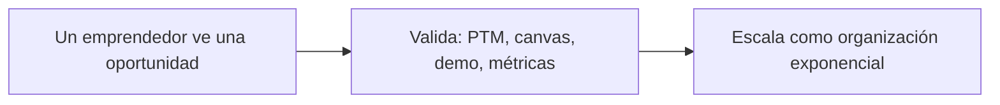
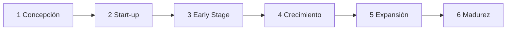
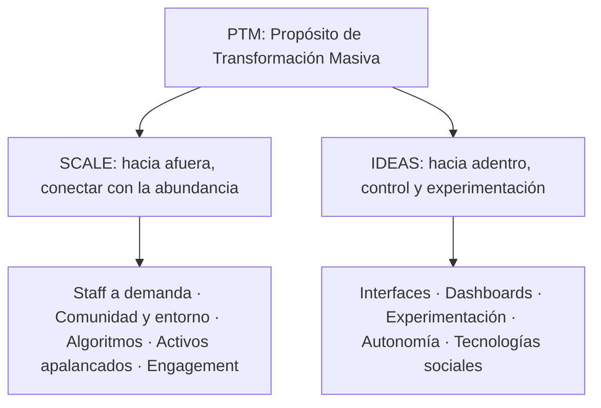

# ADSI 2026: resumen hablado de la Unidad 6, Emprendimientos

[TOC]

## Cómo leer este resumen

La idea es que esto se lea como si te lo estuviera explicando en voz alta, antes de entrar al parcial. La unidad tiene tres partes, igual que el resumen de Simulación:

1. **Los temas**, contados en criollo, con lo que hay que saber decir de memoria.
2. **Un ejemplo resuelto**, paso a paso. Es un caso inventado, porque no hay práctico en la carpeta.
3. **Relaciones y preguntas típicas**: cómo se conecta todo y qué te pueden preguntar.

> **Fuentes.** "U6 – Material Teórico" (Ing. Marisa Callejas). Las figuras del apunte son imágenes y no se ven en el texto: acá están reconstruidas a partir de lo que el apunte describe.

El hilo de la unidad, en un dibujo:

La frase que resume todo: **la U6 es cómo nace una organización nueva alrededor de una oportunidad tecnológica**. Su par es la Unidad 5, que cuenta cómo una organización que ya existe decide y lleva adelante un cambio con TI; el resumen está en [`ADSI_Unidad_5_Administracion_Recursos_IT.md`](ADSI_Unidad_5_Administracion_Recursos_IT.md). En las dos aparece lo mismo: no alcanza con la tecnología, hay que validar antes de gastar.

---

## La unidad en 30 segundos

Si la Unidad 5 era cómo una organización que ya existe encara un cambio, la Unidad 6 es **cómo nace una organización nueva** a partir de una oportunidad tecnológica. Tres bloques: el **emprendedor tecnológico** (quién es, qué etapas atraviesa, cómo se financia), las **organizaciones exponenciales** (empresas que logran un impacto 10 veces mayor apalancándose en tecnología y recursos externos, organizadas con un **PTM** y los atributos **SCALE** e **IDEAS**) y la metodología **ExO Sprint**, que da los pasos concretos para validar el emprendimiento: PTM, canvas, demo y métricas.

## El emprendedor tecnológico y el proceso emprendedor

Un **emprendedor tecnológico** es una persona que **detecta una oportunidad vacante** en el entorno y **crea una organización** (o la compra, o entra al equipo fundador) para aprovecharla, juntando recursos humanos, técnicos y financieros para **generar valor y transformar el mercado**.

El **proceso emprendedor** es todo el camino: detectar la oportunidad, concebir la empresa, lanzarla, consolidarla y escalarla.

**Los tres mitos que hay que desarmar** (preguntan mucho):

1. **"Necesito una idea brillante."** Falso: el **90 %** de los emprendimientos sale de la experiencia previa del fundador. El valor está en **ejecutar mejor**, no en ser original.
2. **"Necesito mucha plata."** Falso: el capital es **consecuencia** de un proyecto validado y un buen equipo, no un requisito previo.
3. **"Soy muy joven o muy grande."** Falso: depende de competencias, convicción y método, no de la edad.

La conclusión del apunte: lo que decide es **el coraje, la convicción y la disciplina para validar y ejecutar**.

## Las seis etapas (modelo Endeavor)

| Etapa | Qué pasa |
|---|---|
| **1. Concepción** | Analizar el concepto, evaluar la oportunidad, validar factibilidad tecnológica y comercial |
| **2. Start-up** | Armar el equipo fundador multidisciplinario, primer plan de negocios, estructura legal |
| **3. Early Stage** | Empiezan las operaciones; se lanza el **MVP**; se ajusta el modelo; primeros clientes y proveedores |
| **4. Crecimiento** | Canales formales de venta, plataformas robustas, desarrollo comercial y administrativo |
| **5. Expansión** | Estrategia de escala regional o internacional, réplica del modelo en nuevos mercados |
| **6. Madurez** | Nuevas líneas de negocio, diversificación, o salida (**exit / IPO**) |

La idea de fondo: el foco va pasando de **validar lo técnico** a **operar bien** y después a **expandirse**.

> **Ojo con el plan de negocios.** El índice del apunte nombra "El Plan de Negocios de una Empresa Tecnológica: Metodología Completa" y "Transformación Digital. Tecnologías exponenciales" como temas, pero el texto no los desarrolla: el plan de negocios solo aparece como tarea de la etapa **Start-up**, y las tecnologías exponenciales solo con la definición de Diamandis. Si en clase los dieron aparte, conviene repasarlos de tus apuntes.

## Perfil del emprendedor: EMPRENDEDOR, tres capas y triángulo invertido

**El acrónimo E.M.P.R.E.N.D.E.D.O.R.** Una letra, una actitud:

| Letra | Actitud | En una frase |
|---|---|---|
| E | Emancipación | Buscar autonomía y libertad para concretar lo propio |
| M | Moderación en la ambición del dinero | La plata es consecuencia del valor, no el fin |
| P | Pasión | Energía para bancarse los obstáculos |
| R | Resultados | Orientación a metas medibles |
| E | Espiritualidad | Valores, propósito y ética |
| N | Novicio | Humildad para aprender siempre |
| D | Disfrute del camino | Que el proceso también guste, no solo la meta |
| E | Éxitos compartidos | Reconocer al equipo y compartir el crédito |
| D | Determinación | Persistir ante la incertidumbre y las negativas |
| O | Optimismo y sueños | Proyectar futuros mejores y contagiar |
| R | Responsabilidad incondicional | Hacerse cargo, nunca jugar a la víctima |

**Las tres capas**, de afuera hacia adentro, según qué tan modificables son:

1. **Capa exterior: hábitos técnicos.** Programar, armar presupuestos, metodologías ágiles, marketing digital. **Se aprenden** estudiando y practicando.
2. **Capa intermedia: meta-habilidades.** Liderazgo, negociación, comunicación, tolerancia a la frustración. **Zona gris**: se pueden desarrollar, pero con tiempo, experiencia y mentoría.
3. **Núcleo: talentos.** Pasión, convicción, intuición, empuje. **No se modifican**: son la base.

El talento arranca el motor, pero sin las otras dos capas no alcanza para sostener una empresa.

**El triángulo invertido.** Tres vértices: arriba el **proyecto** y el **capital**, abajo, como punta de apoyo, el **emprendedor** con su equipo. El mensaje: **ni una gran idea ni mucha plata se sostienen si la base falla**. Y al revés: un emprendedor sólido puede reformular el proyecto y conseguir el capital.

**Tipos de emprendedores**, según por qué emprenden:

- **Luchadores**: emprenden **por necesidad**, porque no encontraron trabajo formal.
- **Caza-olas**: se suben a una **moda** para ganar rápido, sin compromiso a largo plazo.
- **Gladiadores**: lo llevan en el ADN; emprenden **por vocación** aunque tengan opciones estables.

## Idea vs. oportunidad, y dónde nacen las oportunidades

Una **oportunidad de negocio** es un **nicho vacante** en el mercado. El trabajo del profesional de sistemas es definir bien ese espacio y ver si **es lo bastante grande** para sostener una empresa rentable.

Tener una idea no es tener una oportunidad. Para que haya oportunidad tienen que darse **tres condiciones juntas**:

1. **Factibilidad de implementación**: se puede hacer con la tecnología y las capacidades disponibles.
2. **Creación real de valor**: resuelve un dolor importante o da un beneficio concreto.
3. **Predisposición a pagar**: los clientes pagarían bastante más de lo que cuesta proveerlo.

Si falta una, es solo una idea.

**Dónde nacen**, en dos niveles:

- **"A miles de metros" (macro)**: saltos tecnológicos (IA, nube, cuántica), transformación digital masiva, desregulación y cambios de leyes. Crean **industrias nuevas** donde todavía no hay competidores fuertes.
- **"A pocos metros" (micro)**: cambios de hábitos, dolores y cuellos de botella en procesos, clientes insatisfechos, **no-consumidores** que quedan afuera por costo o complejidad, crisis sectoriales. Permiten soluciones puntuales y de alto valor percibido.

En la práctica aparecen en el propio trabajo técnico, en investigación universitaria, hablando con clientes y proveedores, mirando las debilidades de la competencia, en hobbies o transformando modelos que ya existen.

## Financiamiento: etapas y fuentes

La plata que se necesita cambia con la madurez del proyecto:

| Etapa del capital | Para qué se usa |
|---|---|
| **Capital semilla (seed)** | Investigación, armado del proyecto, prototipo o MVP |
| **Etapa temprana (early stage)** | Arrancar a operar, lanzar al mercado, lograr el encaje producto-mercado |
| **Expansión (growth)** | Acelerar, ampliar capacidad, internacionalizar, economías de escala |

Las fuentes, de la más cercana a la más institucional:

- **3F (friends, family and fools)**: amigos y familia, por confianza personal.
- **Inversores ángeles**: personas con mucho patrimonio, muchas veces ex emprendedores, que ponen plata propia en etapas tempranas **y además aportan experiencia y contactos** (por eso se les dice *smart money*).
- **Capital de riesgo (venture capital)**: fondos profesionales que invierten en empresas jóvenes de alto potencial a cambio de acciones, esperando retornos de **más del 35 % anual**.
- **Private equity**: fondos para empresas **ya consolidadas** que quieren expandirse, comprar otras o reestructurarse.
- **Estado**: subsidios y créditos blandos para innovación (FONTAR, FONSOFT, FONSOFT Emprendedores, SEPyME).

Una forma de ordenarlo: semilla con 3F y ángeles, etapa temprana con ángeles y venture capital, expansión con venture capital y private equity. El Estado puede aparecer en cualquiera.

## Cuarta Revolución Industrial y abundancia

Tres autores sostienen el marco teórico. Asociá cada uno con una idea:

- **Klaus Schwab** (Foro Económico Mundial): la **Cuarta Revolución Industrial**: velocidad exponencial, convergencia de lo físico, lo digital y lo biológico, y disrupción de los modelos tradicionales.
- **Peter Diamandis** (Singularity University, XPRIZE): las **tecnologías exponenciales** duplican capacidad y bajan su costo a intervalos regulares, y eso genera un mundo de **abundancia**. Su **pirámide de la abundancia** tiene tres niveles, y la tecnología es lo que permite subir de uno a otro:

| Nivel | Qué es | Qué incluye (figura del apunte) |
|---|---|---|
| 3. Cima: **autorrealización** | Se alcanza del todo cuando los de abajo están garantizados | **Salud y libertad** |
| 2. Medio: **habilitadores de crecimiento** | Lo que permite crecer en conocimiento y producción | **Energía, educación, acceso a la información y telecomunicaciones** |
| 1. Base: **necesidades básicas universales** | Lo mínimo para sobrevivir, que la tecnología puede democratizar a costo casi nulo | **Alimento, agua potable y refugio (vivienda)** |

- **Salim Ismail**: junta todo y define la arquitectura de las **organizaciones exponenciales (ExO)**.

## Organizaciones exponenciales y el PTM

Una **ExO** es una organización cuyo impacto es **desproporcionadamente grande, al menos 10 veces (10x)** el de una organización tradicional de su industria, gracias a técnicas organizativas apoyadas en **tecnologías de información y activos externos**.

En el centro de toda ExO está el **Propósito de Transformación Masiva (PTM)**: la declaración aspiracional más alta, la que conquista la cabeza y el corazón del equipo y de la comunidad. Tiene que:

- Pensar en grande, apuntar a un desafío global.
- Conectar con la **abundancia**, no administrar escasez.
- Ser inspirador, corto, claro y memorable.
- **"Hacernos sentir incómodos"**: no es un slogan, es el norte que no se negocia.

## El cerebro ExO: SCALE e IDEAS

La metáfora es un cerebro. Arriba, el **PTM**. El **hemisferio derecho es SCALE**: lo **externo**, cómo la organización se conecta con la abundancia de afuera. El **hemisferio izquierdo es IDEAS**: lo **interno**, cómo controla, experimenta y se mantiene estable.

**SCALE (afuera):**

- **S, Staff a demanda**: en vez de tener empleados para todo, usar gente externa cuando hace falta. Da velocidad y flexibilidad.
- **C, Comunidad y entorno (crowd)**: la **comunidad** es gente apasionada por el PTM e involucrada; el **entorno** es una multitud más grande con interés pasivo, a la que se llega por canales digitales.
- **A, Algoritmos**: machine learning y deep learning para entender clientes y productos.
- **L, Activos apalancados**: no comprar todo; **alquilar, hacer leasing, pagar por uso**. (Lo mismo que el OpEx de la U5.)
- **E, Engagement (compromiso)**: reputación digital, gamificación y premios para mantener a la comunidad enganchada.

Las capas de participación son concéntricas: en el centro el **core team**, en el medio la **comunidad** (usuarios activos, clientes fieles, alumni, proveedores, socios, staff a demanda) y afuera el **crowd**.

**IDEAS (adentro):**

- **I, Interfaces**: software y flujos (UI/UX) que conectan lo de afuera (SCALE) con la organización interna. Son el puente.
- **D, Dashboards**: tableros en tiempo real, accesibles para todos, con métricas livianas como **OKR**.
- **E, Experimentación**: **Lean Startup**, ciclos cortos de feedback, aceptar el error. Experimentar es **validar los supuestos antes de invertir fuerte**.
- **A, Autonomía**: organización plana, equipos autoorganizados y multidisciplinarios, autoridad descentralizada.
- **S, Tecnologías sociales**: herramientas para que empleados, staff, clientes y comunidad se comuniquen rápido.

Para no mezclarlas: **SCALE trae abundancia de afuera; IDEAS la ordena adentro**. Y fijate que las dos tienen una E distinta: en SCALE es *Engagement*, en IDEAS es *Experimentación*.

## ExO Sprint y LaunchPad: el Sprint 1

El **ExO Sprint / LaunchPad** es una metodología para ayudar a emprendedores a convertir su startup en una ExO. Es **iterativa**: se puede repetir varias veces para revisar y mejorar todos los aspectos clave del emprendimiento.

El **Sprint 1** tiene ocho actividades. Conviene saberlas en orden:

1. **Definir el PTM.**
2. **Team Canvas**: alinear al equipo fundador en roles, valores, objetivos y reglas.
3. **Tipos de mercado.**
4. **Identificar abundancia**: datos masivos, sensores, talento distribuido, activos ociosos.
5. **Modelo de negocio (Business Model Canvas).**
6. **Lienzo de propuesta de valor (Value Proposition Canvas).**
7. **Demo.**
8. **Métricas del problema.**

**Tipos de mercado:**

| Tipo | La pregunta |
|---|---|
| **Existente** | ¿Hay un mercado conocido, con nombre y competencia? ¿Mi producto es mejor en algo? |
| **Resegmentado de nicho** | ¿Hay clientes que quieren algo hecho a su medida, aunque cueste más? |
| **Resegmentado de bajo costo** | ¿Hay clientes que comprarían algo "suficientemente bueno" mucho más barato? |
| **Nuevo** | No hay mercado definido: ni clientes ni competidores |
| **Clon** | ¿Puedo copiar un modelo exitoso de **Estados Unidos** y adaptarlo al idioma y los hábitos de compra locales? |

Un detalle del nicho que el apunte remarca: esos clientes lo compran **aunque cueste más** e incluso aunque sea peor en algún aspecto que a ellos no les importa.

**Business Model Canvas (Osterwalder).** Un modelo de negocio es **una simplificación que describe cómo una organización crea, distribuye y captura valor**. Son nueve bloques:

| # | Bloque | La pregunta |
|---|---|---|
| 1 | Propuesta de valor | ¿Qué valor damos? ¿Qué problema resolvemos? |
| 2 | Segmento de clientes | ¿Para quién creamos valor? |
| 3 | Canales | ¿Cómo llegamos a ellos? |
| 4 | Relación con clientes | ¿Qué relación esperan? |
| 5 | Recursos clave | ¿Qué necesitamos tener? |
| 6 | Actividades clave | ¿Qué tenemos que hacer? |
| 7 | Alianzas clave | ¿Quiénes son los socios y proveedores clave? |
| 8 | Estructura de costos | ¿Cuáles son los costos más importantes? |
| 9 | Fuentes de ingreso | ¿Por qué y cómo nos pagan? |

Un truco para leerlo: el lado derecho (2, 3, 4, 9) es **el cliente y la plata que entra**; el lado izquierdo (5, 6, 7, 8) es **la operación y la plata que sale**; la propuesta de valor (1) está en el medio y une todo.

**Value Proposition Canvas.** Hace zoom en dos bloques del BMC (propuesta de valor y segmento) y busca el **encaje (fit)**:

- **Perfil del cliente** (lado derecho, el círculo): **trabajos** (lo que intenta hacer, resolver o conseguir; pueden ser tareas **funcionales, sociales o emocionales**), **dolores** (problemas, frustraciones, riesgos o costos que le aparecen al hacer esos trabajos) y **ganancias** (los beneficios o mejoras que espera obtener).
- **Mapa de valor** (lado izquierdo, el cuadrado): **productos y servicios**, **aliviadores de dolores** y **creadores de ganancias**.

Ojo con los nombres: en la figura del apunte (de Strategyzer) los dolores aparecen como **frustraciones** y las ganancias como **alegrías**; así que también vas a ver "aliviadores de frustraciones" y "creadores de alegrías". Es lo mismo.

Hay fit cuando cada dolor importante tiene su aliviador y cada ganancia esperada tiene su creador.

**Demo.** Sirve para que el cliente **visualice** la solución y valide que le resuelve el problema. En software, maquetas o videos; en productos físicos, bocetos, CAD, arcilla o impresión 3D; en los dos casos sirve una **landing page**. Cuatro reglas: tiene que ser **realizable**, **parecer real**, **minimizar el desperdicio** y usar **datos de aspecto real**.

**Métricas del problema.** Definir qué se mide y qué valor hay que alcanzar para dar por validado el par problema-solución. El ejemplo del apunte: **al menos 10 entrevistas de problema** y que **el 80 % comparta el problema**.

## Ejemplo resuelto: Sprint 1 aplicado a un emprendimiento

> Caso inventado, armado con los ejemplos que usa el propio apunte (gestión de stock con IA).

Un grupo de estudiantes de sistemas trabaja en distribuidoras y ve que los almacenes de barrio controlan el stock a mano. Recorramos el Sprint 1.

**0. ¿Es idea u oportunidad?** Chequeamos las tres condiciones:

- *Factible*: sí, con una app móvil, lector de código de barras de la cámara y un modelo de predicción simple.
- *Crea valor*: el almacenero pierde horas contando y se queda sin productos que se venden.
- *Predisposición a pagar*: **no lo sabemos todavía**. Eso lo tiene que validar el paso 8.

Origen: es una oportunidad **"a pocos metros"** (dolor en un proceso cotidiano) que nace de la **experiencia previa** de los fundadores. Justo lo que dice el mito 1.

**1. PTM.** "Que ningún comercio de barrio pierda una venta por no saber qué tiene." Es corto, apunta a un problema enorme (miles de comercios) y da un poco de vértigo, como pide el apunte.

**2. Team Canvas.** Dos desarrolladores, uno de datos y uno comercial (el que trabaja en la distribuidora). Valores: hablar con clientes cada semana; reglas: decisiones con datos.

**3. Tipo de mercado.** Ya existen sistemas de gestión de stock, pero son caros y complejos para un almacén. Es un **mercado resegmentado de bajo costo**: algo "suficientemente bueno" mucho más barato y simple.

**4. Abundancia.** Celulares con cámara que todos tienen, nube que se paga por uso (**activos apalancados**) y los datos de ventas que el propio comercio genera (**algoritmos**).

**5. Business Model Canvas** (resumido):

| Bloque | Contenido |
|---|---|
| Propuesta de valor | Saber el stock en tiempo real y recibir alertas antes de quedarse sin un producto |
| Segmento | Almacenes y minimercados de barrio |
| Canales | Preventistas de distribuidoras, redes sociales, tienda de apps |
| Relación | Autoservicio + soporte por WhatsApp |
| Recursos clave | La app, el modelo de predicción, el catálogo de códigos de barras |
| Actividades clave | Desarrollo, mantenimiento del catálogo, soporte |
| Alianzas | Distribuidoras mayoristas (le interesa que sus clientes no se queden sin stock) |
| Costos | Desarrolladores, nube, marketing |
| Ingresos | Suscripción mensual baja por comercio |

**6. Value Proposition Canvas:**

| Perfil del cliente | Mapa de valor |
|---|---|
| Trabajo: gestionar el stock del comercio | Producto: app de gestión de stock con IA |
| Dolor: pierde tiempo contando a mano | Aliviador: carga escaneando con la cámara |
| Dolor: se queda sin lo que más vende | Aliviador: **alertas automáticas de faltantes** |
| Ganancia: información actualizada en tiempo real | Creador: tablero simple con lo que hay y lo que falta |

**7. Demo.** Una **landing page** con video de la app (maqueta en Figma) usando productos y precios reales de un almacén. Realizable en una semana, parece real, cuesta casi nada.

**8. Métricas del problema.** Meta: **10 entrevistas** a almaceneros; se valida si **el 80 % (8 de 10)** confirma que el control de stock le duele. Y para la predisposición a pagar: que al menos la mitad deje su contacto en la landing para una prueba.

**¿Y la plata?** Etapa de **concepción**: no hace falta capital grande todavía (mito 2). Con ahorro propio o **3F** alcanza para la demo; si las métricas dan bien, recién ahí se busca **capital semilla** (un ángel o FONSOFT Emprendedores) para el MVP.

> **Lo que te tenés que llevar del ejemplo:** el Sprint 1 es una forma ordenada de **validar antes de gastar**. Cada herramienta responde una duda distinta: el PTM, para qué; el BMC, cómo se gana plata; el VPC, si de verdad le resuelve algo al cliente; la demo y las métricas, si el cliente está de acuerdo.

## Relaciones de la Unidad 6

- **Con la Unidad 5:** la oportunidad de la U6 tiene que pasar las mismas tres preguntas que la factibilidad. "Factibilidad de implementación" = factibilidad técnica; "predisposición a pagar más que el costo" = factibilidad económica; y la validación con clientes cumple el papel de la operativa (¿lo van a usar?).
- **Activos apalancados ↔ OpEx:** la ExO prefiere alquilar y pagar por uso, igual que pasar a la nube en NovaRetail.
- **Experimentación (IDEAS) ↔ gestión ágil:** Lean Startup, iteración y feedback rápido son el mismo espíritu que la gestión ágil de la U5 para proyectos complejos (matriz de Stacey).
- **Dashboards ↔ monitoreo y control:** los tableros con OKR son la versión ExO de los informes de avance del director de proyecto.
- **Comunidad y crowd ↔ stakeholders:** las capas concéntricas (core team, comunidad, crowd) son otra forma de mirar a los interesados.
- **Etapas Endeavor ↔ etapas del capital:** concepción y start-up con capital semilla; early stage con financiación temprana; crecimiento y expansión con capital de expansión.
- **Triángulo invertido ↔ mitos:** si el emprendedor es la base, la idea brillante (mito 1) y el capital (mito 2) no alcanzan solos.

## Preguntas típicas de la Unidad 6

- Definí emprendedor tecnológico y proceso emprendedor.
- Explicá los tres mitos del emprendimiento.
- Nombrá y describí las seis etapas del modelo Endeavor.
- ¿Qué significa cada letra de EMPRENDEDOR?
- Explicá las tres capas del perfil del emprendedor y cuáles se pueden aprender.
- ¿Qué dice el triángulo invertido?
- Diferenciá luchadores, caza-olas y gladiadores.
- ¿Cuándo una idea es una oportunidad? Las tres condiciones.
- Diferenciá oportunidades a nivel macro y micro.
- Etapas del capital y fuentes de financiamiento. ¿Qué es *smart money*?
- ¿Qué aportan Schwab, Diamandis e Ismail? ¿Qué hay en cada nivel de la pirámide de la abundancia?
- ¿Qué es una ExO? ¿Qué es el PTM y qué características tiene?
- Explicá SCALE e IDEAS. ¿Cuál es externo y cuál interno?
- Nombrá las ocho actividades del Sprint 1.
- Explicá los tipos de mercado.
- Nombrá los nueve bloques del Business Model Canvas.
- Explicá el Value Proposition Canvas y qué es el fit.
- ¿Qué reglas tiene una buena demo? ¿Qué son las métricas del problema?

---

## Repaso rápido de la unidad

| Concepto | En una línea |
|---|---|
| Oportunidad | Factible + crea valor + pagan más de lo que cuesta |
| Endeavor | Concepción, start-up, early stage, crecimiento, expansión, madurez |
| Capital | Semilla, temprana, expansión; 3F, ángeles, VC, private equity, Estado |
| ExO | Impacto 10x; PTM + SCALE (afuera) + IDEAS (adentro) |
| Sprint 1 | PTM, Team Canvas, mercado, abundancia, BMC, VPC, demo, métricas |
