# Unidad 6. Emprendimientos

[TOC]

Vamos con la unidad seis, emprendimientos.

Si la unidad cinco contaba cómo una organización que ya existe encara un cambio, la seis cuenta cómo nace una organización nueva alrededor de una oportunidad tecnológica. Tiene tres bloques:

- El emprendedor tecnológico: quién es, qué etapas atraviesa y cómo se financia.
- Las organizaciones exponenciales (ExO, de *Exponential Organizations*): empresas con un impacto diez veces mayor, apalancadas en tecnología y en recursos externos.
- Una metodología, el ExO Sprint, que da los pasos concretos para validar un emprendimiento. Un *sprint* es una tanda corta de trabajo con un objetivo fijo, palabra que viene de la gestión ágil.

El recorrido, en un dibujo:

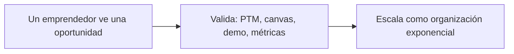

Si te llevás cuatro ideas, que sean estas:

- **La primera:** una idea no es una oportunidad. Para que haya oportunidad tienen que darse tres condiciones juntas: que se pueda hacer, que cree valor y que los clientes paguen más de lo que cuesta.
- **La segunda:** los tres mitos son falsos. No hace falta una idea brillante, ni mucha plata, ni una edad especial.
- **La tercera:** una organización exponencial tiene un propósito en el centro, el PTM (Propósito de Transformación Masiva), y dos hemisferios: SCALE, que mira hacia afuera, e IDEAS, que mira hacia adentro. Son dos siglas inglesas de cinco letras cada una, y cada letra es un atributo; los vemos más abajo.
- **La cuarta:** el Sprint uno sirve para validar antes de gastar, con ocho actividades en orden.

Y una advertencia sobre cómo está armado el repaso. Cada tema termina con dos cosas: "Lo importante", que es lo que tenés que poder decir de memoria, y "Ojo, trampa", que son las confusiones donde más se cae. Al final hay dieciocho preguntas tipo multiple choice, con la opción correcta y dónde está la trampa.

Dos aclaraciones sobre el formato:

- Las figuras del apunte están acá como imágenes capturadas del PDF. Debajo de cada una explico qué muestra, y traduzco lo que está en inglés.
- Cuando explico una sigla o una palabra en inglés que el apunte no traduce, es una aclaración mía, no del apunte.

## Introducción: el rol del emprendedor tecnológico en la Cuarta Revolución Industrial

El apunte abre con una introducción de dos párrafos, y conviene tenerla clara porque da el marco de toda la unidad.

El primer párrafo dice que, en la economía de hoy, **la intersección entre tecnología, innovación y capacidad de gestión constituye el motor primordial para la creación de valor sustentable**. Para quienes se forman en ingeniería y ciencias de la información, desarrollar competencias emprendedoras dejó de ser algo meramente comercial y se volvió **una disciplina estratégica fundamental**.

El segundo párrafo habla de la digitalización global: la empujan la convergencia de tecnologías exponenciales y los cambios estructurales de la Cuarta Revolución Industrial. Eso obliga a entender cómo se conciben, validan, financian y escalan las organizaciones tecnológicas. La unidad aborda dos ejes:

- Los fundamentos del **Proceso Emprendedor Tecnológico**: de la idea a la empresa.
- Los modelos disruptivos de las **Organizaciones Exponenciales (ExO)**.

El objetivo declarado es dar una guía integral para **transformar ideas técnicas en empresas sostenibles de alto impacto**.

El índice del apunte ordena el contenido en tres temas:

- Tema uno: el emprendedor tecnológico, la oportunidad de negocios tecnológica y el plan de negocios de una empresa tecnológica.
- Tema dos: transformación digital, tecnologías exponenciales, organizaciones exponenciales y metodologías de transformación. Incluye el paradigma de abundancia de Diamandis, la Cuarta Revolución Industrial de Schwab y los hemisferios SCALE e IDEAS.
- Tema tres: las metodologías ExO Sprint y LaunchPad.

**Lo importante.** El motor de la creación de valor es la intersección entre tecnología, innovación y gestión. La unidad tiene dos ejes: el Proceso Emprendedor Tecnológico y las Organizaciones Exponenciales.

**Ojo, trampa.** El apunte no presenta el emprendimiento como algo solo comercial: lo plantea como una disciplina estratégica para quienes vienen de ingeniería y sistemas.

## El emprendedor tecnológico y el proceso emprendedor

Un Emprendedor Tecnológico, según el apunte, es **una persona que detecta una oportunidad vacante en el entorno y crea una organización** (o la adquiere, o forma parte activa de un equipo fundador) para encararla. Estructura recursos humanos, técnicos y financieros con el objetivo de generar valor y transformar el mercado.

El Proceso Emprendedor es todo el camino. Comprende la totalidad de actividades interrelacionadas, desde la detección temprana de oportunidades hasta:

- la concepción,
- el lanzamiento,
- la consolidación,
- la escalabilidad de las organizaciones que las concretan.

Ahora, los tres mitos que hay que desarmar. El apunte los llama "mitos clásicos": barreras y preconceptos culturales que paralizan el inicio de iniciativas innovadoras. Preguntan mucho.

- **Mito uno, la "Idea Brillante".** Creer que el éxito requiere una idea jamás pensada. Es falso: el noventa por ciento de los emprendimientos surge de la experiencia y actividad previa del fundador. El valor está en la ejecución superior, no en la originalidad abstracta.
- **Mito dos, la necesidad de grandes sumas de capital.** Es falso: el capital es consecuencia de un proyecto validado y de un equipo sólido, no un requisito previo indispensable.
- **Mito tres, la edad como restricción.** Es falso: el proceso emprendedor responde a competencias, convicción y rigor metodológico, y es independiente de la edad cronológica.

La conclusión operativa del apunte: **Lo verdaderamente determinante es el coraje, la convicción y la disciplina metódica para validar y ejecutar la visión.**

**Lo importante.** El emprendedor detecta una oportunidad vacante y crea una organización para aprovecharla. Los tres mitos son falsos: idea brillante, mucha plata y edad.

**Ojo, trampa.** Si una opción dice que el capital es el punto de partida del emprendimiento, está al revés: el capital es consecuencia de un proyecto validado. Y el noventa por ciento sale de la experiencia previa, no de una idea original.

## Las seis etapas del modelo Endeavor

Endeavor es una organización que apoya emprendedores; el apunte toma de ella el modelo del ciclo de vida. El ciclo de evolución de una empresa tecnológica se estructura en fases secuenciales que demandan distintas capacidades operativas, directivas y financieras.

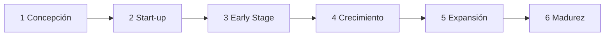

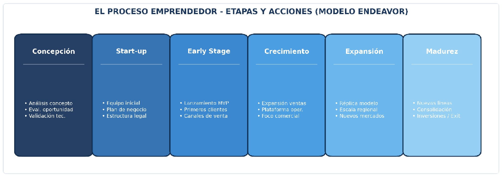

La imagen uno es la Figura 1 del apunte, "El proceso emprendedor - etapas y acciones (modelo Endeavor)". Son seis cuadros de izquierda a derecha, del más oscuro al más claro. Cada uno tiene tres acciones abreviadas, que el texto del apunte desarrolla. En la figura, el early stage incluye "canales de venta"; el texto del apunte ubica los canales formales en el crecimiento. Para el examen, quedate con la versión del texto, que está en la lista de abajo.

Las seis etapas:

- **Uno, concepción (etapa inicial).** Se analiza el concepto, se evalúa rigurosamente la oportunidad de negocio y se valida de forma preliminar la factibilidad tecnológica y el enfoque comercial.
- **Dos, start-up (puesta en marcha).** Start-up es una empresa emergente en sus primeros pasos. Acá se constituye el equipo fundador multidisciplinario, se elabora el primer plan de negocios y se formaliza la estructura legal.
- **Tres, early stage (etapa temprana).** Empiezan las operaciones reales y se lanza el MVP (*Minimum Viable Product*, producto mínimo viable: la primera versión del producto, la más simple que sirve para probar el mercado). Se refina el modelo de negocios y llegan los primeros clientes y proveedores.
- **Cuatro, crecimiento.** Se construyen y consolidan canales formales de distribución y venta, se montan plataformas robustas de operación y se desarrolla el potencial comercial y administrativo.
- **Cinco, expansión.** Se define la estrategia de escalabilidad regional o internacional, se arman plataformas preparadas para el hipercrecimiento y se replica el modelo operativo en nuevos mercados.
- **Seis, madurez.** Consolidación institucional: adquisición de nuevas líneas de negocios, diversificación de inversiones o eventos de salida y liquidez (*exit* e IPO). El exit es la salida: vender la empresa o cobrar la inversión. IPO es *Initial Public Offering*, oferta pública inicial, o sea salir a la bolsa.

La idea de fondo, en palabras del apunte: el emprendimiento es una trayectoria estructurada de maduración donde el foco directivo pasa progresivamente de la validación técnica a la excelencia operativa y la expansión corporativa. Es como criar a un hijo: primero lo cuidás, después le armás su rutina, y al final lo dejás salir solo.

Ojo con el plan de negocios. El índice del apunte nombra como temas "El Plan de Negocios de una Empresa Tecnológica: Metodología Completa" y "Transformación Digital. Tecnologías exponenciales", pero el texto no los desarrolla: el plan de negocios solo aparece como tarea de la etapa de start-up, y las tecnologías exponenciales solo con la definición de Diamandis. Si en clase los dieron aparte, conviene repasarlos de tus apuntes.

**Lo importante.** Seis etapas en orden: concepción, start-up, early stage, crecimiento, expansión y madurez. El MVP se lanza en el early stage.

**Ojo, trampa.** No mezcles el orden: la estructura legal y el equipo fundador son de la start-up, no de la concepción. Y la salida, el exit o IPO, es de la madurez.

## Perfil del emprendedor: el acrónimo y las tres capas

Según el apunte, el perfil del emprendedor exitoso integra un conjunto de actitudes y compromisos sintetizados en el acrónimo EMPRENDEDOR, con una letra por actitud:

- **E, emancipación:** búsqueda de autonomía, autorrealización y libertad de acción para materializar visiones propias.
- **M, moderación en la ambición del dinero:** el beneficio económico es una métrica y consecuencia del valor generado, no el único fin motivador.
- **P, pasión:** energía y entusiasmo inquebrantables para superar los obstáculos cotidianos.
- **R, resultados:** orientación pragmática hacia objetivos medibles y cumplimiento de metas.
- **E, espiritualidad:** coherencia de valores, propósito trascendente y alineación ética con el impacto del proyecto.
- **N, novicio:** humildad intelectual para aprender siempre, con mentalidad de principiante ante entornos cambiantes.
- **D, disfrute del camino:** encontrar satisfacción en el proceso diario de construcción y no solo en la meta final.
- **E, éxitos compartidos:** reconocer el valor del equipo, ser generoso con el crédito y consolidar redes de confianza.
- **D, determinación:** persistencia tenaz y resiliencia ante la incertidumbre, las negativas y las crisis operativas.
- **O, optimismo y sueños:** proyectar escenarios futuros mejores y contagiar entusiasmo al equipo y a los inversores.
- **R, responsabilidad incondicional:** asumir plenamente las consecuencias de las decisiones, evitando el rol de víctima.

Ahora, las tres capas del perfil, de afuera hacia adentro, según qué tan modificables son. El apunte las clasifica por su grado de plasticidad, es decir, qué tanto se pueden cambiar o aprender.

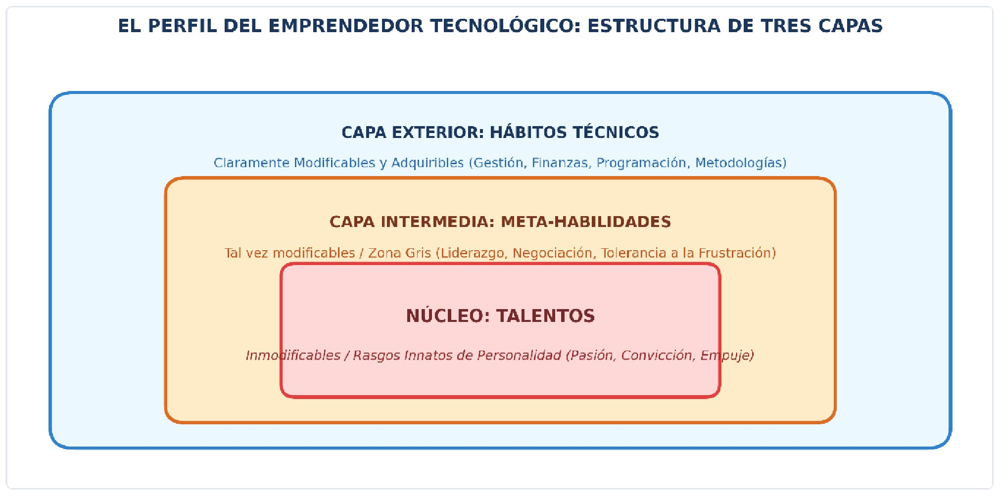

La imagen dos es la Figura 2 del apunte, "El perfil del emprendedor tecnológico: estructura de tres capas". Son tres rectángulos uno dentro del otro: azul afuera, naranja en el medio y rojo en el centro. En la captura, el texto de la capa del núcleo se sale un poco del recuadro rojo; es un defecto del dibujo original.

- **Capa exterior, hábitos técnicos.** Son conocimientos técnicos y habilidades de gestión: programación, formulación presupuestaria, metodologías ágiles, marketing digital. Son **claramente modificables y adquiribles** mediante capacitación formal, estudio y práctica continua.
- **Capa intermedia, meta-habilidades.** Una **zona gris o tal vez modificable**: liderazgo de equipos, negociación estratégica, comunicación asertiva y tolerancia a la frustración. Su desarrollo demanda tiempo, introspección, experiencia y mentoría deliberada.
- **Núcleo, talentos.** Rasgos profundos de la personalidad e inclinaciones innatas: la pasión intrínseca, la convicción visionaria, la intuición y el empuje vital. Son considerados **inmodificables** y forman la base sobre la que se asientan las otras capas.

El apunte cierra con una advertencia: si bien el núcleo de talentos es el motor de arranque, la formación continua en hábitos técnicos y el fortalecimiento de las meta-habilidades son indispensables para transformar el talento en desempeño empresarial sostenible. Es como un auto con un gran motor y sin ruedas: tiene potencia, pero no te lleva a ningún lado.

**Lo importante.** Tres capas: hábitos técnicos, que se aprenden; meta-habilidades, que se desarrollan con tiempo y mentoría; y talentos, que no se modifican.

**Ojo, trampa.** "Todo lo del perfil se puede aprender" es falso: el núcleo de talentos no se modifica. Y la M del acrónimo es moderación en la ambición del dinero: la plata no es el fin.

## Triángulo invertido y tipos de emprendedores

El modelo del triángulo invertido analiza cómo se reparten el peso y el equilibrio entre los tres componentes de cualquier iniciativa de negocio.

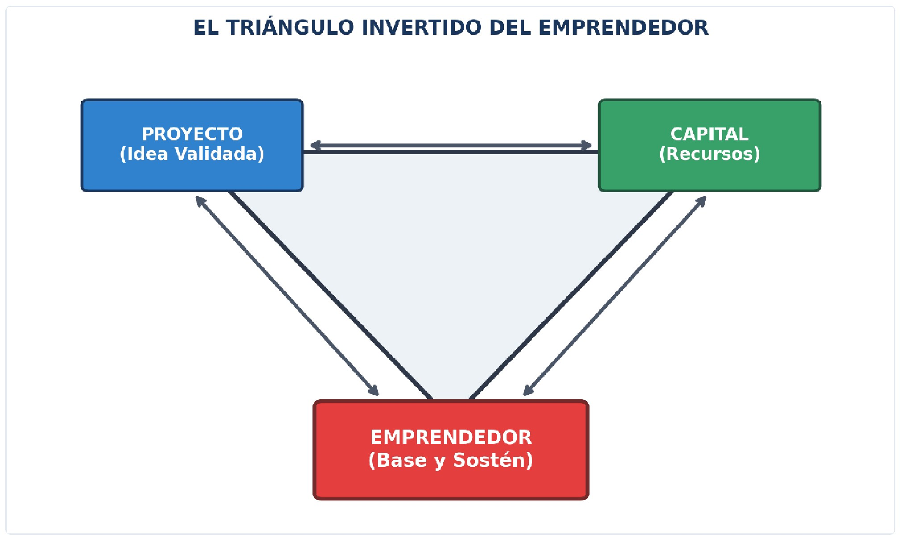

La imagen tres es la Figura 3 del apunte, "El triángulo invertido del emprendedor". Arriba a la izquierda, un recuadro azul, "Proyecto (idea validada)"; arriba a la derecha, uno verde, "Capital (recursos)"; abajo, en rojo, "Emprendedor (base y sostén)". Hay flechas de doble punta entre los tres.

Los tres vértices:

- **Vértice inferior, la base:** el emprendedor y su equipo. Es el punto de apoyo crítico y el soporte sobre el que descansa toda la estructura.
- **Vértice superior izquierdo:** el proyecto, que es la oportunidad de negocio validada, el modelo operativo y la propuesta de valor.
- **Vértice superior derecho:** el capital, que agrupa los recursos económicos y financieros necesarios para apalancar el desarrollo.

El principio rector, textual del apunte: **ni una excelente idea (Proyecto) ni una gran suma de dinero (Capital) pueden sostenerse por sí solas si la base —el Emprendedor y sus competencias— no posee la solidez, resiliencia y capacidad de liderazgo requeridas.** Si el emprendedor falla, la estructura completa colapsa. Y al revés: un emprendedor sólido es capaz de reformular el proyecto y atraer el capital necesario. Es como una pirámide parada de punta: si la punta no aguanta, todo lo de arriba se cae.

Los tipos de emprendedores se distinguen por el motivo por el que emprenden:

- **Luchadores, emprendedores por necesidad.** No eligen la actividad como vocación: entran porque no encuentran alternativas viables en el mercado laboral formal.
- **Caza-olas, oportunistas de corto plazo.** Se montan sobre grandes tendencias o modas transitorias en busca de ganancias rápidas, sin compromiso de largo plazo con la industria o el producto.
- **Gladiadores, emprendedores vocacionales.** Sienten el proceso emprendedor en su ADN y lo asumen como profesión y estilo de vida. Eligen emprender aunque tengan opciones corporativas estables, con compromiso incondicional con la visión.

**Lo importante.** La base del triángulo es el emprendedor con su equipo. Luchadores, por necesidad; caza-olas, por moda; gladiadores, por vocación.

**Ojo, trampa.** Si te preguntan qué sostiene al emprendimiento, no es el capital ni la idea: es el emprendedor. Y no confundas caza-olas, que van por la moda, con luchadores, que van por necesidad.

## Idea contra oportunidad

Una oportunidad de negocio es un espacio o "nicho" vacante en el mercado para introducir un nuevo producto, servicio o tecnología. El desafío central del profesional de sistemas es definir con precisión las características de ese espacio y verificar si su dimensión económica alcanza para garantizar la viabilidad y rentabilidad de una empresa.

Tener una idea no garantiza estar ante una oportunidad comercial. Para que exista una oportunidad real tienen que converger tres condiciones:

- **Factibilidad de implementación:** la idea puede llevarse a la realidad con la tecnología y las capacidades disponibles.
- **Creación real de valor:** resuelve un dolor crítico o genera un beneficio tangible para el comprador o usuario final.
- **Predisposición a pagar:** los clientes demuestran una disposición real a pagar un precio significativamente superior al costo unitario de provisión.

Si falta una, es solo una idea.

La identificación de oportunidades se hace en dos niveles de observación complementarios:

- **A miles de metros de altura, nivel macro.**
  - Disparadores: cambios y saltos tecnológicos (IA, que es inteligencia artificial; *cloud*, la nube; *quantum*, la computación cuántica), procesos masivos de transformación digital, desregulación normativa y cambios legislativos.
  - Impacto: crea nuevos paradigmas de mercado y abre industrias completas donde antes no había competidores consolidados.
- **A pocos metros de altura, nivel micro o cotidiano.**
  - Disparadores: transformaciones en hábitos sociales y de consumo, dolores y cuellos de botella en procesos de negocio, fricciones y consumidores insatisfechos, "no consumidores" excluidos por costo o complejidad, y crisis sectoriales y barreras percibidas como "imposibles".
  - Impacto: permite diseñar soluciones puntuales, ágiles y de alto valor percibido que resuelven ineficiencias concretas.

Y los entornos donde se detectan, según el apunte, son:

- el propio ámbito de trabajo técnico,
- los proyectos de investigación universitaria,
- la interacción directa con clientes o proveedores,
- el análisis de las debilidades de los competidores,
- las comunidades de práctica, o sea los hobbies,
- la adquisición o transformación de modelos que ya existen.

**Lo importante.** Oportunidad es factible, crea valor y la gente paga más de lo que cuesta. Y nace a nivel macro, por saltos tecnológicos, o a nivel micro, por dolores cotidianos.

**Ojo, trampa.** Con dos de las tres condiciones, sigue siendo una idea. Y un no consumidor no es un cliente perdido: es una puerta de oportunidad, a nivel micro.

## Financiamiento: etapas y fuentes

Los requerimientos de financiamiento evolucionan a la par de la madurez del proyecto, y hay tres etapas del capital:

- **Capital semilla (*seed money*):** financia la investigación, la elaboración del proyecto y el desarrollo del prototipo o MVP.
- **Financiación de etapa temprana (*early stage* / start-up):** fondos para iniciar operaciones, lanzar el producto al mercado y alcanzar el encaje producto-mercado, es decir, que el producto responda de verdad a lo que el mercado necesita.
- **Financiación de expansión (*later stage* / *growth*, crecimiento):** capital para acelerar el crecimiento, ampliar la capacidad productiva, internacionalizar la empresa y alcanzar economías de escala.

Las fuentes, de la más cercana a la más institucional:

- **Las 3F (*Friends, Family and Fools*, amigos, familia y "tontos"):** fondos de cercanía que apoyan la concepción inicial por confianza personal.
- **Inversores ángeles (*angel investors*):** particulares de alto patrimonio, muchas veces ex emprendedores, que invierten capital propio en fases tempranas y aportan experiencia, contactos y mentoría. Por eso se los llama *smart money*, plata inteligente.
- **Capital de riesgo (*venture capital*):** fondos institucionales profesionales que invierten en empresas jóvenes con alto potencial de crecimiento e innovación. Asumen alto riesgo a cambio de participación accionaria y retornos esperados de más del treinta y cinco por ciento anual.
- **Private equity (capital privado):** fondos que invierten en empresas consolidadas, con trayectoria comprobada, para financiar grandes expansiones, adquisiciones o reestructuraciones corporativas.
- **Financiamiento estatal y programas públicos:** subsidios y créditos blandos del Estado para la innovación científico-tecnológica. El apunte nombra FONTAR, FONSOFT, FONSOFT Emprendedores y SEPyME. El apunte no desarrolla estas siglas; por lo que sé, FONTAR es el Fondo Tecnológico Argentino, FONSOFT el Fondo Fiduciario de Promoción de la Industria del Software y SEPyME la Secretaría de la Pequeña y Mediana Empresa. Chequealo si te lo piden.

Una forma de ordenarlo:

- Semilla: 3F y ángeles.
- Etapa temprana: ángeles y venture capital.
- Expansión: venture capital y private equity.
- El Estado puede aparecer en cualquiera.

Este ordenamiento por etapas es una síntesis mía, no una tabla del apunte.

**Lo importante.** Tres etapas del capital: semilla, temprana y expansión. Los ángeles aportan plata y también experiencia y contactos: smart money. El venture capital va a empresas jóvenes; el private equity, a empresas consolidadas.

**Ojo, trampa.** No confundas venture capital con private equity: uno es para empresas jóvenes de alto potencial, y el otro para empresas ya consolidadas. Y el ángel es de etapa temprana, no de expansión.

## Cuarta Revolución Industrial y abundancia

El marco teórico de las organizaciones exponenciales se apoya en tres referentes globales. Asociá cada uno con una idea:

- **Klaus Schwab (Foro Económico Mundial):** define la Cuarta Revolución Industrial como una transformación con velocidad exponencial, convergencia entre los mundos físico, digital y biológico, y disrupción radical de los modelos organizacionales tradicionales.
- **Peter Diamandis (Singularity University y XPRIZE):** postula que las tecnologías exponenciales, aquellas que duplican su capacidad y reducen su costo a intervalos regulares, generan un entorno de abundancia universal de recursos. La Singularity University es una institución de formación en tecnologías exponenciales, y el XPRIZE una fundación de premios de incentivo para resolver grandes desafíos; ambas aclaraciones son mías.
- **Salim Ismail:** sintetiza estos conceptos al definir la arquitectura y los atributos de las organizaciones exponenciales, las ExO.

La pirámide de la abundancia es de Diamandis. Tiene tres niveles jerárquicos, y la tecnología actúa como facilitadora del progreso humano: es lo que permite subir de un nivel al siguiente.

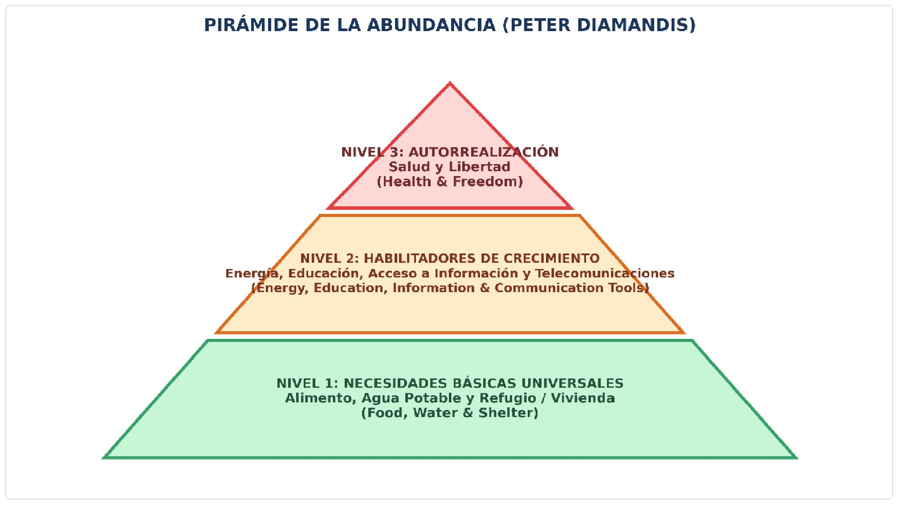

La imagen cuatro es la Figura 4 del apunte, "Pirámide de la abundancia (Peter Diamandis)". El contenido de cada nivel, con lo que dice la figura:

- **Nivel uno, base: necesidades básicas universales.** Alimento, agua potable y refugio o vivienda (*Food, Water & Shelter*). Son los requerimientos mínimos de supervivencia material, que las tecnologías exponenciales permiten democratizar a costos marginales casi nulos.
- **Nivel dos, capa intermedia: habilitadores de crecimiento.** Energía, educación, acceso a información y telecomunicaciones (*Energy, Education, Information & Communication Tools*). Son los catalizadores del crecimiento cognitivo y productivo de las sociedades.
- **Nivel tres, cúspide: autorrealización.** Salud y libertad (*Health & Freedom*). Se alcanza plenamente cuando los niveles inferiores están garantizados.

**Lo importante.** Schwab, la Cuarta Revolución Industrial. Diamandis, tecnologías exponenciales y abundancia, con su pirámide de tres niveles. Ismail, las organizaciones exponenciales.

**Ojo, trampa.** Es una pregunta de asociar nombre con idea, y el error típico es cruzarlos. La pirámide de la abundancia es de Diamandis, y la arquitectura ExO es de Ismail. Y no mezcles los niveles: alimento, agua y refugio están en la base; salud y libertad, en la cima.

## Organizaciones exponenciales y el PTM

Una Organización Exponencial (ExO) es **una entidad cuyo impacto o resultado es desproporcionadamente grande, al menos diez veces superior (10x), en comparación con las organizaciones tradicionales de su misma industria**. Lo logra gracias a técnicas organizativas apalancadas en tecnologías de información y activos externos. *Apalancarse* quiere decir usar algo ajeno para multiplicar el alcance propio.

En el centro de toda ExO está el Propósito de Transformación Masiva, el PTM: **la declaración aspiracional más alta de la organización que captura los corazones y las mentes** tanto del equipo interno como de su comunidad externa.

Las características esenciales del PTM:

- Pensar en grande y orientarse a resolver un desafío global.
- Conectar intrínsecamente con la abundancia, en lugar de gestionar la escasez.
- Ser altamente inspiracional, conciso, claro y memorable.
- **"Debe hacernos sentir incómodos":** no es un simple slogan comercial, es el norte estratégico no negociable.

**Lo importante.** ExO es impacto de al menos diez veces, apoyado en tecnología y activos externos. En el centro está el PTM, que es grande, inspirador y un poco incómodo.

**Ojo, trampa.** El PTM no es un slogan comercial ni una meta cómoda de lograr. Y la ExO no necesita tener más empleados: se apoya en activos externos.

## El cerebro ExO: SCALE e IDEAS

El funcionamiento de una ExO imita los dos hemisferios del cerebro humano. El derecho es SCALE: conecta con la abundancia externa. El izquierdo es IDEAS: gestiona el control, la experimentación y la estabilidad interna. Arriba de los dos corona el PTM.

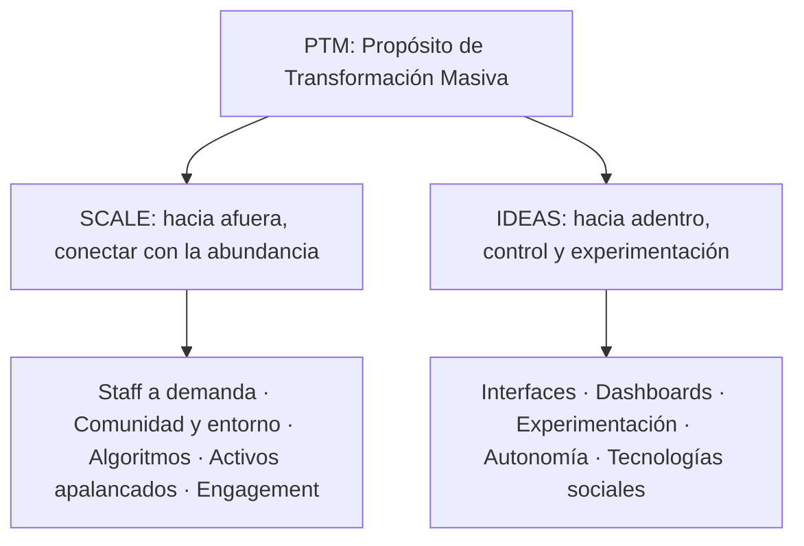

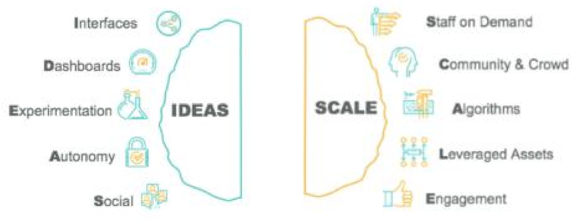

La imagen cinco es la Figura 5 del apunte, el modelo de gestión de las organizaciones exponenciales. La captura muestra los dos hemisferios con sus cinco atributos cada uno, en inglés. A la izquierda va IDEAS (*Interfaces, Dashboards, Experimentation, Autonomy, Social*); a la derecha va SCALE (*Staff on Demand, Community & Crowd, Algorithms, Leveraged Assets, Engagement*). Fijate que en el dibujo, desde quien mira, IDEAS queda a la izquierda y SCALE a la derecha, y el apunte dice lo mismo: SCALE es el hemisferio derecho e IDEAS el izquierdo. El PTM, que el apunte ubica arriba del cerebro, no está en esta captura.

SCALE, el hemisferio derecho, conexión con la abundancia externa. Cinco letras:

- **S, staff a demanda (*Staff on Demand*):** necesario para tener velocidad, funcionalidad y flexibilidad en un mundo que cambia rápido. **En lugar de tener empleados, ExOs se apalancan con gente externa.**
- **C, comunidad y entorno:**
  - La comunidad es un grupo de individuos apasionados por el PTM e involucrados en las funciones de la organización.
  - El entorno o *crowd* (multitud) es un grupo mayor de individuos con interés pasivo por el PTM, que no están directamente conectados con la organización.
- **A, algoritmos:** a medida que el mundo se llena de datos e información, las ExO se apalancan con algoritmos. Incluyen *machine learning* (aprendizaje automático: sistemas que aprenden de los datos) y *deep learning* (aprendizaje profundo, una variante con redes neuronales) para sacar mejores ideas sobre sus clientes y productos.
- **L, apalancamiento de activos (*Leveraged Assets*):** **No compre todo lo necesario para desarrollar su negocio. Alquile o haga leasing y haga uso de modelos de costo por uso.** El *leasing* es un alquiler con opción de compra. Es la misma lógica del OpEx (gasto operativo) de la unidad cinco.
- **E, compromiso (*Engagement*):** uso de sistemas de reputación digital, gamificación y premios de incentivo para mantener a la comunidad interesada y comprometida. *Gamificación* es usar mecánicas de juego, como puntos y niveles, para motivar.

Las capas de participación son concéntricas.

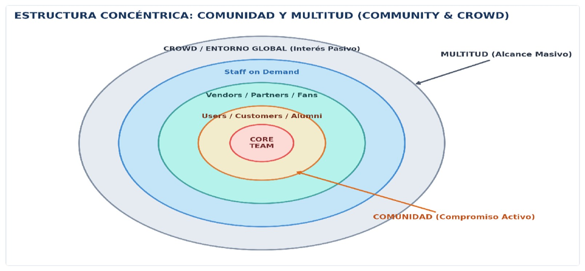

La imagen seis es la Figura 6 del apunte, "Estructura concéntrica: comunidad y multitud (community & crowd)". Son óvalos uno dentro de otro, del centro hacia afuera: *Core Team*; usuarios, clientes y *alumni*; *vendors*, *partners* y *fans*; *Staff on Demand*; y por fuera el *crowd* o entorno global, de interés pasivo. Una flecha naranja marca la comunidad, de compromiso activo, y una flecha gris marca la multitud, de alcance masivo. Traducciones mías: *alumni* son los egresados, *vendors* los proveedores, *partners* los socios y *fans* los seguidores.

Según el texto del apunte:

- **Centro, core team o red personal:** el equipo fundador y los líderes operativos directos.
- **Círculos intermedios, la comunidad:** usuarios activos, clientes fidelizados, egresados (alumni), proveedores estratégicos, socios y staff a demanda. Tienen alta identificación emocional y operativa con el PTM.
- **Anillo exterior, el entorno o crowd:** la multitud global con interés pasivo o potencial en la solución, que se alcanza masivamente por canales digitales.

IDEAS, el hemisferio izquierdo, organización y estabilidad interna. También cinco letras:

- **I, interfaces:** cuando se implementan las externalidades (SCALE), las ExO usan interfaces para conectar la abundancia con la organización interna, con software y *workflows* (flujos de trabajo), con UI/UX. UI es *User Interface*, la interfaz de usuario; UX es *User Experience*, la experiencia de usuario. Son el puente entre los dos hemisferios.
- **D, dashboards (cuadros de mando):** para medir y administrar el desempeño hace falta un tablero en tiempo real y adaptable, con métricas de la compañía y sus empleados, accesible a todos. Con métricas livianas, los OKR (*Objectives and Key Results*, objetivos y resultados clave: metas simples con indicadores para medirlas; aclaración mía).
- **E, experimentación:** las ExO usan la metodología *Lean Startup* (empresa ajustada: crear, medir y aprender en ciclos cortos; es de Eric Ries) y otras técnicas para experimentar constantemente con nuevas ideas y procesos, permitiendo culturalmente errores y fallas. Los procesos se ajustan con feedback en ciclos rápidos. **Experimentación es el acto de validar sus presunciones antes de realizar una inversión significante.**
- **A, autonomía:** organización plana, con equipos autoorganizados y multidisciplinarios, y autoridad descentralizada.
- **S, tecnologías sociales (*Social*):** herramientas que permiten a la comunidad de empleados, staff a demanda, clientes y otros comunicarse rápido y fácilmente.

Para no mezclarlas: SCALE trae abundancia de afuera; IDEAS la ordena adentro. Y fijate que las dos tienen una E distinta: en SCALE es engagement, en IDEAS es experimentación.

**Lo importante.** SCALE es lo externo y IDEAS es lo interno. En SCALE, la E es engagement; en IDEAS, la E es experimentación. Las interfaces son el puente entre los dos hemisferios.

**Ojo, trampa.** La más repetida: poner experimentación o dashboards del lado de SCALE, o staff a demanda del lado de IDEAS. Y los activos apalancados no son comprar activos: son alquilar, hacer leasing y pagar por uso.

## ExO Sprint: el Sprint uno

El ExO Sprint, o LaunchPad (plataforma de lanzamiento), es **una metodología para ayudar a emprendedores a transformar su Startup en una ExO (Exponential Organization) exitosa**. Es un proceso iterativo: puede aplicarse múltiples veces y se basa en metodologías y experiencias validadas, para comprobar y mejorar todos los aspectos clave de un nuevo emprendimiento.

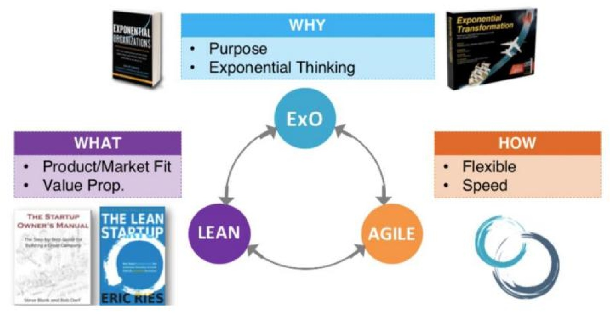

La imagen siete es la figura de la metodología ExO Sprint. El apunte no tiene un texto que la explique, así que esta lectura es mía, a partir de la propia figura. Muestra tres círculos conectados entre sí, ExO, Lean y Agile, cada uno con una pregunta:

- **WHY (por qué), ExO:** propósito (*Purpose*) y pensamiento exponencial (*Exponential Thinking*). Acompañan dos libros sobre organizaciones y transformación exponencial.
- **WHAT (qué), Lean:** encaje producto-mercado (*Product/Market Fit*) y propuesta de valor (*Value Prop.*). Acompañan *The Startup Owner's Manual* y *The Lean Startup*, de Eric Ries.
- **HOW (cómo), Agile:** flexibilidad (*Flexible*) y velocidad (*Speed*).

Lo que importa de la figura: el ExO Sprint combina tres miradas, el propósito exponencial, el método lean para validar producto y mercado, y la agilidad para ejecutar rápido.

El Sprint uno, según el apunte, ejecuta ocho actividades sistemáticas. Conviene saberlas en orden:

- **Uno:** definir el Propósito de Transformación Masiva (PTM), el propósito aspiracional más alto de la organización, que conecta con la abundancia y captura el corazón y la mente del ecosistema.
- **Dos:** construir el Team Canvas. El Team Canvas Basic es una herramienta para alinear al equipo fundador en roles, valores comunes, objetivos y reglas de funcionamiento.
- **Tres:** definir los tipos de mercado.
- **Cuatro:** identificar la abundancia, o sea conectar con las fuentes de abundancia que generan las tecnologías exponenciales: datos masivos, sensores, talento distribuido y activos ociosos.
- **Cinco:** definir el modelo de negocio, con el Business Model Canvas.
- **Seis:** el lienzo de propuesta de valor, el Value Proposition Canvas.
- **Siete:** realizar una demo.
- **Ocho:** definir las métricas del problema.

Los tipos de mercado son cinco, y cada uno se reconoce por una pregunta del apunte:

- **Mercado existente:** ¿existe un mercado consolidado y bien definido, con muchos clientes? ¿Los clientes conocen el nombre del mercado y hay competencia? ¿El nuevo producto tiene una ventaja sobre los competidores, sea en rendimiento, prestaciones o servicio?
- **Mercado vuelto a segmentar, estrategia de nicho:** ¿algunos clientes de un mercado que ya existe quieren comprar un producto diseñado especialmente para sus necesidades? ¿Incluso aunque cueste más? ¿Incluso aunque sea peor en algún aspecto que a ellos no les importa?
- **Mercado vuelto a segmentar, nicho de bajo costo:** ¿hay clientes en el extremo inferior de un mercado que ya existe que comprarían un producto "lo suficientemente bueno" si lo consiguieran a un precio sustancialmente más bajo?
- **Mercado nuevo:** sin un mercado establecido y bien definido, es evidente que no hay clientes ni competidores existentes.
- **Mercado clon:** ¿se puede adoptar, tomar prestado o copiar un modelo de negocio exitoso de Estados Unidos y adaptarlo al idioma y a las preferencias de compra locales?

**Lo importante.** Ocho actividades en orden: PTM, Team Canvas, tipos de mercado, abundancia, modelo de negocio, propuesta de valor, demo y métricas. Cinco tipos de mercado: existente, nicho, bajo costo, nuevo y clon.

**Ojo, trampa.** Primero va el PTM, después el equipo, no al revés, y la demo y las métricas van al final, no al principio. El resegmentado de nicho paga más por algo a medida; el de bajo costo busca algo suficientemente bueno y más barato.

## Business Model Canvas y propuesta de valor

Un canvas (lienzo) es una hoja de trabajo con casilleros que se completan. El apunte cita la definición: **un modelo de negocio es una simplificación que describe racionalmente cómo una organización crea, distribuye y captura valor**. Es de Alexander Osterwalder.

El Business Model Canvas (BMC) tiene nueve bloques interdependientes, y cada uno guía su diseño con preguntas clave.

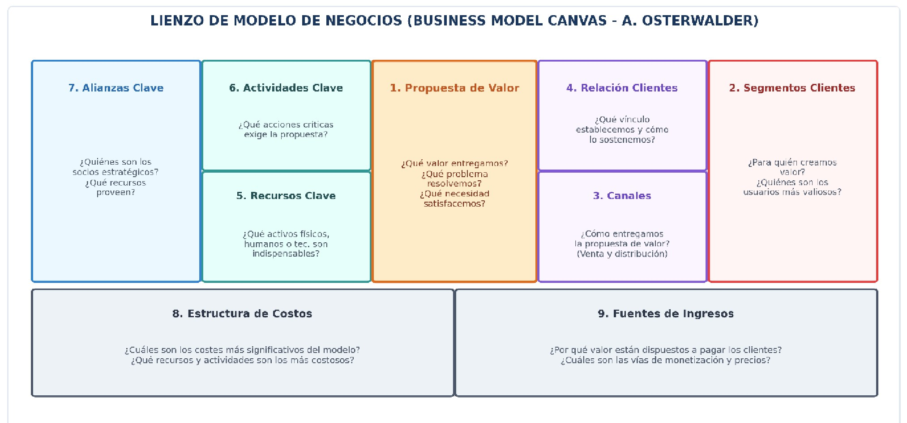

La imagen ocho es la Figura 8 del apunte, "Lienzo de modelo de negocios (Business Model Canvas, A. Osterwalder)". Los bloques están numerados como en el apunte: arriba, de izquierda a derecha, alianzas clave (siete), actividades clave (seis) sobre recursos clave (cinco), propuesta de valor (uno), relación con clientes (cuatro) sobre canales (tres), y segmentos de clientes (dos). Abajo, estructura de costos (ocho) y fuentes de ingresos (nueve). La numeración es la del apunte, no el orden en que se llena el canvas.

Los nueve bloques, con las preguntas del apunte:

- **Uno, propuesta de valor:** ¿qué valor ofrecemos a nuestros clientes? ¿Qué ayudamos a resolver? ¿Qué necesidad cubrimos?
- **Dos, segmento de clientes:** ¿para quiénes creamos valor? ¿Quiénes son nuestros clientes más importantes?
- **Tres, canales de comunicación y distribución:** ¿cómo distribuyo mi propuesta de valor? ¿Cómo llego al segmento ahora? ¿Cuáles canales funcionan mejor? ¿A través de qué canales quieren los clientes que accedamos a ellos?
- **Cuatro, relación con los clientes:** ¿qué tipo de relación esperan los clientes? ¿Qué relaciones establecimos? ¿Cómo se integra con el resto del modelo?
- **Cinco, recursos claves:** ¿qué recursos requiere nuestra propuesta de valor? ¿Y los canales? ¿Y la relación con los clientes?
- **Seis, actividades claves:** ¿qué actividades requiere nuestra propuesta de valor? ¿Y los canales? ¿Y la relación con los clientes?
- **Siete, alianzas claves:** ¿quiénes son nuestros aliados o proveedores clave? ¿Qué recursos estratégicos estamos adquiriendo? ¿Qué actividades clave desarrollan nuestros aliados?
- **Ocho, estructura de costos:** ¿cuáles son los costos más importantes? ¿Cuáles son los recursos y las actividades clave más costosos?
- **Nueve, fuente de ingresos:** ¿por dónde se generan los ingresos? ¿Cómo? ¿Por qué se paga?

Un truco para leerlo, que es mío y no del apunte:

- El lado derecho, con segmento, canales, relación e ingresos, es el cliente y la plata que entra.
- El lado izquierdo, con recursos, actividades, alianzas y costos, es la operación y la plata que sale.
- La propuesta de valor está en el medio y une todo.

Después viene el Value Proposition Canvas (VPC), el lienzo de la propuesta de valor. Es una herramienta para analizar la relación entre las necesidades, problemas y deseos del cliente y la propuesta de valor del emprendimiento. Hace zoom en dos bloques del canvas, la propuesta de valor y el segmento de clientes, y evalúa el **encaje (FIT)** entre el valor que se intenta crear y las expectativas del cliente.

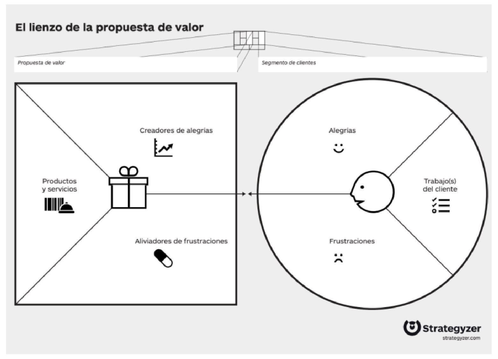

La imagen nueve es el lienzo de la propuesta de valor, de Strategyzer (la empresa de Osterwalder; el nombre está en la propia figura). A la izquierda, un cuadrado con tres zonas: productos y servicios, creadores de alegrías y aliviadores de frustraciones. A la derecha, un círculo con tres zonas: trabajo(s) del cliente, alegrías y frustraciones. Una flecha de doble punta une los dos lados: ese vínculo es el fit. Ojo con los nombres: la figura dice "frustraciones" y "alegrías" donde el texto dice "dolores" y "ganancias". Es lo mismo.

Los dos lados:

- **Perfil del cliente** (a la derecha, el círculo):
  - **Trabajos (*Jobs*):** lo que el cliente intenta hacer, resolver o conseguir en su vida cotidiana o laboral. Pueden ser tareas funcionales, sociales o emocionales. Ejemplo del apunte: "Gestionar el stock de su comercio".
  - **Dolores (*Pains*), frustraciones:** problemas, dificultades, frustraciones, riesgos o costos que aparecen al hacer esos trabajos. Ejemplo: "Pierde tiempo controlando el stock manualmente".
  - **Ganancias (*Gains*), alegrías:** beneficios, resultados o mejoras que el cliente espera obtener. Ejemplo: "Tener información actualizada del stock en tiempo real".
- **Mapa de valor** (a la izquierda, el cuadrado):
  - **Productos y servicios:** las soluciones concretas que ofrece el emprendimiento. Ejemplo: "Plataforma de gestión de stock con IA".
  - **Aliviadores de dolores (*Pain Relievers*):** cómo la solución reduce o elimina los dolores identificados. Ejemplo: "Alertas automáticas de faltantes".
  - **Creadores de ganancias (*Gain Creators*):** cómo la solución genera los beneficios que el cliente espera.

Hay fit cuando cada dolor importante tiene su aliviador y cada ganancia esperada tiene su creador. Esa definición de fit es una síntesis mía de lo que describe el apunte.

**Lo importante.** El canvas tiene nueve bloques: cliente e ingresos a la derecha, operación y costos a la izquierda, y la propuesta de valor en el medio. El fit se da cuando dolores y ganancias tienen aliviadores y creadores.

**Ojo, trampa.** Los aliviadores resuelven dolores, y los creadores generan ganancias: no los cruces. Y las alianzas clave son un bloque del lado de la operación, no del cliente.

## Demo y métricas del problema

La demo tiene un objetivo principal: ayudar a los clientes a visualizar la solución y validar que va a resolver su problema. Según el tipo de producto:

- **Software:** las maquetas y los videos son una excelente manera de demostrar la solución que se pretende.
- **Productos físicos:** bocetos, modelos de diseño asistido por computadora (CAD, *Computer-Aided Design*) o incluso prototipos rápidos hechos con arcilla o impresión 3D.
- **En ambos casos:** se puede hacer una *landing page* (una página web de aterrizaje, pensada para presentar una sola propuesta) como demo.

Las pautas fundamentales para la demo:

- La demostración debe ser realizable.
- La demostración tiene que parecer real.
- La demostración necesita minimizar el desperdicio.
- La demostración necesita usar datos de aspecto real.

Las métricas del problema: se deben definir cuáles se van a usar y qué valores tienen que alcanzar como objetivo para dar por validada la etapa de problema y solución. El ejemplo del apunte: **cantidad de entrevistas de problema a realizar (mínimo diez) y resultado esperado de éxito (ochenta por ciento comparte el problema).**

**Lo importante.** La demo permite que el cliente visualice la solución. Las métricas definen cuándo se da por validado el problema: por ejemplo, diez entrevistas con ochenta por ciento de coincidencia.

**Ojo, trampa.** La demo no es el producto terminado: es una maqueta que parece real y es realizable. Y las métricas se fijan antes de ver los resultados, no después.

## Ejemplo resuelto: el Sprint uno aplicado a un emprendimiento

Este es un caso inventado por mí, armado con los ejemplos que usa el propio apunte, sobre gestión de stock con IA.

Un grupo de estudiantes de sistemas trabaja en distribuidoras y ve que los almacenes de barrio controlan el stock a mano. Recorramos el Sprint uno:

- **Paso cero, ¿es idea u oportunidad?** Chequeamos las tres condiciones.
  - Factibilidad: sí, con una app móvil, un lector de código de barras con la cámara y un modelo de predicción simple.
  - Creación de valor: el almacenero pierde horas contando y se queda sin productos que se venden.
  - Predisposición a pagar: no lo sabemos todavía. Eso lo tiene que validar el paso ocho.
  - El origen es una oportunidad a pocos metros, un dolor en un proceso cotidiano, que nace de la experiencia previa de los fundadores, justo lo que dice el mito uno.
- **Paso uno, el PTM:** "que ningún comercio de barrio pierda una venta por no saber qué tiene". Es corto, apunta a un problema enorme, miles de comercios, y da un poco de vértigo, como pide el apunte.
- **Paso dos, el Team Canvas:**
  - Equipo: dos desarrolladores, uno de datos y uno comercial, el que trabaja en la distribuidora.
  - Valores: hablar con clientes cada semana.
  - Reglas: decisiones con datos.
- **Paso tres, el tipo de mercado:** ya existen sistemas de gestión de stock, pero son caros y complejos para un almacén. Es un mercado resegmentado de bajo costo: algo suficientemente bueno, mucho más barato y simple.
- **Paso cuatro, la abundancia:**
  - Celulares con cámara que todos tienen.
  - Nube que se paga por uso, que son activos apalancados.
  - Los datos de ventas que el propio comercio genera, que alimentan los algoritmos.
- **Paso cinco, el Business Model Canvas:**
  - Propuesta de valor: saber el stock en tiempo real y recibir alertas antes de quedarse sin un producto.
  - Segmento: almacenes y minimercados de barrio.
  - Canales: preventistas de distribuidoras, redes sociales y tienda de apps.
  - Relación: autoservicio y soporte por WhatsApp.
  - Recursos clave: la app, el modelo de predicción y el catálogo de códigos de barras.
  - Actividades clave: desarrollo, mantenimiento del catálogo y soporte.
  - Alianzas: distribuidoras mayoristas, a las que les interesa que sus clientes no se queden sin stock.
  - Costos: desarrolladores, nube y marketing.
  - Ingresos: una suscripción mensual baja por comercio.
- **Paso seis, el Value Proposition Canvas:**
  - Trabajo del cliente: gestionar el stock del comercio. El producto es una app de gestión con IA.
  - Dolor: perder tiempo contando a mano. Aliviador: cargar escaneando con la cámara.
  - Dolor: quedarse sin lo que más vende. Aliviador: alertas automáticas de faltantes.
  - Ganancia: tener información actualizada en tiempo real. Creador: un tablero simple con lo que hay y lo que falta.
- **Paso siete, la demo:** una landing page con un video de la app y una maqueta hecha en Figma (una herramienta de diseño de interfaces), usando productos y precios reales de un almacén. Se hace en una semana, parece real y cuesta casi nada.
- **Paso ocho, las métricas del problema:**
  - Meta: diez entrevistas a almaceneros. Se valida si el ochenta por ciento, ocho de diez, confirma que el control de stock le duele.
  - Para la predisposición a pagar: que al menos la mitad deje su contacto en la landing para una prueba.

¿Y la plata? Estamos en la etapa de concepción: no hace falta capital grande todavía, que es el mito dos. Con ahorro propio o 3F alcanza para la demo. Si las métricas dan bien, recién ahí se busca capital semilla, un ángel o FONSOFT Emprendedores, para el MVP.

**Lo importante.** El Sprint uno es una forma ordenada de validar antes de gastar. Cada herramienta responde una duda distinta: el PTM, para qué; el canvas, cómo se gana plata; el fit, si de verdad le resuelve algo al cliente; la demo y las métricas, si el cliente está de acuerdo.

**Ojo, trampa.** En el ejemplo, la predisposición a pagar queda sin confirmar hasta el paso ocho: no se da por hecha al principio. Y se pide capital semilla recién después de validar las métricas, no antes.

## Cómo se conecta todo

Estas conexiones entre unidades son una síntesis mía, no están en el apunte.

- **Con la unidad cinco, la factibilidad.** La oportunidad de la seis tiene que pasar las mismas tres preguntas.
  - La factibilidad de implementación es la factibilidad técnica.
  - La predisposición a pagar más que el costo es la económica.
  - La validación con clientes cumple el papel de la operativa, o sea, si lo van a usar.
- **Con el OpEx.** Los activos apalancados se conectan con el OpEx: la ExO prefiere alquilar y pagar por uso, igual que pasar a la nube en NovaRetail.
- **Con la gestión ágil.** La experimentación de IDEAS: Lean Startup, iteración y feedback rápido son el mismo espíritu que la gestión ágil de la unidad cinco para proyectos complejos, la matriz de Stacey.
- **Con el monitoreo y control.** Los dashboards: los tableros con OKR son la versión ExO de los informes de avance del director de proyecto.
- **Con los stakeholders.** La comunidad y el crowd: las capas concéntricas, con el core team, la comunidad y el crowd, son otra forma de mirar a los interesados.
- **Con las etapas del capital.** Las etapas de Endeavor:
  - concepción y start-up, con capital semilla;
  - early stage, con financiación temprana;
  - crecimiento y expansión, con capital de expansión.
- **Con los mitos.** El triángulo invertido: si el emprendedor es la base, la idea brillante, el mito uno, y el capital, el mito dos, no alcanzan solos.

**Lo importante.** La oportunidad de la unidad seis pasa por las mismas tres preguntas de la factibilidad de la unidad cinco.

**Ojo, trampa.** No cruces las dos unidades en el vocabulario: el PTM no es el objetivo SMART, y los stakeholders de la cinco no son el crowd de la seis, aunque se parezcan en la idea de mirar a los interesados.

## Preguntas tipo multiple choice

En cada una: las opciones, la correcta, por qué, y dónde está la trampa.

Pregunta uno. ¿Qué dice el apunte sobre el origen de los emprendimientos?

- Primera: la mayoría nace de una idea brillante y original.
- Segunda: el noventa por ciento sale de la experiencia previa del fundador, y el valor está en ejecutar mejor.
- Tercera: nacen del capital disponible.
- Cuarta: dependen de la edad del emprendedor.

La correcta es la segunda. ¿La trampa? La primera, que es justo el mito uno.

Pregunta dos. ¿Qué se hace en la etapa de start-up del modelo Endeavor?

- Primera: se analiza el concepto y se evalúa la oportunidad.
- Segunda: se lanza una estrategia internacional.
- Tercera: se arma el equipo fundador multidisciplinario, el primer plan de negocios y la estructura legal.
- Cuarta: se piensa la salida, el exit o IPO.

La correcta es la tercera. ¿La trampa? La primera, que es la concepción, la etapa anterior.

Pregunta tres. ¿Qué capa del perfil del emprendedor no se puede modificar?

- Primera: los talentos, el núcleo.
- Segunda: los hábitos técnicos.
- Tercera: las meta-habilidades.
- Cuarta: ninguna, todo se aprende.

La correcta es la primera. ¿La trampa? La cuarta, y la tercera: las meta-habilidades son la zona gris, que se desarrolla con tiempo y mentoría.

Pregunta cuatro. ¿Qué dice el triángulo invertido?

- Primera: que el capital es lo único que sostiene el proyecto.
- Segunda: que la idea es la base del emprendimiento.
- Tercera: que el proyecto y el capital descansan sobre el emprendedor y su equipo, que son la base.
- Cuarta: que el emprendedor solo importa en la etapa de concepción.

La correcta es la tercera. ¿La trampa? La segunda, que pone la idea como base.

Pregunta cinco. Un emprendedor monta un negocio porque no encontró trabajo formal. ¿Qué tipo es?

- Primera: gladiador.
- Segunda: caza-olas.
- Tercera: inversor ángel.
- Cuarta: luchador.

La correcta es la cuarta. ¿La trampa? La segunda: el caza-olas se sube a una moda para ganar rápido, y el gladiador emprende por vocación.

Pregunta seis. Una idea es factible y crea valor, pero no se sabe si los clientes pagarían más de lo que cuesta proveerla. ¿Qué es?

- Primera: todavía solo una idea, porque falta una de las tres condiciones.
- Segunda: una oportunidad, porque tiene dos de tres.
- Tercera: un mercado nuevo.
- Cuarta: un modelo clon.

La correcta es la primera. ¿La trampa? La segunda: hacen falta las tres condiciones juntas.

Pregunta siete. Un inversor aporta plata propia en una etapa temprana y además experiencia y contactos. ¿Cómo se lo llama?

- Primera: fondo de private equity.
- Segunda: inversor ángel, que aporta smart money.
- Tercera: capital de riesgo.
- Cuarta: crédito blando del Estado.

La correcta es la segunda. ¿La trampa? La tercera: el venture capital es un fondo profesional que invierte a cambio de acciones, esperando más del treinta y cinco por ciento anual.

Pregunta ocho. ¿Con qué autor se asocia la pirámide de la abundancia?

- Primera: Klaus Schwab.
- Segunda: Salim Ismail.
- Tercera: Osterwalder.
- Cuarta: Peter Diamandis.

La correcta es la cuarta. ¿La trampa? La segunda: Ismail define la arquitectura de las organizaciones exponenciales, y Schwab es la Cuarta Revolución Industrial.

Pregunta nueve. ¿Qué es una organización exponencial?

- Primera: una organización cuyo impacto es al menos diez veces el de una tradicional de su industria, apoyada en tecnología y activos externos.
- Segunda: una organización que tiene el doble de empleados.
- Tercera: una que crece solo con capital de riesgo.
- Cuarta: cualquier startup tecnológica.

La correcta es la primera. ¿La trampa? La cuarta: no toda startup es una ExO.

Pregunta diez. En el cerebro ExO, ¿qué letra E corresponde a SCALE?

- Primera: experimentación.
- Segunda: engagement, el compromiso de la comunidad.
- Tercera: ecosistema.
- Cuarta: eficiencia.

La correcta es la segunda. ¿La trampa? La primera: la experimentación es la E de IDEAS.

Pregunta once. ¿Cuál de estos atributos es de IDEAS, el hemisferio interno?

- Primera: staff a demanda.
- Segunda: activos apalancados.
- Tercera: comunidad y entorno.
- Cuarta: dashboards.

La correcta es la cuarta. ¿La trampa? Las otras tres son de SCALE, el hemisferio externo.

Pregunta doce. ¿Cuál es el orden correcto del comienzo del Sprint uno?

- Primera: PTM, Team Canvas, tipos de mercado, identificar abundancia.
- Segunda: modelo de negocio, PTM, Team Canvas, demo.
- Tercera: demo, métricas, PTM, tipos de mercado.
- Cuarta: tipos de mercado, PTM, abundancia, Team Canvas.

La correcta es la primera. ¿La trampa? La tercera: la demo y las métricas van al final del Sprint uno.

Pregunta trece. Unos clientes comprarían algo suficientemente bueno pero mucho más barato que lo que hay en el mercado. ¿Qué tipo de mercado es?

- Primera: resegmentado de nicho.
- Segunda: clon.
- Tercera: resegmentado de bajo costo.
- Cuarta: nuevo.

La correcta es la tercera. ¿La trampa? La primera: el nicho es para clientes que quieren algo hecho a su medida, aunque cueste más.

Pregunta catorce. En el Value Proposition Canvas, el cliente se queda sin el producto que más vende. ¿Qué elemento del mapa de valor responde a ese dolor?

- Primera: un creador de ganancias.
- Segunda: un aliviador de dolores.
- Tercera: un trabajo del cliente.
- Cuarta: un recurso clave.

La correcta es la segunda: el dolor tiene un aliviador. ¿La trampa? La primera: los creadores de ganancias responden a las ganancias esperadas, no a los dolores.

Pregunta quince. Según la conclusión operativa del apunte, ¿qué es lo verdaderamente determinante en el proceso emprendedor?

- Primera: tener una idea que nadie pensó antes.
- Segunda: reunir una gran suma de capital desde el principio.
- Tercera: ser joven.
- Cuarta: el coraje, la convicción y la disciplina metódica para validar y ejecutar la visión.

La correcta es la cuarta. ¿La trampa? La primera y la segunda: son justo los mitos uno y dos.

Pregunta dieciséis. Una ExO aplica el atributo de activos apalancados. ¿Qué hace?

- Primera: alquila, hace leasing y paga por uso.
- Segunda: compra todo lo necesario para desarrollar su negocio.
- Tercera: contrata empleados de planta para cada función.
- Cuarta: replica su modelo operativo en nuevos mercados.

La correcta es la primera. ¿La trampa? La segunda: es exactamente lo contrario de lo que pide el apunte.

Pregunta diecisiete. En la pirámide de la abundancia de Diamandis, ¿qué hay en el nivel dos, el de los habilitadores de crecimiento?

- Primera: alimento, agua potable y refugio.
- Segunda: salud y libertad.
- Tercera: energía, educación, acceso a la información y telecomunicaciones.
- Cuarta: capital semilla y venture capital.

La correcta es la tercera. ¿La trampa? La primera y la segunda: son el nivel uno, la base, y el nivel tres, la cima.

Pregunta dieciocho. En la estructura concéntrica de una ExO, ¿quiénes forman el anillo exterior, el crowd?

- Primera: el core team.
- Segunda: la multitud global con interés pasivo o potencial en la solución, alcanzable por canales digitales.
- Tercera: los clientes fidelizados y los socios.
- Cuarta: el staff a demanda.

La correcta es la segunda. ¿La trampa? La tercera y la cuarta: son parte de la comunidad, en los círculos intermedios, con alto compromiso.

## Lo que puede entrar en desarrollo

Cuatro temas posibles. En cada uno, lo que te pueden pedir:

- **Tema uno, el emprendedor:**
  - Definir emprendedor tecnológico y proceso emprendedor.
  - Explicar los tres mitos.
  - Nombrar y describir las seis etapas de Endeavor.
  - Decir qué significa cada letra de EMPRENDEDOR.
  - Las tres capas del perfil y cuáles se pueden aprender.
  - El triángulo invertido.
  - Luchadores, caza-olas y gladiadores.
- **Tema dos, oportunidades y financiamiento:**
  - Cuándo una idea es una oportunidad, con las tres condiciones.
  - Oportunidades a nivel macro y micro.
  - Etapas del capital y fuentes de financiamiento, y qué es el smart money.
- **Tema tres, organizaciones exponenciales:**
  - Qué aportan Schwab, Diamandis e Ismail, y qué hay en cada nivel de la pirámide de la abundancia.
  - Qué es una ExO.
  - Qué es el PTM y qué características tiene.
  - Explicar SCALE e IDEAS y cuál es externo y cuál interno.
  - Las capas de participación: core team, comunidad y crowd.
- **Tema cuatro, el Sprint uno:**
  - Nombrar las ocho actividades.
  - Explicar los tipos de mercado.
  - Nombrar los nueve bloques del Business Model Canvas.
  - Explicar el Value Proposition Canvas y qué es el fit.
  - Qué reglas tiene una buena demo y qué son las métricas del problema.

## Lo mínimo que te tenés que llevar

- El emprendedor detecta una oportunidad vacante y crea una organización. Los mitos son falsos: ni idea brillante, ni mucha plata, ni edad. El noventa por ciento sale de la experiencia previa.
- Las seis etapas de Endeavor son concepción, start-up, early stage, crecimiento, expansión y madurez.
- El perfil tiene tres capas: hábitos técnicos, meta-habilidades y talentos, y solo el núcleo no se modifica. El emprendedor es la base del triángulo invertido.
- Una idea es oportunidad cuando es factible, crea valor y los clientes pagan más de lo que cuesta.
- Se financia con capital semilla, temprano y de expansión: 3F y ángeles al principio, venture capital después, private equity para las consolidadas, y el Estado en cualquier momento.
- Una ExO tiene impacto de diez veces o más, con el PTM en el centro, SCALE hacia afuera e IDEAS hacia adentro. En SCALE la E es engagement, y en IDEAS, experimentación.
- El Sprint uno tiene ocho actividades: PTM, Team Canvas, tipos de mercado, abundancia, modelo de negocio, propuesta de valor, demo y métricas. Y todo sirve para lo mismo: validar antes de gastar.
