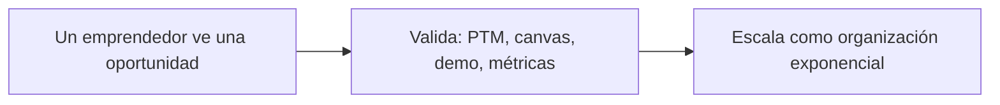
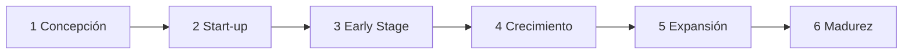
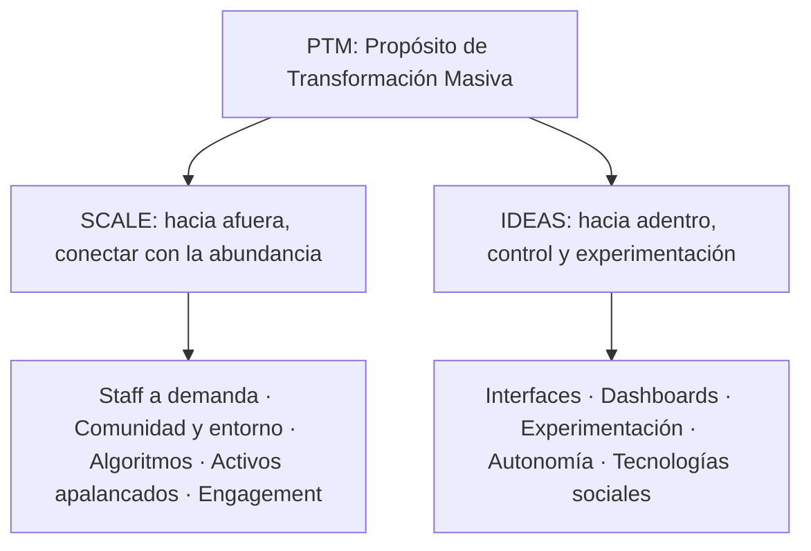

# Unidad 6. Emprendimientos

[TOC]

Vamos con la unidad seis, emprendimientos.

Si la unidad cinco contaba cómo una organización que ya existe encara un cambio, la seis cuenta cómo nace una organización nueva alrededor de una oportunidad tecnológica. Tiene tres bloques. El emprendedor tecnológico: quién es, qué etapas atraviesa y cómo se financia. Las organizaciones exponenciales: empresas con un impacto diez veces mayor, apalancadas en tecnología y en recursos externos. Y una metodología, el ExO Sprint, que da los pasos concretos para validar un emprendimiento.

El recorrido, en un dibujo:

Si te llevás cuatro ideas, que sean estas.

La primera: una idea no es una oportunidad. Para que haya oportunidad tienen que darse tres condiciones juntas: que se pueda hacer, que cree valor y que los clientes paguen más de lo que cuesta.

La segunda: los tres mitos son falsos. No hace falta una idea brillante, ni mucha plata, ni una edad especial.

La tercera: una organización exponencial tiene un propósito en el centro, el PTM, y dos hemisferios: SCALE, que mira hacia afuera, e IDEAS, que mira hacia adentro.

Y la cuarta: el Sprint uno sirve para validar antes de gastar, con ocho actividades en orden.

Y una advertencia sobre cómo está armado el repaso. Cada tema termina con dos cosas: "Lo importante", que es lo que tenés que poder decir de memoria, y "Ojo, trampa", que son las confusiones donde más se cae. Al final hay catorce preguntas tipo multiple choice, con la opción correcta y dónde está la trampa.

Una aclaración sobre las figuras. Las del apunte son imágenes y no se ven en el texto: acá están reconstruidas a partir de lo que el apunte describe.

## El emprendedor tecnológico y el proceso emprendedor

Un emprendedor tecnológico es una persona que detecta una oportunidad vacante en el entorno y crea una organización, o la compra, o entra al equipo fundador, para aprovecharla. Junta recursos humanos, técnicos y financieros para generar valor y transformar el mercado.

El proceso emprendedor es todo el camino: detectar la oportunidad, concebir la empresa, lanzarla, consolidarla y escalarla.

Ahora, los tres mitos que hay que desarmar. Preguntan mucho.

El primero: "necesito una idea brillante". Falso. El noventa por ciento de los emprendimientos sale de la experiencia previa del fundador. El valor está en ejecutar mejor, no en ser original.

El segundo: "necesito mucha plata". Falso. El capital es consecuencia de un proyecto validado y un buen equipo, no un requisito previo.

Y el tercero: "soy muy joven o muy grande". Falso. Depende de las competencias, la convicción y el método, no de la edad.

La conclusión del apunte: lo que decide es el coraje, la convicción y la disciplina para validar y ejecutar.

**Lo importante.** El emprendedor detecta una oportunidad vacante y crea una organización para aprovecharla. Los tres mitos son falsos: idea brillante, mucha plata y edad.

**Ojo, trampa.** Si una opción dice que el capital es el punto de partida del emprendimiento, está al revés: el capital es consecuencia de un proyecto validado. Y el noventa por ciento sale de la experiencia previa, no de una idea original.

## Las seis etapas del modelo Endeavor

La primera es la concepción: se analiza el concepto, se evalúa la oportunidad y se valida la factibilidad tecnológica y comercial.

La segunda es la start-up: se arma el equipo fundador multidisciplinario, el primer plan de negocios y la estructura legal.

La tercera es el early stage: empiezan las operaciones, se lanza el MVP, se ajusta el modelo y llegan los primeros clientes y proveedores.

La cuarta es el crecimiento: canales formales de venta, plataformas robustas, desarrollo comercial y administrativo.

La quinta es la expansión: una estrategia de escala regional o internacional, replicando el modelo en nuevos mercados.

Y la sexta es la madurez: nuevas líneas de negocio, diversificación, o la salida, que en inglés se llama exit o IPO.

La idea de fondo: el foco va pasando de validar lo técnico a operar bien, y después a expandirse. Es como criar a un hijo: primero lo cuidás, después le armás su rutina, y al final lo dejás salir solo.

Ojo con el plan de negocios. El índice del apunte nombra como temas "El Plan de Negocios de una Empresa Tecnológica: Metodología Completa" y "Transformación Digital. Tecnologías exponenciales", pero el texto no los desarrolla: el plan de negocios solo aparece como tarea de la etapa de start-up, y las tecnologías exponenciales solo con la definición de Diamandis. Si en clase los dieron aparte, conviene repasarlos de tus apuntes.

**Lo importante.** Seis etapas en orden: concepción, start-up, early stage, crecimiento, expansión y madurez. El MVP se lanza en el early stage.

**Ojo, trampa.** No mezcles el orden: la estructura legal y el equipo fundador son de la start-up, no de la concepción. Y la salida, el exit o IPO, es de la madurez.

## Perfil del emprendedor: el acrónimo y las tres capas

El acrónimo EMPRENDEDOR, con una letra por actitud.

La E es emancipación: buscar autonomía y libertad para concretar lo propio. La M es moderación en la ambición del dinero: la plata es consecuencia del valor, no el fin. La P es pasión: la energía para bancarse los obstáculos. La R es resultados: orientación a metas medibles. La E es espiritualidad: valores, propósito y ética. La N es novicio: humildad para aprender siempre. La D es disfrute del camino: que el proceso también guste, no solo la meta. La E es éxitos compartidos: reconocer al equipo y compartir el crédito. La D es determinación: persistir ante la incertidumbre y las negativas. La O es optimismo y sueños: proyectar futuros mejores y contagiar. Y la R es responsabilidad incondicional: hacerse cargo, nunca jugar a la víctima.

Ahora, las tres capas del perfil, de afuera hacia adentro, según qué tan modificables son.

La capa exterior son los hábitos técnicos: programar, armar presupuestos, metodologías ágiles, marketing digital. Se aprenden estudiando y practicando.

La capa intermedia son las meta-habilidades: liderazgo, negociación, comunicación, tolerancia a la frustración. Es una zona gris: se pueden desarrollar, pero con tiempo, experiencia y mentoría.

Y el núcleo son los talentos: pasión, convicción, intuición, empuje. No se modifican: son la base.

El talento arranca el motor, pero sin las otras dos capas no alcanza para sostener una empresa. Es como un auto con un gran motor y sin ruedas: tiene potencia, pero no te lleva a ningún lado.

**Lo importante.** Tres capas: hábitos técnicos, que se aprenden; meta-habilidades, que se desarrollan con tiempo y mentoría; y talentos, que no se modifican.

**Ojo, trampa.** "Todo lo del perfil se puede aprender" es falso: el núcleo de talentos no se modifica. Y la M del acrónimo es moderación en la ambición del dinero: la plata no es el fin.

## Triángulo invertido y tipos de emprendedores

El triángulo invertido tiene tres vértices. Arriba, el proyecto y el capital. Abajo, como punta de apoyo, el emprendedor con su equipo. El mensaje: ni una gran idea ni mucha plata se sostienen si la base falla. Y al revés: un emprendedor sólido puede reformular el proyecto y conseguir el capital. Es como una pirámide parada de punta: si la punta no aguanta, todo lo de arriba se cae.

Los tipos de emprendedores se distinguen por el motivo por el que emprenden.

Los luchadores emprenden por necesidad, porque no encontraron trabajo formal. Los caza-olas se suben a una moda para ganar rápido, sin compromiso a largo plazo. Y los gladiadores lo llevan en el ADN: emprenden por vocación aunque tengan opciones estables.

**Lo importante.** La base del triángulo es el emprendedor con su equipo. Luchadores, por necesidad; caza-olas, por moda; gladiadores, por vocación.

**Ojo, trampa.** Si te preguntan qué sostiene al emprendimiento, no es el capital ni la idea: es el emprendedor. Y no confundas caza-olas, que van por la moda, con luchadores, que van por necesidad.

## Idea contra oportunidad

Una oportunidad de negocio es un nicho vacante en el mercado. El trabajo del profesional de sistemas es definir bien ese espacio y ver si es lo bastante grande para sostener una empresa rentable.

Tener una idea no es tener una oportunidad. Para que haya oportunidad tienen que darse tres condiciones juntas. Primera, factibilidad de implementación: se puede hacer con la tecnología y las capacidades disponibles. Segunda, creación real de valor: resuelve un dolor importante o da un beneficio concreto. Y tercera, predisposición a pagar: los clientes pagarían bastante más de lo que cuesta proveerlo. Si falta una, es solo una idea.

Las oportunidades nacen en dos niveles. A miles de metros, el nivel macro: saltos tecnológicos como la inteligencia artificial, la nube y la computación cuántica, transformación digital masiva, desregulación y cambios de leyes. Crean industrias nuevas donde todavía no hay competidores fuertes. Y a pocos metros, el nivel micro: cambios de hábitos, dolores y cuellos de botella en procesos, clientes insatisfechos, no consumidores que quedan afuera por costo o complejidad, y crisis sectoriales. Permiten soluciones puntuales y de alto valor percibido.

En la práctica aparecen en el propio trabajo técnico, en la investigación universitaria, hablando con clientes y proveedores, mirando las debilidades de la competencia, en hobbies o transformando modelos que ya existen.

**Lo importante.** Oportunidad es factible, crea valor y la gente paga más de lo que cuesta. Y nace a nivel macro, por saltos tecnológicos, o a nivel micro, por dolores cotidianos.

**Ojo, trampa.** Con dos de las tres condiciones, sigue siendo una idea. Y un no consumidor no es un cliente perdido: es una puerta de oportunidad, a nivel micro.

## Financiamiento: etapas y fuentes

La plata que se necesita cambia con la madurez del proyecto, y hay tres etapas del capital.

El capital semilla, o seed, se usa para investigación, armado del proyecto, prototipo o MVP. La etapa temprana, o early stage, para arrancar a operar, lanzar al mercado y lograr el encaje producto mercado. Y la expansión, o growth, para acelerar, ampliar capacidad, internacionalizar y lograr economías de escala.

Las fuentes, de la más cercana a la más institucional.

Las 3F, friends, family and fools: amigos y familia, por confianza personal. Los inversores ángeles: personas con mucho patrimonio, muchas veces ex emprendedores, que ponen plata propia en etapas tempranas y además aportan experiencia y contactos. Por eso se les dice smart money, plata inteligente. El capital de riesgo, o venture capital: fondos profesionales que invierten en empresas jóvenes de alto potencial a cambio de acciones, esperando retornos de más del treinta y cinco por ciento anual. El private equity: fondos para empresas ya consolidadas que quieren expandirse, comprar otras o reestructurarse. Y el Estado: subsidios y créditos blandos para innovación, como FONTAR, FONSOFT, FONSOFT Emprendedores y SEPyME.

Una forma de ordenarlo: semilla con 3F y ángeles, etapa temprana con ángeles y venture capital, expansión con venture capital y private equity. El Estado puede aparecer en cualquiera.

**Lo importante.** Tres etapas del capital: semilla, temprana y expansión. Los ángeles aportan plata y también experiencia y contactos: smart money. El venture capital va a empresas jóvenes; el private equity, a empresas consolidadas.

**Ojo, trampa.** No confundas venture capital con private equity: uno es para empresas jóvenes de alto potencial, y el otro para empresas ya consolidadas. Y el ángel es de etapa temprana, no de expansión.

## Cuarta Revolución Industrial y abundancia

Tres autores sostienen el marco teórico. Asociá cada uno con una idea.

Klaus Schwab, del Foro Económico Mundial: la Cuarta Revolución Industrial, con velocidad exponencial, convergencia de lo físico, lo digital y lo biológico, y disrupción de los modelos tradicionales.

Peter Diamandis, de la Singularity University y el XPRIZE: las tecnologías exponenciales duplican su capacidad y bajan su costo a intervalos regulares, y eso genera un mundo de abundancia. Su pirámide de la abundancia tiene tres niveles, y la tecnología es lo que permite subir de uno a otro. En la base, las necesidades básicas universales: lo mínimo para sobrevivir, que la tecnología puede democratizar a costo casi nulo, o sea alimento, agua potable y refugio. En el medio, los habilitadores de crecimiento, lo que permite crecer en conocimiento y producción: energía, educación, acceso a la información y telecomunicaciones. Y en la cima, la autorrealización, que se alcanza del todo cuando los de abajo están garantizados: salud y libertad.

Y Salim Ismail: junta todo y define la arquitectura de las organizaciones exponenciales, las ExO.

**Lo importante.** Schwab, la Cuarta Revolución Industrial. Diamandis, tecnologías exponenciales y abundancia, con su pirámide de tres niveles. Ismail, las organizaciones exponenciales.

**Ojo, trampa.** Es una pregunta de asociar nombre con idea, y el error típico es cruzarlos. La pirámide de la abundancia es de Diamandis, y la arquitectura ExO es de Ismail. Y no mezcles los niveles: alimento, agua y refugio están en la base; salud y libertad, en la cima.

## Organizaciones exponenciales y el PTM

Una ExO es una organización cuyo impacto es desproporcionadamente grande, al menos diez veces, el de una organización tradicional de su industria. Lo logra con técnicas organizativas apoyadas en tecnologías de información y activos externos.

En el centro de toda ExO está el Propósito de Transformación Masiva, el PTM: la declaración aspiracional más alta, la que conquista la cabeza y el corazón del equipo y de la comunidad. Tiene que pensar en grande, apuntando a un desafío global. Tiene que conectar con la abundancia, no administrar escasez. Tiene que ser inspirador, corto, claro y memorable. Y tiene que hacernos sentir incómodos: no es un slogan, es el norte que no se negocia.

**Lo importante.** ExO es impacto de al menos diez veces, apoyado en tecnología y activos externos. En el centro está el PTM, que es grande, inspirador y un poco incómodo.

**Ojo, trampa.** El PTM no es un slogan comercial ni una meta cómoda de lograr. Y la ExO no necesita tener más empleados: se apoya en activos externos.

## El cerebro ExO: SCALE e IDEAS

La metáfora es un cerebro. Arriba, el PTM. El hemisferio derecho es SCALE: lo externo, cómo la organización se conecta con la abundancia de afuera. El hemisferio izquierdo es IDEAS: lo interno, cómo controla, experimenta y se mantiene estable.

SCALE, hacia afuera, tiene cinco letras.

La S es staff a demanda: en vez de tener empleados para todo, usar gente externa cuando hace falta. Da velocidad y flexibilidad. La C es comunidad y entorno, el crowd: la comunidad es gente apasionada por el PTM e involucrada, y el entorno es una multitud más grande con interés pasivo, a la que se llega por canales digitales. La A es algoritmos: machine learning y deep learning para entender clientes y productos. La L es activos apalancados: no comprar todo, alquilar, hacer leasing y pagar por uso, lo mismo que el OpEx de la unidad cinco. Y la E es engagement, o compromiso: reputación digital, gamificación y premios para mantener a la comunidad enganchada.

Las capas de participación son concéntricas: en el centro, el core team; en el medio, la comunidad, con usuarios activos, clientes fieles, alumni, proveedores, socios y staff a demanda; y afuera, el crowd.

IDEAS, hacia adentro, también tiene cinco letras.

La I es interfaces: software y flujos, de UI y UX, que conectan lo de afuera con la organización interna. Son el puente. La D es dashboards: tableros en tiempo real, accesibles para todos, con métricas livianas como los OKR. La E es experimentación: Lean Startup, ciclos cortos de feedback y aceptar el error. Experimentar es validar los supuestos antes de invertir fuerte. La A es autonomía: organización plana, equipos autoorganizados y multidisciplinarios, autoridad descentralizada. Y la S es tecnologías sociales: herramientas para que empleados, staff, clientes y comunidad se comuniquen rápido.

Para no mezclarlas: SCALE trae abundancia de afuera; IDEAS la ordena adentro. Y fijate que las dos tienen una E distinta: en SCALE es engagement, en IDEAS es experimentación.

**Lo importante.** SCALE es lo externo y IDEAS es lo interno. En SCALE, la E es engagement; en IDEAS, la E es experimentación. Las interfaces son el puente entre los dos hemisferios.

**Ojo, trampa.** La más repetida: poner experimentación o dashboards del lado de SCALE, o staff a demanda del lado de IDEAS. Y los activos apalancados no son comprar activos: son alquilar, hacer leasing y pagar por uso.

## ExO Sprint: el Sprint uno

El ExO Sprint, o LaunchPad, es una metodología para ayudar a emprendedores a convertir su startup en una ExO. Es iterativa: se puede repetir varias veces para revisar y mejorar todos los aspectos clave del emprendimiento.

El Sprint uno tiene ocho actividades. Conviene saberlas en orden. Una, definir el PTM. Dos, el Team Canvas, para alinear al equipo fundador en roles, valores, objetivos y reglas. Tres, los tipos de mercado. Cuatro, identificar la abundancia: datos masivos, sensores, talento distribuido, activos ociosos. Cinco, el modelo de negocio, con el Business Model Canvas. Seis, el lienzo de propuesta de valor, el Value Proposition Canvas. Siete, la demo. Y ocho, las métricas del problema.

Los tipos de mercado son cinco, y cada uno es una pregunta. El mercado existente: ¿hay un mercado conocido, con nombre y competencia? ¿Mi producto es mejor en algo? El resegmentado de nicho: ¿hay clientes que quieren algo hecho a su medida, aunque cueste más? El resegmentado de bajo costo: ¿hay clientes que comprarían algo suficientemente bueno mucho más barato? El nuevo: no hay mercado definido, ni clientes ni competidores. Y el clon: ¿puedo copiar un modelo exitoso de Estados Unidos y adaptarlo al idioma y los hábitos de compra locales?

Un detalle del nicho que el apunte remarca: esos clientes lo compran aunque cueste más, e incluso aunque sea peor en algún aspecto que a ellos no les importa.

**Lo importante.** Ocho actividades en orden: PTM, Team Canvas, tipos de mercado, abundancia, modelo de negocio, propuesta de valor, demo y métricas. Cinco tipos de mercado: existente, nicho, bajo costo, nuevo y clon.

**Ojo, trampa.** Primero va el PTM, después el equipo, no al revés, y la demo y las métricas van al final, no al principio. El resegmentado de nicho paga más por algo a medida; el de bajo costo busca algo suficientemente bueno y más barato.

## Business Model Canvas y propuesta de valor

Un modelo de negocio, según Osterwalder, es una simplificación que describe cómo una organización crea, distribuye y captura valor. El Business Model Canvas tiene nueve bloques, y cada uno responde una pregunta. Propuesta de valor: ¿qué valor damos y qué problema resolvemos? Segmento de clientes: ¿para quién creamos valor? Canales: ¿cómo llegamos a ellos? Relación con clientes: ¿qué relación esperan? Recursos clave: ¿qué necesitamos tener? Actividades clave: ¿qué tenemos que hacer? Alianzas clave: ¿quiénes son los socios y proveedores clave? Estructura de costos: ¿cuáles son los costos más importantes? Y fuentes de ingreso: ¿por qué y cómo nos pagan?

Un truco para leerlo. El lado derecho, con segmento, canales, relación e ingresos, es el cliente y la plata que entra. El lado izquierdo, con recursos, actividades, alianzas y costos, es la operación y la plata que sale. Y la propuesta de valor está en el medio y une todo.

Después viene el Value Proposition Canvas, que hace zoom en dos bloques del canvas, la propuesta de valor y el segmento, y busca el encaje, el fit. Tiene dos lados. El perfil del cliente, a la derecha, el círculo, con tres elementos: trabajos, lo que intenta hacer, resolver o conseguir, que pueden ser tareas funcionales, sociales o emocionales; dolores, los problemas, frustraciones, riesgos o costos que le aparecen al hacer esos trabajos; y ganancias, los beneficios o mejoras que espera obtener. Y el mapa de valor, a la izquierda, el cuadrado, también con tres: productos y servicios, aliviadores de dolores y creadores de ganancias. Hay fit cuando cada dolor importante tiene su aliviador y cada ganancia esperada tiene su creador.

Ojo con los nombres: en la figura del apunte, que es de Strategyzer, los dolores aparecen como frustraciones y las ganancias como alegrías. Entonces también vas a ver aliviadores de frustraciones y creadores de alegrías. Es lo mismo.

**Lo importante.** El canvas tiene nueve bloques: cliente e ingresos a la derecha, operación y costos a la izquierda, y la propuesta de valor en el medio. El fit se da cuando dolores y ganancias tienen aliviadores y creadores.

**Ojo, trampa.** Los aliviadores resuelven dolores, y los creadores generan ganancias: no los cruces. Y las alianzas clave son un bloque del lado de la operación, no del cliente.

## Demo y métricas del problema

La demo sirve para que el cliente visualice la solución y valide que le resuelve el problema. En software, maquetas o videos; en productos físicos, bocetos, CAD, arcilla o impresión 3D; y en los dos casos sirve una landing page. Tiene cuatro reglas: tiene que ser realizable, parecer real, minimizar el desperdicio y usar datos de aspecto real.

Las métricas del problema definen qué se mide y qué valor hay que alcanzar para dar por validado el par problema solución. El ejemplo del apunte: al menos diez entrevistas de problema y que el ochenta por ciento comparta el problema.

**Lo importante.** La demo permite que el cliente visualice la solución. Las métricas definen cuándo se da por validado el problema: por ejemplo, diez entrevistas con ochenta por ciento de coincidencia.

**Ojo, trampa.** La demo no es el producto terminado: es una maqueta que parece real y es realizable. Y las métricas se fijan antes de ver los resultados, no después.

## Ejemplo resuelto: el Sprint uno aplicado a un emprendimiento

Este es un caso inventado, armado con los ejemplos que usa el propio apunte, sobre gestión de stock con IA.

Un grupo de estudiantes de sistemas trabaja en distribuidoras y ve que los almacenes de barrio controlan el stock a mano. Recorramos el Sprint uno.

Paso cero: ¿es idea u oportunidad? Chequeamos las tres condiciones. Es factible: sí, con una app móvil, un lector de código de barras con la cámara y un modelo de predicción simple. Crea valor: el almacenero pierde horas contando y se queda sin productos que se venden. Y la predisposición a pagar: no lo sabemos todavía. Eso lo tiene que validar el paso ocho. El origen es una oportunidad a pocos metros, un dolor en un proceso cotidiano, que nace de la experiencia previa de los fundadores, justo lo que dice el mito uno.

Paso uno, el PTM: "que ningún comercio de barrio pierda una venta por no saber qué tiene". Es corto, apunta a un problema enorme, miles de comercios, y da un poco de vértigo, como pide el apunte.

Paso dos, el Team Canvas: dos desarrolladores, uno de datos y uno comercial, el que trabaja en la distribuidora. Valores: hablar con clientes cada semana. Reglas: decisiones con datos.

Paso tres, el tipo de mercado. Ya existen sistemas de gestión de stock, pero son caros y complejos para un almacén. Es un mercado resegmentado de bajo costo: algo suficientemente bueno, mucho más barato y simple.

Paso cuatro, la abundancia: celulares con cámara que todos tienen, nube que se paga por uso, que son activos apalancados, y los datos de ventas que el propio comercio genera, que alimentan los algoritmos.

Paso cinco, el Business Model Canvas. La propuesta de valor: saber el stock en tiempo real y recibir alertas antes de quedarse sin un producto. El segmento: almacenes y minimercados de barrio. Los canales: preventistas de distribuidoras, redes sociales y tienda de apps. La relación: autoservicio y soporte por WhatsApp. Los recursos clave: la app, el modelo de predicción y el catálogo de códigos de barras. Las actividades clave: desarrollo, mantenimiento del catálogo y soporte. Las alianzas: distribuidoras mayoristas, a las que les interesa que sus clientes no se queden sin stock. Los costos: desarrolladores, nube y marketing. Y los ingresos: una suscripción mensual baja por comercio.

Paso seis, el Value Proposition Canvas. El trabajo del cliente: gestionar el stock del comercio, y el producto es una app de gestión con IA. El dolor de perder tiempo contando a mano tiene como aliviador la carga escaneando con la cámara. El dolor de quedarse sin lo que más vende tiene como aliviador las alertas automáticas de faltantes. Y la ganancia de tener información actualizada en tiempo real tiene como creador un tablero simple con lo que hay y lo que falta.

Paso siete, la demo: una landing page con un video de la app, una maqueta hecha en Figma, usando productos y precios reales de un almacén. Se hace en una semana, parece real y cuesta casi nada.

Paso ocho, las métricas del problema. La meta: diez entrevistas a almaceneros, y se valida si el ochenta por ciento, ocho de diez, confirma que el control de stock le duele. Y para la predisposición a pagar: que al menos la mitad deje su contacto en la landing para una prueba.

¿Y la plata? Estamos en la etapa de concepción: no hace falta capital grande todavía, que es el mito dos. Con ahorro propio o 3F alcanza para la demo. Si las métricas dan bien, recién ahí se busca capital semilla, un ángel o FONSOFT Emprendedores, para el MVP.

**Lo importante.** El Sprint uno es una forma ordenada de validar antes de gastar. Cada herramienta responde una duda distinta: el PTM, para qué; el canvas, cómo se gana plata; el fit, si de verdad le resuelve algo al cliente; la demo y las métricas, si el cliente está de acuerdo.

**Ojo, trampa.** En el ejemplo, la predisposición a pagar queda sin confirmar hasta el paso ocho: no se da por hecha al principio. Y se pide capital semilla recién después de validar las métricas, no antes.

## Cómo se conecta todo

Con la unidad cinco: la oportunidad de la seis tiene que pasar las mismas tres preguntas que la factibilidad. La factibilidad de implementación es la factibilidad técnica; la predisposición a pagar más que el costo es la económica; y la validación con clientes cumple el papel de la operativa, o sea, si lo van a usar.

Los activos apalancados se conectan con el OpEx: la ExO prefiere alquilar y pagar por uso, igual que pasar a la nube en NovaRetail.

La experimentación de IDEAS se conecta con la gestión ágil: Lean Startup, iteración y feedback rápido son el mismo espíritu que la gestión ágil de la unidad cinco para proyectos complejos, la matriz de Stacey.

Los dashboards se conectan con el monitoreo y control: los tableros con OKR son la versión ExO de los informes de avance del director de proyecto.

La comunidad y el crowd se conectan con los stakeholders: las capas concéntricas, con el core team, la comunidad y el crowd, son otra forma de mirar a los interesados.

Las etapas de Endeavor se conectan con las etapas del capital: concepción y start-up con capital semilla; early stage con financiación temprana; crecimiento y expansión con capital de expansión.

Y el triángulo invertido se conecta con los mitos: si el emprendedor es la base, la idea brillante, el mito uno, y el capital, el mito dos, no alcanzan solos.

**Lo importante.** La oportunidad de la unidad seis pasa por las mismas tres preguntas de la factibilidad de la unidad cinco.

**Ojo, trampa.** No cruces las dos unidades en el vocabulario: el PTM no es el objetivo SMART, y los stakeholders de la cinco no son el crowd de la seis, aunque se parezcan en la idea de mirar a los interesados.

## Preguntas tipo multiple choice

En cada una: las opciones, la correcta, por qué, y dónde está la trampa.

Pregunta uno. ¿Qué dice el apunte sobre el origen de los emprendimientos?

Primera: la mayoría nace de una idea brillante y original. Segunda: el noventa por ciento sale de la experiencia previa del fundador, y el valor está en ejecutar mejor. Tercera: nacen del capital disponible. Cuarta: dependen de la edad del emprendedor.

La correcta es la segunda. ¿La trampa? La primera, que es justo el mito uno.

Pregunta dos. ¿Qué se hace en la etapa de start-up del modelo Endeavor?

Primera: se analiza el concepto y se evalúa la oportunidad. Segunda: se lanza una estrategia internacional. Tercera: se arma el equipo fundador multidisciplinario, el primer plan de negocios y la estructura legal. Cuarta: se piensa la salida, el exit o IPO.

La correcta es la tercera. ¿La trampa? La primera, que es la concepción, la etapa anterior.

Pregunta tres. ¿Qué capa del perfil del emprendedor no se puede modificar?

Primera: los talentos, el núcleo. Segunda: los hábitos técnicos. Tercera: las meta-habilidades. Cuarta: ninguna, todo se aprende.

La correcta es la primera. ¿La trampa? La cuarta, y la tercera: las meta-habilidades son la zona gris, que se desarrolla con tiempo y mentoría.

Pregunta cuatro. ¿Qué dice el triángulo invertido?

Primera: que el capital es lo único que sostiene el proyecto. Segunda: que la idea es la base del emprendimiento. Tercera: que el proyecto y el capital descansan sobre el emprendedor y su equipo, que son la base. Cuarta: que el emprendedor solo importa en la etapa de concepción.

La correcta es la tercera. ¿La trampa? La segunda, que pone la idea como base.

Pregunta cinco. Un emprendedor monta un negocio porque no encontró trabajo formal. ¿Qué tipo es?

Primera: gladiador. Segunda: caza-olas. Tercera: inversor ángel. Cuarta: luchador.

La correcta es la cuarta. ¿La trampa? La segunda: el caza-olas se sube a una moda para ganar rápido, y el gladiador emprende por vocación.

Pregunta seis. Una idea es factible y crea valor, pero no se sabe si los clientes pagarían más de lo que cuesta proveerla. ¿Qué es?

Primera: todavía solo una idea, porque falta una de las tres condiciones. Segunda: una oportunidad, porque tiene dos de tres. Tercera: un mercado nuevo. Cuarta: un modelo clon.

La correcta es la primera. ¿La trampa? La segunda: hacen falta las tres condiciones juntas.

Pregunta siete. Un inversor aporta plata propia en una etapa temprana y además experiencia y contactos. ¿Cómo se lo llama?

Primera: fondo de private equity. Segunda: inversor ángel, que aporta smart money. Tercera: capital de riesgo. Cuarta: crédito blando del Estado.

La correcta es la segunda. ¿La trampa? La tercera: el venture capital es un fondo profesional que invierte a cambio de acciones, esperando más del treinta y cinco por ciento anual.

Pregunta ocho. ¿Con qué autor se asocia la pirámide de la abundancia?

Primera: Klaus Schwab. Segunda: Salim Ismail. Tercera: Osterwalder. Cuarta: Peter Diamandis.

La correcta es la cuarta. ¿La trampa? La segunda: Ismail define la arquitectura de las organizaciones exponenciales, y Schwab es la Cuarta Revolución Industrial.

Pregunta nueve. ¿Qué es una organización exponencial?

Primera: una organización cuyo impacto es al menos diez veces el de una tradicional de su industria, apoyada en tecnología y activos externos. Segunda: una organización que tiene el doble de empleados. Tercera: una que crece solo con capital de riesgo. Cuarta: cualquier startup tecnológica.

La correcta es la primera. ¿La trampa? La cuarta: no toda startup es una ExO.

Pregunta diez. En el cerebro ExO, ¿qué letra E corresponde a SCALE?

Primera: experimentación. Segunda: engagement, el compromiso de la comunidad. Tercera: ecosistema. Cuarta: eficiencia.

La correcta es la segunda. ¿La trampa? La primera: la experimentación es la E de IDEAS.

Pregunta once. ¿Cuál de estos atributos es de IDEAS, el hemisferio interno?

Primera: staff a demanda. Segunda: activos apalancados. Tercera: comunidad y entorno. Cuarta: dashboards.

La correcta es la cuarta. ¿La trampa? Las otras tres son de SCALE, el hemisferio externo.

Pregunta doce. ¿Cuál es el orden correcto del comienzo del Sprint uno?

Primera: PTM, Team Canvas, tipos de mercado, identificar abundancia. Segunda: modelo de negocio, PTM, Team Canvas, demo. Tercera: demo, métricas, PTM, tipos de mercado. Cuarta: tipos de mercado, PTM, abundancia, Team Canvas.

La correcta es la primera. ¿La trampa? La tercera: la demo y las métricas van al final del Sprint uno.

Pregunta trece. Unos clientes comprarían algo suficientemente bueno pero mucho más barato que lo que hay en el mercado. ¿Qué tipo de mercado es?

Primera: resegmentado de nicho. Segunda: clon. Tercera: resegmentado de bajo costo. Cuarta: nuevo.

La correcta es la tercera. ¿La trampa? La primera: el nicho es para clientes que quieren algo hecho a su medida, aunque cueste más.

Pregunta catorce. En el Value Proposition Canvas, el cliente se queda sin el producto que más vende. ¿Qué elemento del mapa de valor responde a ese dolor?

Primera: un creador de ganancias. Segunda: un aliviador de dolores. Tercera: un trabajo del cliente. Cuarta: un recurso clave.

La correcta es la segunda: el dolor tiene un aliviador. ¿La trampa? La primera: los creadores de ganancias responden a las ganancias esperadas, no a los dolores.

## Lo que puede entrar en desarrollo

Tema uno: el emprendedor. Definí emprendedor tecnológico y proceso emprendedor. Explicá los tres mitos. Nombrá y describí las seis etapas de Endeavor. Qué significa cada letra de EMPRENDEDOR. Las tres capas del perfil y cuáles se pueden aprender. El triángulo invertido. Luchadores, caza-olas y gladiadores.

Tema dos: oportunidades y financiamiento. Cuándo una idea es una oportunidad, con las tres condiciones. Oportunidades a nivel macro y micro. Etapas del capital y fuentes de financiamiento, y qué es el smart money.

Tema tres: organizaciones exponenciales. Qué aportan Schwab, Diamandis e Ismail, y qué hay en cada nivel de la pirámide de la abundancia. Qué es una ExO. Qué es el PTM y qué características tiene. Explicar SCALE e IDEAS y cuál es externo y cuál interno.

Tema cuatro: el Sprint uno. Nombrar las ocho actividades. Explicar los tipos de mercado. Nombrar los nueve bloques del Business Model Canvas. Explicar el Value Proposition Canvas y qué es el fit. Qué reglas tiene una buena demo y qué son las métricas del problema.

## Lo mínimo que te tenés que llevar

El emprendedor detecta una oportunidad vacante y crea una organización. Los mitos son falsos: ni idea brillante, ni mucha plata, ni edad. El noventa por ciento sale de la experiencia previa.

Las seis etapas de Endeavor son concepción, start-up, early stage, crecimiento, expansión y madurez. El perfil tiene tres capas: hábitos técnicos, meta-habilidades y talentos, y solo el núcleo no se modifica. El emprendedor es la base del triángulo invertido.

Una idea es oportunidad cuando es factible, crea valor y los clientes pagan más de lo que cuesta. Se financia con capital semilla, temprano y de expansión: 3F y ángeles al principio, venture capital después, private equity para las consolidadas, y el Estado en cualquier momento.

Una ExO tiene impacto de diez veces o más, con el PTM en el centro, SCALE hacia afuera e IDEAS hacia adentro. En SCALE la E es engagement, y en IDEAS, experimentación.

El Sprint uno tiene ocho actividades: PTM, Team Canvas, tipos de mercado, abundancia, modelo de negocio, propuesta de valor, demo y métricas. Y todo sirve para lo mismo: validar antes de gastar.
