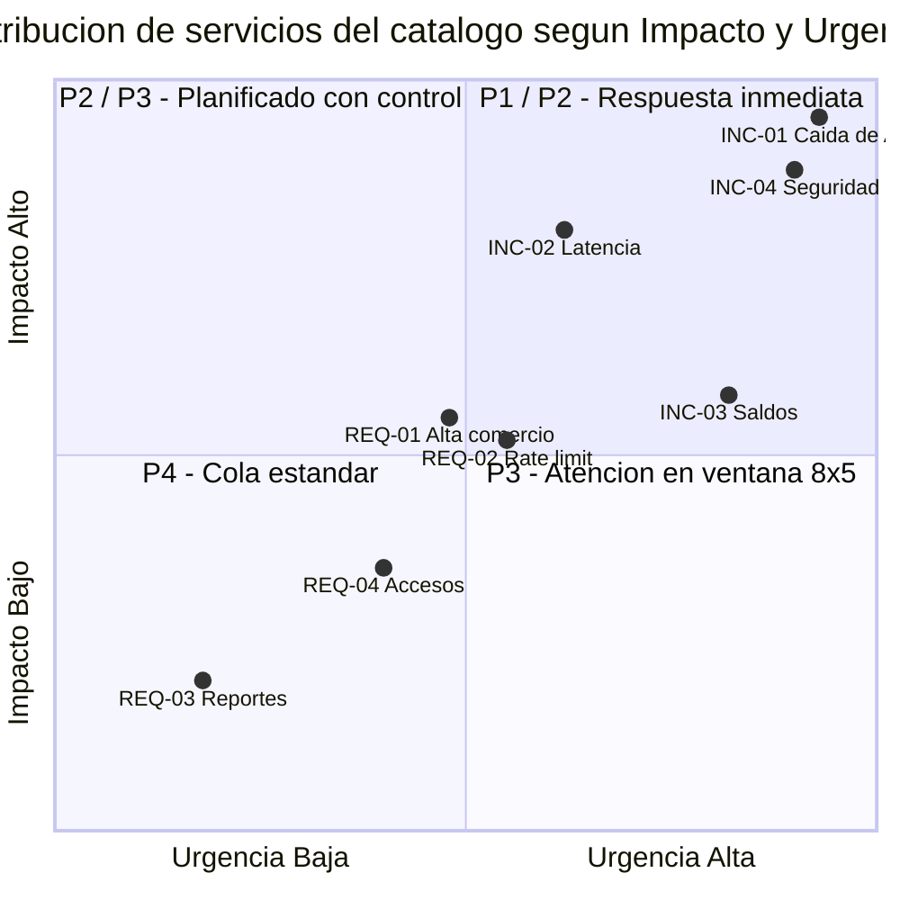
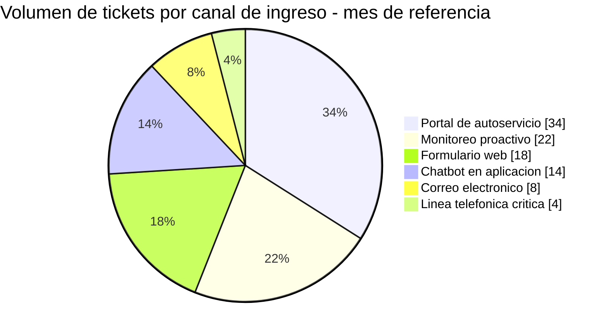
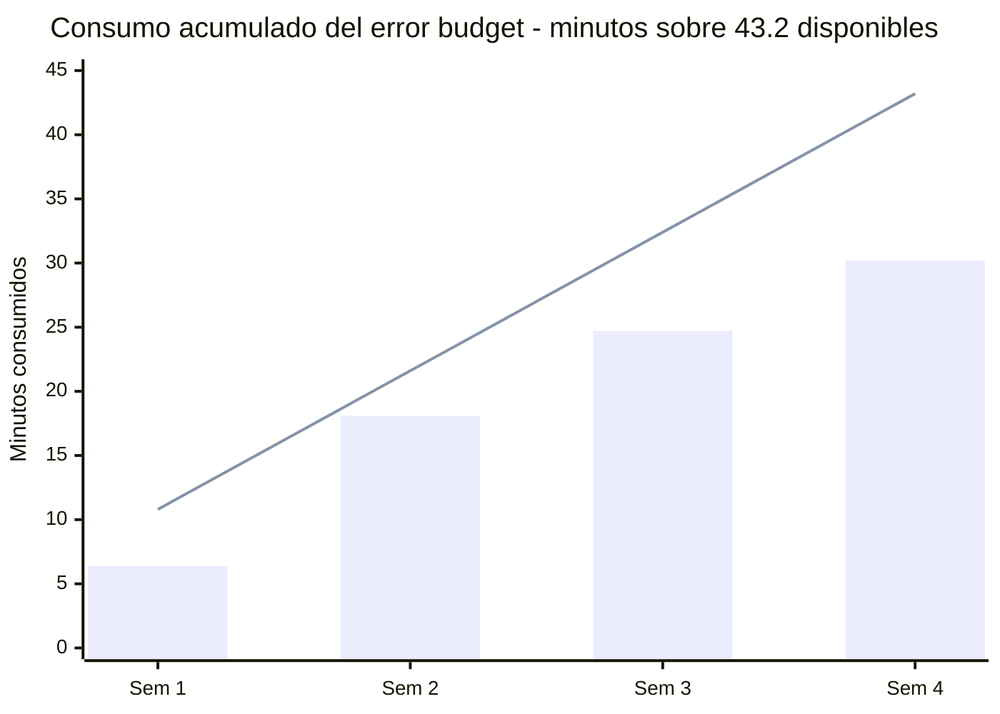
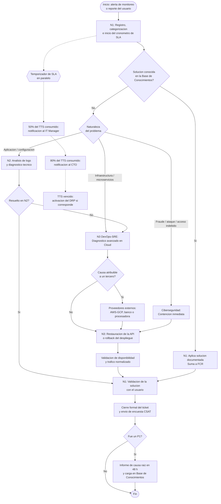
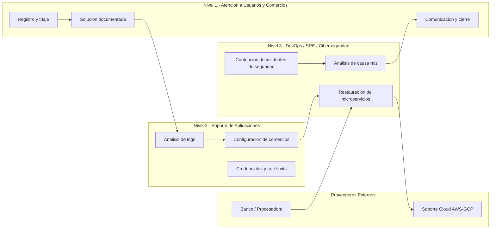

# Universidad Tecnológica Nacional
## Facultad Regional Venado Tuerto
### Ingeniería en Sistemas de Información

**Administración de Sistemas de Información**

**TEMA:** Gestión Operativa de los Servicios IT

- **Unidad Nro.:** 4
- **Trabajo Práctico Nro.:** 7
- **Año:** 2026
- **Docentes:** Juan Cruz Bosetti Palacios – Jorge Ariel Balut Cabezas
- **Grupo Nro.:** 3
- **Integrantes:** Jonatan Harbertz, Tomás Acosta, Donato Cacchiarelli, Iván Salomón
- **Fecha de Entrega:** 19/09/2026

---

## Contexto de la Organización

La organización asignada es una *startup* FinTech (tecnología financiera) de medios de pago y billetera virtual, en fase de escala, con 3.000.000 de usuarios activos, arquitectura íntegramente en la nube sobre AWS (Amazon Web Services) y GCP (Google Cloud Platform), e integraciones vía API (Application Programming Interface, interfaz de programación de aplicaciones) con bancos y procesadoras de tarjetas.

El desafío principal es que los microcortes o la latencia en las APIs provocan el rechazo masivo de transacciones en los comercios adheridos. A diferencia de una caída de sistema administrativo, cada minuto de degradación tiene un costo económico directo, medible y atribuible: transacciones perdidas, comercios que migran a un competidor y penalidades contractuales.

En consecuencia, el diseño de la Mesa de Servicios se orienta a tres ejes:

1. **Gestión de incidentes de alta complejidad** en Nivel 3 / DevOps (Development and Operations) y SRE (Site Reliability Engineering, ingeniería de confiabilidad de sitio).
2. **Monitoreo proactivo**: la mayor parte de los incidentes críticos debe detectarse por alerta automática antes de que el comercio los reporte.
3. **Acuerdos de nivel de servicio basados en disponibilidad de APIs** con un objetivo del 99,9 %.

### Marco de referencia

El diseño se encuadra en **ITIL 4** (Information Technology Infrastructure Library, biblioteca de infraestructura de tecnologías de la información), tomando específicamente las prácticas de *Service Desk* (Mesa de Servicios), *Incident Management* (gestión de incidentes), *Service Request Management* (gestión de solicitudes de servicio), *Service Level Management* (gestión de niveles de servicio) y *Monitoring and Event Management* (monitoreo y gestión de eventos). Para la definición de objetivos de nivel de servicio y presupuesto de error se incorpora el enfoque SRE de Google.

---

# Sección I: Catálogo de Servicios TIC

## 1. Modelado del Servicio: estructura de la Mesa de Servicios

La Mesa de Servicios opera como **SPOC** (Single Point of Contact, punto único de contacto) para comercios adheridos, usuarios finales de la billetera y usuarios internos. Se estructura en tres niveles internos más un anillo de proveedores externos.

| Nivel | Denominación | Responsabilidades | Ventana | Dotación estimada |
|---|---|---|---|---|
| **N1** | Atención a Usuarios y Comercios | Recepción, registro, triaje, categorización y priorización. Resolución en primer contacto mediante Base de Conocimientos. Comunicación al cliente durante todo el ciclo de vida del ticket. Cierre y encuesta. | 24x7 (turnos rotativos) | 12 analistas |
| **N2** | Soporte Técnico de Aplicaciones | Análisis de logs, diagnóstico de rechazos de transacciones, errores de configuración de comercios, gestión de credenciales y *rate limits*, reprocesamiento de conciliaciones. | 24x7 (guardia activa nocturna) | 6 analistas |
| **N3** | DevOps / Arquitectura SRE | Incidentes de alta complejidad sobre microservicios, infraestructura Cloud, *pipelines* de despliegue, restauración de APIs, análisis de causa raíz y acciones preventivas. | 8x5 + guardia pasiva 24x7 | 4 ingenieros |
| **CIB** | Ciberseguridad (equipo especializado) | Incidentes de fraude transaccional, ataques de denegación de servicio, accesos indebidos, filtración de datos. Interviene por escalamiento funcional directo desde cualquier nivel. | Guardia 24x7 | 3 especialistas |
| **EXT** | Proveedores Externos | Soporte de AWS y GCP, bancos integrados, procesadoras y redes de tarjetas (Visa / Mastercard), proveedor de la herramienta de monitoreo. | Según contrato de cada proveedor | — |

### Canales de entrada autorizados

| Canal | Tipos de solicitud admitidos | Prioridad máxima que admite |
|---|---|---|
| Monitoreo proactivo (alertas automáticas) | Incidentes detectados por umbral | P1 |
| Línea telefónica crítica (comercios *enterprise*) | Incidentes | P1 |
| Portal de autoservicio | Requerimientos y consultas | P3 |
| Formulario web de soporte | Incidentes y requerimientos | P2 |
| Correo electrónico de soporte | Requerimientos y consultas | P3 |
| *Chatbot* en la aplicación (usuarios de la billetera) | Consultas e incidentes de usuario final | P3 |

> **Criterio adoptado:** ningún incidente crítico ingresa por correo electrónico ni por *chatbot*. La restricción de prioridad por canal evita que un P1 real quede en una cola de baja frecuencia de revisión.

## 2. Catálogo de Servicios

### Categoría A: Requerimientos de Servicio (*Service Requests*)

| ID | Servicio |
|---|---|
| **REQ-01** | Alta e integración de nuevo comercio adherido a la API |
| **REQ-02** | Solicitud de ampliación de cuota de consumo (*rate limit*) de la API |
| **REQ-03** | Solicitud de reportes históricos de transacciones o conciliaciones |
| **REQ-04** | Alta, baja o modificación de accesos de usuarios internos a consolas Cloud y paneles administrativos |

### Categoría B: Gestión de Incidentes (*Incidents*)

| ID | Servicio |
|---|---|
| **INC-01** | Caída total o intermitencia (microcortes) de la API de validación de pagos |
| **INC-02** | Latencia alta en la respuesta hacia la procesadora de tarjetas |
| **INC-03** | Falla de sincronización en la billetera virtual (saldos no actualizados) |
| **INC-04** | Incidente de seguridad: patrón anómalo de fraude, ataque de denegación de servicio o acceso indebido |

## 3. Matriz de Prioridad (Impacto vs. Urgencia)

### Criterios de clasificación

**Impacto** (alcance del daño):

| Nivel | Criterio |
|---|---|
| **Alto** | Afecta a más del 20 % de los comercios adheridos o compromete el flujo transaccional troncal. Riesgo de pérdida económica directa o de datos. |
| **Medio** | Afecta a un grupo acotado de comercios o a una funcionalidad no troncal. Existe solución temporal (*workaround*). |
| **Bajo** | Afecta a uno o pocos usuarios, sin comprometer transacciones en curso. |

**Urgencia** (velocidad de degradación):

| Nivel | Criterio |
|---|---|
| **Alta** | La situación se deteriora minuto a minuto o hay pérdida económica en curso. |
| **Media** | Situación estable pero con fecha límite comprometida. |
| **Baja** | Sin deterioro en el tiempo; puede planificarse. |

### Matriz de asignación

| Impacto \ Urgencia | **Alta** | **Media** | **Baja** |
|---|---|---|---|
| **Alto** | **P1 – Crítica** | **P2 – Alta** | **P3 – Media** |
| **Medio** | **P2 – Alta** | **P3 – Media** | **P4 – Baja** |
| **Bajo** | **P3 – Media** | **P4 – Baja** | **P4 – Baja** |

## 4. Fichas de Servicio

### Ficha 1 — INC-01: Caída o microcortes de la API de Pagos

| Campo | Definición |
|---|---|
| **Descripción** | Falla total o pérdida de conectividad masiva e intermitente en la API de validación de pagos. Impide la aprobación de transacciones en los comercios adheridos. |
| **Usuario / Beneficiario** | Comercios adheridos y usuarios finales de la billetera virtual. |
| **Canal de entrada autorizado** | Monitoreo proactivo (alerta automática por umbral de tasa de error) o línea telefónica crítica. |
| **Impacto / Urgencia** | Alto / Alta |
| **Prioridad resultante** | **P1 – Crítica** |
| **SLA aplicable** | TTR < 10 min – TTS < 1 h – 24x7 |

**Flujo de resolución:** alerta recibida → creación automática del ticket P1 y apertura del *war room* → asignación inmediata a N3/DevOps con notificación simultánea al IT Manager → diagnóstico sobre microservicios y proveedor Cloud → restauración del servicio o activación de *rollback* → validación de disponibilidad y de tráfico normalizado → comunicación a comercios → cierre → informe de causa raíz (RCA, *Root Cause Analysis*) dentro de las 48 h.

---

### Ficha 2 — INC-02: Latencia alta hacia la procesadora de tarjetas

| Campo | Definición |
|---|---|
| **Descripción** | Degradación del tiempo de respuesta en la integración con la procesadora, con aumento de transacciones que expiran por *timeout* sin caída total del servicio. |
| **Usuario / Beneficiario** | Comercios adheridos con alto volumen transaccional. |
| **Canal de entrada autorizado** | Monitoreo proactivo (umbral de latencia p95) o formulario web de soporte. |
| **Impacto / Urgencia** | Alto / Media |
| **Prioridad resultante** | **P2 – Alta** |
| **SLA aplicable** | TTR < 20 min – TTS < 4 h – 24x7 |

**Flujo de resolución:** detección por umbral de latencia → registro y categorización en N1 → verificación en N2 de si la degradación es propia o del tercero → si es interna, escalamiento a N3 para análisis de *pool* de conexiones y escalado horizontal; si es externa, apertura de caso con la procesadora y activación de enrutamiento alternativo → validación de latencia dentro del objetivo → cierre.

---

### Ficha 3 — INC-03: Falla de sincronización de saldos en la billetera

| Campo | Definición |
|---|---|
| **Descripción** | El saldo mostrado al usuario no refleja las operaciones efectivamente acreditadas o debitadas, por desfase entre el servicio de cuentas y el motor transaccional. |
| **Usuario / Beneficiario** | Usuarios finales de la billetera virtual. |
| **Canal de entrada autorizado** | *Chatbot* de la aplicación, formulario web o alerta de conciliación automática. |
| **Impacto / Urgencia** | Medio / Alta |
| **Prioridad resultante** | **P2 – Alta** |
| **SLA aplicable** | TTR < 20 min – TTS < 4 h – 24x7 |

**Flujo de resolución:** reporte o alerta de descuadre → N1 valida alcance (caso individual o masivo) → N2 ejecuta cotejo entre motor transaccional y servicio de cuentas → si es masivo, se escala a N3 y se comunica por canal público → reprocesamiento de la cola de eventos → verificación de saldos con el usuario afectado → cierre.

> Si el descuadre supera el 0,5 % de las cuentas activas, el incidente se reclasifica automáticamente como **P1** por impacto reputacional y regulatorio.

---

### Ficha 4 — INC-04: Incidente de seguridad (fraude, DDoS o acceso indebido)

| Campo | Definición |
|---|---|
| **Descripción** | Detección de patrones anómalos de transaccionalidad compatibles con fraude, ataque de denegación de servicio distribuido (DDoS, *Distributed Denial of Service*) o accesos no autorizados a paneles y consolas. |
| **Usuario / Beneficiario** | La organización en su conjunto, comercios adheridos y titulares de los datos personales. |
| **Canal de entrada autorizado** | Monitoreo proactivo (motor antifraude / WAF) o reporte del área de Riesgos. |
| **Impacto / Urgencia** | Alto / Alta |
| **Prioridad resultante** | **P1 – Crítica** |
| **SLA aplicable** | TTR < 10 min – TTS < 1 h – 24x7 |

**Flujo de resolución:** alerta del motor antifraude o del WAF (*Web Application Firewall*) → ticket P1 con escalamiento funcional inmediato a Ciberseguridad, sin pasar por diagnóstico de N2 → contención (bloqueo de reglas, *rate limiting* de emergencia, suspensión de credenciales comprometidas) → notificación al CTO y al Oficial de Protección de Datos → erradicación y recuperación → informe de incidente y evaluación de notificación a la autoridad de control conforme a la Ley 25.326 de Protección de los Datos Personales.

---

### Ficha 5 — REQ-01: Alta e integración de nuevo comercio adherido

| Campo | Definición |
|---|---|
| **Descripción** | Generación de credenciales y habilitación de acceso a los entornos de *testing* y producción para un comercio recién contratado. |
| **Usuario / Beneficiario** | Desarrolladores y equipo técnico del comercio adherido; área Comercial como solicitante interno. |
| **Canal de entrada autorizado** | Portal de autoservicio o formulario web de soporte. |
| **Impacto / Urgencia** | Medio / Media |
| **Prioridad resultante** | **P3 – Media** |
| **SLA aplicable** | TTR < 2 h – TTS < 24 h – 8x5 |

**Flujo de resolución:** solicitud recibida → verificación de contrato y de cumplimiento de *onboarding* KYC (*Know Your Customer*, conocimiento del cliente) en N1 → generación de credenciales y claves de API por N2 → entrega por canal seguro con doble factor → acompañamiento de la primera transacción de prueba en *sandbox* → confirmación del comercio → cierre.

---

### Ficha 6 — REQ-02: Ampliación de cuota de consumo (*rate limit*)

| Campo | Definición |
|---|---|
| **Descripción** | Aumento del límite de llamadas por minuto habilitado a un comercio, generalmente asociado a campañas comerciales o crecimiento sostenido de su volumen. |
| **Usuario / Beneficiario** | Comercios adheridos con crecimiento de operaciones. |
| **Canal de entrada autorizado** | Portal de autoservicio o formulario web de soporte. |
| **Impacto / Urgencia** | Medio / Media |
| **Prioridad resultante** | **P3 – Media** |
| **SLA aplicable** | TTR < 2 h – TTS < 24 h – 8x5 |

**Flujo de resolución:** solicitud recibida → N1 verifica historial de consumo del comercio → N2 evalúa impacto en capacidad de la plataforma y consulta a N3 si la ampliación supera el 15 % de la capacidad disponible → aplicación del nuevo límite en el *API Gateway* → monitoreo reforzado durante 72 h → cierre.

> **Excepción documentada:** si el comercio acredita un evento comercial con fecha confirmada dentro de las 48 h, la urgencia se eleva a Alta y el requerimiento pasa a **P2**.

---

### Ficha 7 — REQ-03: Reportes históricos y conciliaciones

| Campo | Definición |
|---|---|
| **Descripción** | Generación y entrega de reportes históricos de transacciones o de archivos de conciliación para un período determinado. |
| **Usuario / Beneficiario** | Áreas de administración y finanzas de los comercios adheridos; área contable interna. |
| **Canal de entrada autorizado** | Portal de autoservicio o correo electrónico de soporte. |
| **Impacto / Urgencia** | Bajo / Baja |
| **Prioridad resultante** | **P4 – Baja** |
| **SLA aplicable** | TTR < 8 h – TTS < 48 h – 8x5 |

**Flujo de resolución:** solicitud recibida → N1 valida identidad del solicitante y alcance del período → si el reporte está disponible en el portal, se deriva a autoservicio y se cierra con registro de oportunidad de automatización → si requiere extracción manual, N2 genera el archivo → entrega por canal seguro → cierre.

---

### Ficha 8 — REQ-04: Gestión de accesos de usuarios internos

| Campo | Definición |
|---|---|
| **Descripción** | Alta, baja o modificación de permisos de personal interno sobre consolas Cloud, paneles administrativos y herramientas de monitoreo. |
| **Usuario / Beneficiario** | Empleados de la organización; solicitado por el líder del área y validado por Ciberseguridad. |
| **Canal de entrada autorizado** | Portal de autoservicio con aprobación del responsable jerárquico. |
| **Impacto / Urgencia** | Medio / Media |
| **Prioridad resultante** | **P3 – Media** |
| **SLA aplicable** | TTR < 2 h – TTS < 24 h – 8x5 |

**Flujo de resolución:** solicitud con aprobación del líder → N1 verifica perfil contra la matriz de roles → Ciberseguridad autoriza si involucra permisos productivos → N2 aplica el cambio bajo el principio de mínimo privilegio → registro en el inventario de accesos → cierre.

> **Excepción documentada:** las **bajas por desvinculación** se ejecutan como **P1** con TTS < 1 h, cualquiera sea el día y horario, por riesgo de acceso indebido.

---

# Sección II: Acuerdos de Nivel de Servicio (SLA) y Objetivos de Nivel de Servicio (SLO)

Se distinguen dos instrumentos complementarios:

- **SLA** (*Service Level Agreement*, acuerdo de nivel de servicio): compromiso **contractual** frente a comercios y usuarios, con consecuencias comerciales en caso de incumplimiento. Se expresa en tiempos de atención de tickets.
- **SLO** (*Service Level Objective*, objetivo de nivel de servicio): meta **técnica interna**, más exigente que el SLA, que gobierna las decisiones de ingeniería. Se expresa en disponibilidad, latencia y tasa de éxito de la plataforma.

## 1. Matriz de Niveles de Servicio por severidad

| Prioridad | TTR *(Time to Respond)* | TTS *(Time to Solve)* | Ventana de atención | Escalamiento automático |
|---|---|---|---|---|
| **P1 – Crítica** | < 10 minutos | < 1 hora | 24x7 | IT Manager al 50 % del TTS; CTO al 80 % |
| **P2 – Alta** | < 20 minutos | < 4 horas | 24x7 | IT Manager al 70 % del TTS |
| **P3 – Media** | < 2 horas | < 24 horas | L-V 9:00–18:00 (8x5) | Líder de Mesa al 80 % del TTS |
| **P4 – Baja** | < 8 horas | < 48 horas | L-V 9:00–18:00 (8x5) | Revisión semanal de backlog |

**Aclaraciones del acuerdo:**

- El TTR mide el tiempo hasta la **primera respuesta humana** al solicitante, no el acuse automático de recepción del sistema de *ticketing*.
- Para P3 y P4 el cronómetro se **detiene** fuera de la ventana 8x5 y mientras el ticket esté en estado *"pendiente de información del cliente"*.
- **Quedan excluidos del SLA:** ventanas de mantenimiento programado notificadas con 72 h de anticipación, indisponibilidades atribuibles a terceros con caso abierto y acreditado, y eventos de fuerza mayor.

## 2. Objetivos de Nivel de Servicio (SLO) y presupuesto de error

| SLO | Indicador | Objetivo | Ventana de medición |
|---|---|---|---|
| Disponibilidad de la API de pagos | *Uptime* medido por el monitor sintético | **99,9 %** | Mensual (30 días) |
| Latencia de la API de pagos | Percentil 95 del tiempo de respuesta | **< 300 ms** | Semanal |
| Latencia de la API de pagos | Percentil 99 del tiempo de respuesta | **< 800 ms** | Semanal |
| Tasa de éxito transaccional | Transacciones aprobadas sobre intentos válidos | **> 99,5 %** | Diaria |

### Cálculo del presupuesto de error (*error budget*)

El presupuesto de error es la indisponibilidad **tolerada** por el objetivo: lo que sobra del 100 % una vez comprometido el 99,9 %.

$$\text{Error Budget} = (1 - \text{SLO}) \times T_{\text{ventana}}$$

Para una ventana mensual de 30 días:

$$T_{\text{ventana}} = 30 \times 24 \times 60 = 43.200 \text{ minutos}$$

$$\text{Error Budget} = (1 - 0{,}999) \times 43.200 = 43{,}2 \text{ minutos/mes}$$

Es decir, **43 minutos y 12 segundos de indisponibilidad admitida por mes**.

**Política de consumo del presupuesto:**

| Consumo acumulado | Decisión de ingeniería |
|---|---|
| < 50 % | Operación normal. Se habilitan despliegues de nuevas funcionalidades. |
| 50 % – 80 % | Alerta al IT Manager. Revisión de la causa raíz de los eventos consumidores. |
| > 80 % | **Congelamiento de despliegues** no críticos. Todo el esfuerzo de N3 se redirige a confiabilidad hasta el reinicio de la ventana. |
| 100 % (agotado) | Incumplimiento del SLO. Informe formal al CTO y plan de remediación con fecha comprometida. |

> **Observación relevante:** el objetivo de 99,9 % de disponibilidad **no debe confundirse** con la meta de cumplimiento de SLA de tickets. Son dos métricas distintas: la primera mide la plataforma, la segunda mide la Mesa de Servicios. Comprometer un 99,9 % de tickets dentro de SLA equivaldría a admitir menos de 1 incumplimiento cada 1.000 tickets, lo cual no es sostenible con una dotación real.

---

# Sección III: Sistema de Indicadores (Métricas y KPIs)

## 1. Tablero de gestión

### Dimensión: Operativa y Eficiencia

| Indicador | Fórmula | Frecuencia | Meta | Acción correctiva si no se cumple |
|---|---|---|---|---|
| **FCR** – *First Contact Resolution Rate* (tasa de resolución en primer contacto) | Tickets resueltos por N1 sin escalar / Total de tickets resueltos × 100 | Semanal | **> 60 %** | Ampliar la Base de Conocimientos con los 10 motivos de escalamiento más frecuentes y capacitar a N1 sobre ellos. |
| **MTTA** – *Mean Time to Acknowledge* (tiempo medio de reconocimiento) | Σ (hora de toma – hora de creación) / N.º de tickets | Diaria | **< 5 min (P1)** / < 15 min (global) | Revisar la cobertura de turnos y activar guardia adicional en las franjas con mayor demora. |
| **MTTR** – *Mean Time to Repair/Resolve* (tiempo medio de resolución), **segmentado por prioridad** | Σ (hora de cierre – hora de creación) / N.º de tickets de esa prioridad | Semanal | **P1 < 45 min** / P2 < 3 h / P3 < 18 h / P4 < 36 h | Automatizar reinicios y *rollback* de los servicios con mayor recurrencia; revisar la asignación de especialistas. |

> El MTTR se mide **por prioridad** y no como promedio único: un promedio global de 2 horas sería compatible con un P1 resuelto en 3 horas, es decir, con el incumplimiento del SLA más importante del acuerdo.

### Dimensión: Calidad y Satisfacción

| Indicador | Fórmula | Frecuencia | Meta | Acción correctiva si no se cumple |
|---|---|---|---|---|
| **CSAT** – *Customer Satisfaction Score* (índice de satisfacción del cliente) | Encuestas con puntaje 4 o 5 / Total de encuestas respondidas × 100 | Mensual (encuesta al cierre de cada ticket) | **> 85 %** | Análisis de causa raíz sobre los comentarios negativos y contacto directo del Líder de Mesa con los comercios insatisfechos. |
| **Cumplimiento de SLA** | Tickets resueltos dentro del TTS comprometido / Total de tickets resueltos × 100 | Mensual (con corte semanal de seguimiento) | **> 95 % global** y **> 98 % en P1** | Rebalanceo de cargas, refuerzo de la franja horaria incumplidora y revisión de la razonabilidad del TTS comprometido. |

### Dimensión: Volumen y Capacidad

| Indicador | Fórmula | Frecuencia | Meta | Acción correctiva si no se cumple |
|---|---|---|---|---|
| **Tasa de backlog** | Tickets sin resolver al cierre del mes / Tickets creados en el mes × 100 | Mensual | **< 5 %** | Balanceo de cargas entre niveles y depuración de tickets sin actividad. |
| **Volumen de tickets por canal y por servicio** | Recuento segmentado por canal y por ID de servicio | Semanal | **≥ 40 % de los requerimientos ingresados por autoservicio** al cierre del trimestre | Campaña de difusión del portal y ampliación del catálogo autogestionable. |
| **Porcentaje de tickets reabiertos** | Tickets reabiertos / Tickets cerrados × 100 | Mensual | **< 3 %** | Refuerzo del control de calidad en el proceso de cierre y verificación obligatoria con el usuario antes de cerrar. |

### Dimensión adicional: Confiabilidad de la plataforma (específica del escenario FinTech)

| Indicador | Fórmula | Frecuencia | Meta | Acción correctiva si no se cumple |
|---|---|---|---|---|
| **Disponibilidad de la API de pagos** | (Tiempo total – Tiempo de indisponibilidad) / Tiempo total × 100 | Mensual (monitoreo continuo) | **≥ 99,9 %** | Congelamiento de despliegues al superar el 80 % del presupuesto de error y revisión de arquitectura con el proveedor Cloud. |
| **Latencia p95 de la API** | Percentil 95 de los tiempos de respuesta del período | Semanal (alerta en tiempo real) | **< 300 ms** | Escalado horizontal de microservicios y revisión del *pool* de conexiones hacia la procesadora. |
| **Tasa de detección proactiva** | Incidentes detectados por monitoreo / Total de incidentes × 100 | Mensual | **> 70 %** | Ampliación de la cobertura de alertas y calibración de umbrales. |

## 2. Formulario de cálculo

$$\text{FCR} = \frac{T_{\text{resueltos en N1}}}{T_{\text{resueltos totales}}} \times 100$$

$$\text{MTTA} = \frac{\sum_{i=1}^{n} (t_{\text{toma}_i} - t_{\text{creación}_i})}{n}$$

$$\text{MTTR}_{P} = \frac{\sum_{i=1}^{n_P} (t_{\text{cierre}_i} - t_{\text{creación}_i})}{n_P}$$

$$\text{CSAT} = \frac{E_{\text{puntaje} \geq 4}}{E_{\text{respondidas}}} \times 100$$

$$\text{Cumplimiento SLA} = \frac{T_{\text{dentro de TTS}}}{T_{\text{resueltos}}} \times 100$$

$$\text{Backlog} = \frac{T_{\text{sin resolver al cierre del mes}}}{T_{\text{creados en el mes}}} \times 100$$

$$\text{Reapertura} = \frac{T_{\text{reabiertos}}}{T_{\text{cerrados}}} \times 100$$

$$\text{Disponibilidad} = \frac{T_{\text{total}} - T_{\text{indisponible}}}{T_{\text{total}}} \times 100$$

## 3. Tablero de gestión: lectura del mes de referencia

| Indicador | Meta | Medición del mes | Estado |
|---|---|---|---|
| FCR | > 60 % | 62,0 % | Cumple (al límite) |
| MTTA global | < 15 min | 12 min | Cumple |
| MTTR P1 | < 45 min | 38 min | Cumple |
| CSAT | > 85 % | 89 % | Cumple |
| Cumplimiento de SLA global | > 95 % | 96,4 % | Cumple |
| Cumplimiento de SLA en P1 | > 98 % | 97,2 % | **No cumple** |
| Tasa de backlog | < 5 % | 3,5 % | Cumple |
| Tickets reabiertos | < 3 % | 1,9 % | Cumple |
| Disponibilidad de API | ≥ 99,9 % | 99,93 % | Cumple (30,2 min consumidos de 43,2) |
| Latencia p95 | < 300 ms | 271 ms | Cumple |
| Detección proactiva | > 70 % | 74 % | Cumple |

> **Lectura de gestión:** dos señales requieren acción. El cumplimiento de SLA en P1 (97,2 %) está por debajo de la meta pese a que el MTTR promedio de P1 la cumple, lo que indica **pocos casos con desvíos muy grandes** y no un problema sistémico. El FCR en 62 % está al límite y sostenido únicamente por el volumen de consultas simples; si crece la complejidad de los tickets, caerá por debajo de la meta.

### Distribución de tickets por canal de ingreso

### Consumo del presupuesto de error

> La línea representa el consumo lineal esperado y las barras el consumo real. El mes cierra por debajo de la curva, con presupuesto remanente y despliegues habilitados.

---

# Sección IV: Diseño del Flujo de Procesos y Escalado

## 1. Ciclo de vida del ticket

1. **Inicio:** detección por monitoreo proactivo o reporte del usuario por canal autorizado.
2. **Registro y categorización:** N1 registra, clasifica según la matriz Impacto vs. Urgencia y **se inicia el cronómetro de SLA**.
3. **Investigación inicial:** N1 consulta la Base de Conocimientos. Si existe solución documentada, la aplica (aporta al FCR); si no, escala.
4. **Control de vencimiento de SLA:** en paralelo a todo el proceso, un temporizador evalúa el porcentaje de TTS consumido y dispara el escalamiento jerárquico en los umbrales definidos.
5. **Escalamiento funcional a N2 / N3 / Ciberseguridad** según la naturaleza del problema.
6. **Proveedores externos:** intervención cuando la causa es atribuible a un tercero (Cloud, banco, procesadora), sin que ello detenga la comunicación al cliente.
7. **Resolución:** restauración del servicio y validación técnica del tráfico normalizado.
8. **Cierre y CSAT:** N1 valida la solución con el usuario, cierra formalmente y envía la encuesta de satisfacción.
9. **Post-incidente (solo P1):** informe de causa raíz dentro de las 48 h y carga de la solución en la Base de Conocimientos.

## 2. Diagrama del proceso

> **Nota de notación:** el ramal punteado representa el evento temporizador intermedio adjunto al ciclo de atención. En notación BPMN (*Business Process Model and Notation*, modelo y notación de procesos de negocio) corresponde a un **evento intermedio de temporizador** anexado a la tarea de diagnóstico, que dispara el flujo de escalamiento jerárquico sin interrumpir la atención técnica en curso.

## 3. Asignación por carriles de responsabilidad

## 4. Criterios de Escalamiento

### 4.1 Escalamiento funcional (cambio de equipo resolutor)

| Origen | Destino | Disparador |
|---|---|---|
| N1 | N2 | No existe solución documentada en la Base de Conocimientos, o el diagnóstico requiere acceso a logs de aplicación. |
| N1 | N3 (directo) | Alerta automática de caída total de API clasificada como P1. No se pierde tiempo en triaje técnico. |
| N1 / N2 | Ciberseguridad (directo) | Cualquier indicio de fraude, acceso indebido, exfiltración de datos o ataque de denegación de servicio. |
| N2 | N3 | Caída de servidores, degradación de infraestructura de red, error en un despliegue o necesidad de modificar configuración productiva del entorno Cloud. |
| N2 / N3 | Desarrollo | El diagnóstico identifica un defecto de código (*bug*) que requiere corrección y nuevo despliegue. |
| N3 | Proveedores externos | La causa raíz se confirma en un tercero: servicio de AWS o GCP, banco emisor o red de tarjetas. Se abre caso con el número de contrato y se informa el ticket interno asociado. |

### 4.2 Escalamiento jerárquico (intervención de la conducción)

| Umbral | Rol notificado | Acción esperada |
|---|---|---|
| Ticket P1 abierto (inmediato) | **Líder de Mesa de Servicios** | Toma de coordinación del *war room* y control de la comunicación a comercios. |
| 50 % del TTS consumido en P1, o 70 % en P2 | **IT Manager** | Reasignación de recursos, autorización de horas extraordinarias y decisión sobre comunicación pública. |
| 80 % del TTS consumido en P1 | **CTO** *(Chief Technology Officer, director de tecnología)* | Autorización de medidas excepcionales: *rollback* masivo, degradación controlada de funcionalidades no críticas o corte selectivo de tráfico. |
| Caída masiva con TTS vencido o pérdida de datos | **CTO + Comité de Crisis** | Activación del **DRP** (*Disaster Recovery Plan*, plan de recuperación ante desastres) y evaluación de notificaciones regulatorias. |
| Reclamo formal de un comercio *enterprise* | **IT Manager + Gerencia Comercial** | Respuesta institucional y evaluación de compensación contractual. |

> **Distinción conceptual:** el escalamiento **funcional** busca *capacidad técnica* (quién sabe resolverlo) y el escalamiento **jerárquico** busca *autoridad de decisión* (quién puede autorizar medidas excepcionales o asumir el costo). Un mismo ticket puede recorrer ambos caminos simultáneamente.

---

## Conclusión

El diseño propuesto para la Mesa de Servicios responde al rasgo distintivo del escenario asignado: en una FinTech de medios de pago, la indisponibilidad no genera una molestia administrativa sino una pérdida económica inmediata y cuantificable, tanto propia como de los comercios adheridos.

De ahí las tres decisiones centrales del trabajo:

1. **Monitoreo proactivo como canal principal de incidentes críticos**, con la meta de que más del 70 % de los incidentes se detecte antes del reporte del cliente.
2. **Separación explícita entre SLA y SLO**, con un presupuesto de error de 43,2 minutos mensuales que convierte la confiabilidad en una restricción operativa concreta sobre el ritmo de despliegues, y no en una declaración de intenciones.
3. **Un camino de escalamiento a Ciberseguridad independiente del circuito técnico habitual**, dado que en una plataforma con 3.000.000 de usuarios activos y manejo de fondos de terceros el incidente de seguridad no admite el tiempo de un diagnóstico escalonado.

---

## Referencias

- AXELOS. (2019). *ITIL Foundation: ITIL 4 Edition*. TSO.
- Beyer, B., Jones, C., Petoff, J., & Murphy, N. R. (2016). *Site Reliability Engineering: How Google Runs Production Systems*. O'Reilly Media.
- ISO/IEC. (2018). *ISO/IEC 20000-1:2018. Information technology — Service management — Part 1: Service management system requirements*.
- Ley N.º 25.326. *Protección de los Datos Personales*. Boletín Oficial de la República Argentina, 2000.
- Object Management Group. (2014). *Business Process Model and Notation (BPMN) Version 2.0.2*.
