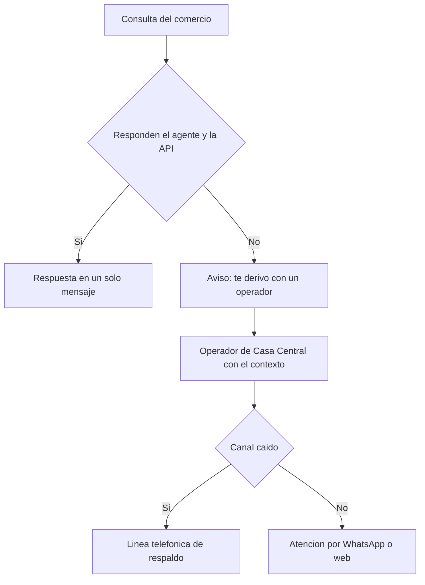

# TP8 Grupo 3: Amenazas y plan de contingencia (4 min)

Eje: Agentes IA y motores de procesamiento IA, caso NovaRetail Distribuciones S.A. La consigna de la cátedra pide dos cosas para esta presentación: las **amenazas técnicas más peligrosas** y su **contingencia**.

## Reparto del tiempo

| Min | Diapositiva | Contenido |
|---|---|---|
| 0:00 a 0:30 | 1. Contexto | Qué es el agente y por qué no puede fallar |
| 0:30 a 2:00 | 2. Amenazas | 4 amenazas y cuál es la más peligrosa |
| 2:00 a 3:30 | 3. Contingencia | Qué hacemos antes y qué hacemos si ocurre |
| 3:30 a 4:00 | 4. Cierre | Condiciones de contrato y conclusión |

---

## Diapositiva 1. Contexto (30 s)

**En pantalla**

- Agente IA 24/7 en WhatsApp y web: estado de pedidos, saldos y stock.
- Botmaker Scale + Claude Haiku 5.5, USD 396 por mes, 5.500 conversaciones.
- Meta: sacar de la central las 250 llamadas diarias.

**Decir**

> Nuestro eje es el agente de inteligencia artificial que atiende a los comercios por WhatsApp y web. Reemplaza las más de 250 llamadas diarias que hoy colapsan la central. Cuesta unos 396 dólares por mes. Pero el punto clave es este: si el agente falla, esas 250 llamadas vuelven de golpe. Por eso nos concentramos en qué puede salir mal.

---

## Diapositiva 2. Amenazas técnicas identificadas (1 min 30 s)

**En pantalla**

| # | Amenaza | Probabilidad | Impacto | Nivel |
|---|---|---|---|---|
| 1 | Caída de la plataforma o del canal de WhatsApp | Media | Alto | **Alta** |
| 2 | Falla de la API de integración o de la base en la nube | Media | Alto | **Alta** |
| 3 | Fuga de saldos o respuestas inventadas por el modelo | Baja | Muy alto | **Alta** |
| 4 | Sobrecosto por mensajes salientes de Meta | Alta | Medio | Media |

*Probabilidad e impacto son una estimación del grupo, no un dato del caso.*

**Decir**

> Identificamos cuatro amenazas técnicas. Las tres más peligrosas son estas.
>
> La primera es la caída de la plataforma o del canal. Ni Botmaker ni Cliengo publican un compromiso de disponibilidad, y el objetivo IT exige 99,5 %.
>
> La segunda es la falla de la API de integración o de la base de datos. El agente no es un chatbot de preguntas frecuentes: sin esa API solo responde generalidades. Además depende de lo que construyan los grupos 1 y 4.
>
> La tercera es la más delicada: exponer el saldo de cuenta corriente de un comercio a otro, o que el modelo invente un dato. Tiene menos probabilidad, pero el impacto es comercial y legal por la Ley 25.326 de datos personales.
>
> La cuarta es económica: cada mensaje saliente cuesta 0,026 dólares. Con tres mensajes por consulta en lugar de uno, la factura sube de 396 a 682 dólares, un 72 % más.

---

## Diapositiva 3. Plan de contingencia (1 min 30 s)

**En pantalla**

| # | Prevención | Si ocurre |
|---|---|---|
| 1 | SLA de 99,5 % por escrito, con créditos por incumplimiento | Mensaje automático y derivación a operadores; se mantienen las líneas telefónicas durante la transición |
| 2 | Monitoreo y tiempo límite en la API; caché de solo lectura | El agente no inventa: avisa que no pudo verificar y deriva con todo el contexto |
| 3 | Identificar al comercio antes de dar el saldo; el modelo responde solo con lo que devuelve la API; API de solo lectura | Cortar la sesión, revisar el registro de conversaciones y avisar al responsable de TI |
| 4 | Un solo mensaje por consulta; meta de 1,2 mensajes salientes por conversación | Alerta de presupuesto y ajuste del flujo conversacional |

**Decir**

> Para cada amenaza separamos prevención y contingencia.
>
> Contra la caída, exigimos el SLA de 99,5 % por escrito con créditos. Si igual ocurre, el agente avisa y deriva a un operador, y no desmantelamos las líneas telefónicas durante la transición.
>
> Contra la falla de la API, ponemos monitoreo y tiempo límite. Si no responde, el agente nunca inventa: dice que no pudo verificar y deriva con todo el contexto de la conversación.
>
> Contra la fuga de datos, identificamos al comercio antes de mostrar un saldo, el modelo solo responde con lo que devuelve la API, y esa API es de solo lectura.
>
> Y contra el sobrecosto, una regla de diseño: un solo mensaje por consulta.

---

## Diapositiva 4. Cierre (30 s)

**En pantalla**

- Ninguna amenaza se elimina, se acota.
- Toda contingencia termina en una persona.
- Condiciones a exigir al proveedor antes de firmar:
  - SLA de 99,5 % por escrito con penalidades.
  - Soporte comprometido de 08:00 a 14:00 hs.
  - Costo de excedente confirmado y motor de IA incluido en el abono.

**Decir**

> Ninguna amenaza se elimina, se acota. Y en todos los casos la contingencia termina en una persona de Casa Central con el contexto de la conversación. Antes de firmar con Botmaker exigimos tres cosas: SLA de 99,5 % por escrito, soporte en la franja de 8 a 14 horas, y el costo del excedente confirmado. Gracias.

---

## Notas para el expositor

- El guion tiene unas 480 palabras: a ritmo normal entra en 4 minutos. Si vas justo de tiempo, recortá la cuarta amenaza (sobrecosto) de la diapositiva 2.
- Si preguntan "¿por qué la fuga de datos es Alta si la probabilidad es Baja?": porque el impacto es muy alto (pérdida de confianza del cliente y exposición legal), y el nivel combina ambos.
- Si preguntan por Meta Business Agent: se descartó porque cuesta entre 1,5 y 2 veces más por mensaje y no resuelve la integración por API.
