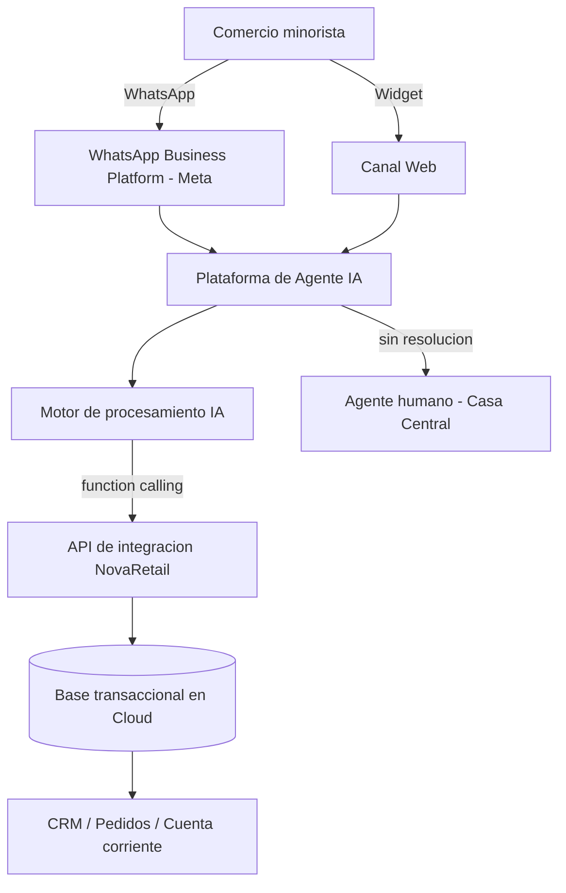

# TP8 - Grupo 3: Agentes IA / Motores de procesamiento IA

[TOC]

## Caso y alcance del eje

**Empresa:** NovaRetail Distribuciones S.A. (distribución mayorista, sur de Santa Fe, 120 empleados).

**Necesidad operativa a resolver**, según el caso de negocio:

> Asistente virtual 24/7 en WhatsApp y Web para responder estado de pedidos, saldos y precios sin saturar a los humanos.

El eje del Grupo 3 cubre **dos capas que se cotizan por separado** y que conviene no mezclar:

1. **Plataforma de agente conversacional** — el canal (WhatsApp Business Platform, widget web), el constructor de flujos, el panel de agentes humanos, el derive a humano y las métricas.
2. **Motor de procesamiento IA** — el modelo de lenguaje que interpreta la consulta en lenguaje natural y redacta la respuesta. Puede venir incluido en la plataforma o contratarse por API aparte.

---

## Dimensionamiento del requerimiento

Los requerimientos mínimos del caso dicen `[Investigar necesidades]`, así que el volumen se deriva de los datos operativos del propio caso.

| Dato del caso | Valor | Qué define |
|---|---|---|
| Llamadas diarias de consulta | más de 250 | Volumen base de conversaciones |
| Franja de concentración | 08:00 a 14:00 hs (6 h) | Pico de concurrencia |
| Tiempo de operadores consumido | 70% | Caso de ahorro |
| Cartera activa | 1.200 comercios | Universo de usuarios únicos |
| Pedidos diarios | 350 a 500 | Volumen de notificación proactiva |
| Catálogo | 3.200 SKU | Tamaño de la base de consulta de stock y precios |
| Uptime exigido | 99,5% | SLA mínimo aceptable |
| Plazo | 4 meses (120 días) | Ventana de implementación |

### Volumen mensual a cotizar

- 250 consultas/día × 22 días hábiles = **5.500 conversaciones/mes**
- Se solicita cotización por una banda de **5.000 a 7.000 conversaciones/mes** para absorber crecimiento y el canal web.

### Concurrencia en el pico

250 consultas concentradas en 6 horas dan aproximadamente **42 consultas/hora**, es decir menos de 1 por minuto. La concurrencia no es una restricción técnica: ninguna plataforma del mercado tiene problema con ese caudal. El cuello de botella del caso es humano, no de capacidad.

### Requerimientos técnicos mínimos derivados

- Canal WhatsApp a través de la **API oficial de Meta** (no automatizaciones sobre WhatsApp Web, que violan los términos de servicio y exponen el número a bloqueo).
- Canal web embebible en el sitio de la empresa.
- **Capacidad de consultar datos en vivo vía API** (function calling o webhooks) contra la base transaccional. Es el requisito que más pesa: "¿dónde está mi pedido?" y "¿cuál es mi saldo?" no se responden con un árbol de FAQ.
- Derivación a agente humano con traspaso de contexto.
- Autenticación o identificación del comercio antes de exponer saldo de cuenta corriente.
- Panel de métricas para medir la tasa de automatización.

---

## Arquitectura de la solución

El punto crítico del eje: el agente no es un chatbot de preguntas frecuentes, es un consumidor de las APIs que construye el equipo de desarrollo.



Sin el bloque **API de integración**, el agente solo responde generalidades y el caso no se resuelve. Esa API es la dependencia directa con el eje de licencias de desarrollo y con la infraestructura cloud.

---

## Tabla comparativa de proveedores

Dos proveedores reales del mercado, ambos con operación en Argentina y facturación local.

| Criterio de Selección | Proveedor Candidato A: Botmaker | Proveedor Candidato B: Cliengo | Decisión de Ingeniería Justificada |
|---|---|---|---|
| **Producto / Plan Específico** | Plan **Scale** (US$ 249/mes, 5.000 conversaciones). Se descarta Standard por cupo insuficiente y Pro por sobredimensionado | Plan **Business** (US$ 259/mes, 4.000 conversaciones IA, incluye 1 línea de WhatsApp API) | **A.** Scale cubre 5.000 de las 5.500 conversaciones con excedente tarifado; Business deja 1.500 sin cubrir |
| **Especificaciones Técnicas** | BSP oficial de Meta. WhatsApp API nativa, web, Instagram, Messenger. Bots ilimitados. 20 agentes humanos incluidos en Scale. Integración por API y webhooks | Plataforma de agentes IA con canal web y WhatsApp API (desde Business). Starter y Premium no incluyen línea de WhatsApp oficial | **A.** Ser BSP oficial deja el alta del número, el canal y el soporte en un único proveedor, sin intermediario |
| **Modelo de Contratación** | Suscripción mensual por volumen de conversaciones + excedente tarifado (US$ 0,06 por conversación en Scale) + alta única de WhatsApp Business Platform de US$ 99 | Suscripción mensual por conversaciones IA. El costo del excedente **no está publicado**; superar el cupo obliga a pasar a plan Corporate "a medida" | **A.** Excedente publicado y predecible. El excedente no publicado de B es una factura de monto abierto |
| **Costo Mensual Estimado** (solo plataforma; el canal Meta se suma aparte) | **US$ 279/mes** (249 de base + 30 de excedente por 500 conversaciones) + US$ 99 por única vez | **US$ 259/mes de piso**, con 1.500 conversaciones/mes sin cubrir. Valor real sujeto a cotización de Corporate | **A.** 279 cerrado contra 259 abierto. La diferencia de 20 dólares no compensa el riesgo de monto variable |
| **Moneda y Facturación** | Precios de lista en USD. Empresa argentina, factura local | Precios de lista en USD. Empresa argentina, factura local | **Empate.** Ambas facturan en el país. En los dos casos hay que pedir el valor en ARS con impuestos incluidos |
| **SLA y Soporte Técnico** | Soporte por chat, WhatsApp o e-mail en todos los planes. Atención personalizada solo en Enterprise. **Uptime no publicado** | Asesoramiento personalizado y demo con ejecutivo en Corporate. **Uptime no publicado** | **Pendiente en ambos.** El 99,5% del objetivo IT no está comprometido por escrito por ninguno: hay que exigirlo en el contrato |
| **Enlace a Cotizador Oficial** | https://botmaker.com/es/precios | https://www.cliengo.com/pricing | — |

### Composición del costo mensual

El motor de IA es la parte más barata del eje. Esto es contraintuitivo y conviene dejarlo asentado.

```grafico
tipo: barras
titulo: Costo mensual del motor de IA segun modelo contratado por API
unidad: USD

Modelo, Costo mensual estimado
Claude Haiku 5.5, 14
Claude Sonnet 5.5, 275
Claude Opus 5.5, 550
```

---

## Capa de motor de procesamiento IA

Si en lugar de usar el motor incluido en la plataforma se desarrolla un agente propio contra una API de modelo, el costo se calcula por tokens procesados.

### Supuesto de consumo

Una conversación promedio del caso ("¿dónde está mi pedido?", identificación del comercio, consulta a la API, respuesta) se estima en **8 turnos**, con instrucciones de sistema y contexto de catálogo reenviados en cada turno:

- Entrada: aproximadamente 20.000 tokens por conversación
- Salida: aproximadamente 1.000 tokens por conversación
- Mensual: 110 millones de tokens de entrada y 5,5 millones de salida

### Comparativa de motores

| Motor | Precio entrada (USD/millón) | Precio salida (USD/millón) | Costo mensual estimado |
|---|---|---|---|
| Claude Haiku 5.5 | 0,10 | 0,50 | **US$ 14** |
| Claude Sonnet 5.5 | 2,00 | 10,00 | US$ 275 |
| Claude Opus 5.5 | 4,00 | 20,00 | US$ 550 |

**Decisión de ingeniería:** **Claude Haiku 5.5**. La tarea del caso es clasificar una intención, llamar a una API y redactar una respuesta corta en español. No requiere razonamiento complejo, y un modelo de gama alta multiplicaría el costo por 40 sin mejorar el resultado para esta tarea. Con *prompt caching* sobre las instrucciones de sistema, que se repiten idénticas en cada turno, el costo real baja todavía más.

El dato relevante para la defensa del TP: **el motor de IA representa menos del 5% del costo del eje**. El gasto está en la plataforma de orquestación, el canal y el panel de agentes, no en el modelo.

---

## Costo del canal WhatsApp (Meta)

Meta factura **aparte** de la plataforma. Es el error de costeo más común del eje y, en este caso, **el componente más caro de todos**.

Desde el 1 de julio de 2025 Meta cobra **por mensaje entregado** de la empresa al usuario. No cobra los mensajes del usuario a la empresa, ni los mensajes no entregados. La tarifa depende de la **categoría** del mensaje y del **mercado** (código de llamada del destinatario).

### Cambio vigente desde el 1 de octubre de 2026

La documentación oficial se actualizó el 30 de septiembre de 2026 y **los mensajes de servicio volvieron a cobrarse**:

- Hay **5 categorías**: marketing, utilidad, autenticación, **servicio** y **Meta Business Agent** (esta última incorporada el 1 de julio de 2026).
- **Servicio** es todo mensaje no-plantilla enviado dentro de la ventana de atención de 24 horas, sea respondido por una IA de terceros o por una persona. Es exactamente lo que hace el agente del caso.
- Cada número de teléfono de la empresa tiene un **nivel gratuito de 1.000 mensajes de servicio entregados por mes**. Desde el mensaje 1.001 se cobra a la tarifa publicada. **No se acumula**: se reinicia cada mes a las 00:00 de la zona horaria de la cuenta.
- Los **niveles de volumen** (descuento por escala) aplican **solo a utilidad y autenticación**. Los mensajes de servicio **no tienen descuento por volumen**.

### Tarifario oficial para Argentina

Argentina es uno de los 39 **mercados designados** con hoja de tarifas propia, no cae en "Resto de Latinoamérica". Valores tomados de las hojas de tarifas oficiales descargables de Meta, vigentes desde el 1 de octubre de 2026:

| Categoría | USD por mensaje | ARS por mensaje |
|---|---|---|
| Marketing | 0,0618 | 89,5620 |
| Utilidad | 0,0260 | 37,6798 |
| Autenticación | 0,0260 | 37,6798 |
| Autenticación internacional | no aplica | no aplica |
| **Servicio** | **0,0260** | **37,6798** |
| Meta Business Agent | 2,00 por millón de tokens | 2,00 USD por millón de tokens |

El tipo de cambio implícito de la hoja ARS es de aproximadamente 1.449 pesos por dólar.

### Impacto sobre el caso

Las 250 consultas diarias son **entrantes**, pero eso ya no las hace gratuitas: **cada respuesta que el agente envía es un mensaje de servicio facturable** una vez agotado el nivel gratuito de 1.000.

El costo depende de **cuántos mensajes salientes use el agente para cerrar cada consulta**, que es una decisión de diseño, no un dato del caso:

| Mensajes salientes por consulta | Mensajes/mes | Facturables | Costo Meta mensual |
|---|---|---|---|
| 1 (respuesta única) | 5.500 | 4.500 | **US$ 117** |
| 2 | 11.000 | 10.000 | US$ 260 |
| 3 (saludo + respuesta + cierre) | 16.500 | 15.500 | **US$ 403** |
| 4 | 22.000 | 21.000 | US$ 546 |

```grafico
tipo: barras
titulo: Costo mensual de Meta segun mensajes salientes por consulta
unidad: USD

Mensajes por consulta, Costo Meta
1, 117
2, 260
3, 403
4, 546
```

**Consecuencia de ingeniería:** a US$ 0,026 por mensaje saliente, diseñar el agente para que responda en **un solo mensaje** en lugar de tres ahorra **US$ 286 por mes** (US$ 3.432 al año) sin cambiar una línea de la plataforma contratada. Es la decisión de mayor impacto económico de todo el eje y no cuesta nada implementarla: es una regla de prompt y de diseño de flujo.

### Notificación proactiva (fase 2 opcional)

"Tu pedido salió del depósito" es un mensaje de **plantilla de utilidad**, no de servicio, y se cobra siempre.

- 500 pedidos/día × 22 días = 11.000 plantillas × US$ 0,026 = **US$ 286/mes**
- A diferencia de los mensajes de servicio, las plantillas de utilidad **sí acceden a descuentos por nivel de volumen**, de modo que el valor real sería algo menor.

Si se incorpora, se cotiza como fase 2 y con un criterio de corte: no todos los pedidos justifican una notificación paga.

### Meta Business Agent como tercera alternativa

Meta ofrece su propio motor de agente IA, facturado por tokens: **US$ 2,00 por millón de tokens**, con un consumo típico de 20.000 a 25.000 tokens por mensaje, es decir **US$ 0,04 a 0,05 por mensaje**. Ese cargo reemplaza al de servicio y cubre tanto el procesamiento de IA como la entrega.

Comparado contra la arquitectura propuesta, con 1 mensaje saliente por consulta:

| Opción | Costo por mensaje | Costo mensual (5.500 mensajes) |
|---|---|---|
| Servicio + motor propio (Haiku 5.5) | 0,026 + 0,003 = **0,029** | **US$ 117 + 14 = 131** |
| Meta Business Agent | 0,040 a 0,050 | US$ 220 a 275 |

**Se descarta Meta Business Agent.** Cuesta entre 1,5 y 2 veces más por mensaje y, sobre todo, no resuelve el requisito central del caso: la integración por API contra la base transaccional para responder estado de pedidos y saldos de cuenta corriente.

---

## Costo total del eje

Se presentan dos escenarios según el diseño conversacional, porque la diferencia es significativa y la decisión está en manos del equipo, no del proveedor.

| Concepto | Diseño eficiente (1 mensaje) | Diseño conversacional (3 mensajes) |
|---|---|---|
| Plataforma Botmaker Scale | US$ 249 | US$ 249 |
| Excedente (500 conversaciones × US$ 0,06) | US$ 30 | US$ 30 |
| Canal Meta, mensajes de servicio | US$ 117 | US$ 403 |
| Motor de IA | incluido en plataforma | incluido en plataforma |
| **Total mensual** | **US$ 396** | **US$ 682** |
| Alta WhatsApp Business Platform (única vez, solo mes 1) | US$ 99 | US$ 99 |
| **Total mes 1** | **US$ 495** | **US$ 781** |

Costo por consulta atendida en el escenario eficiente: US$ 396 / 5.500 = **US$ 0,072**.

A modo de referencia, una llamada telefónica de 3 minutos atendida por un administrativo tiene un costo de oportunidad del orden de US$ 0,30 (supuesto: costo laboral cargado de aproximadamente US$ 6 por hora). La automatización resulta cerca de **4 veces más barata por consulta**. El cálculo de retorno completo requiere la dotación exacta del sector de atención, dato que el caso no provee.

### Dónde está realmente el gasto

La distribución del costo mensual desarma la intuición inicial del eje:

| Componente | Monto | Participación |
|---|---|---|
| Plataforma de orquestación | US$ 279 | 70% |
| Canal WhatsApp (Meta) | US$ 117 | 30% |
| Motor de procesamiento IA | incluido, o US$ 14 si es propio | menos del 4% |

El motor de IA, que da nombre al eje, es el componente más barato. El gasto está en la plataforma que lo orquesta y en el canal que lo transporta.

---

## Decisión de ingeniería justificada

**Se selecciona Botmaker, plan Scale, con Claude Haiku 5.5 como motor en caso de desarrollo propio.**

Fundamentos, en orden de peso:

1. **Cobertura del volumen con costo acotado.** Scale cubre 5.000 conversaciones y tarifa el excedente a US$ 0,06 publicado. Cliengo Business cubre 4.000 y no publica el excedente, lo que deja 1.500 conversaciones mensuales a precio desconocido y obliga a negociar un plan Corporate sin referencia de mercado.
2. **BSP oficial de Meta.** Botmaker es proveedor oficial de WhatsApp Business Platform. El alta del número, el canal y el soporte quedan bajo un único contrato, sin un tercero intermediando ante una caída del canal.
3. **Proveedor local con soporte en huso horario.** El pico operativo del caso es de 08:00 a 14:00 hs de Argentina. Un soporte en otro huso horario deja el pico descubierto.
4. **Costo marginal del motor.** Resolver la capa de IA con Haiku 5.5 mantiene el gasto de modelo en el orden de US$ 14 mensuales, lo que permite asignar el presupuesto a la plataforma y a la integración.
5. **Se descarta Meta Business Agent**, la alternativa del propio Meta, por costar entre 1,5 y 2 veces más por mensaje y no cubrir la integración por API contra la base transaccional, que es el requisito central del caso.

### Regla de diseño conversacional obligatoria

Desde el 1 de octubre de 2026 cada mensaje saliente cuesta US$ 0,026. Por lo tanto se establece como requisito de diseño, no como recomendación:

- **El agente responde en un único mensaje por consulta.** Sin saludo separado, sin mensaje de cierre, sin "dame un momento que lo verifico".
- Ahorro frente a un diseño de tres mensajes: **US$ 286 por mes, US$ 3.432 al año**, a costo de implementación cero.
- Se monitorea el indicador "mensajes salientes por conversación" en el panel de la plataforma y se fija una meta de 1,2 o menos.

### Condiciones a exigir en el contrato

Ninguno de los dos proveedores publica un compromiso de uptime. El objetivo IT del caso exige 99,5%, de modo que la contratación queda sujeta a:

- SLA de **99,5% de disponibilidad** por escrito, con régimen de penalidades o crédito por incumplimiento.
- Tiempo de respuesta de soporte comprometido dentro de la franja de 08:00 a 14:00 hs.
- Confirmación del costo de excedente por conversación vigente al momento de la firma.
- Confirmación de que el motor de IA está incluido en el abono y no se factura por separado.

---

## Supuestos y verificación pendiente

Se declaran los supuestos para que la cotización sea auditable.

- [x] Volumen de 5.500 conversaciones/mes derivado de 250 consultas diarias por 22 días hábiles.
- [x] Consumo de 20.000 tokens de entrada y 1.000 de salida por conversación, sobre un supuesto de 8 turnos.
- [x] Costo laboral cargado de referencia de US$ 6 por hora para el cálculo comparativo.
- [x] **Tarifa de Meta para Argentina: verificada.** Valores tomados de las hojas de tarifas oficiales descargables de Meta en USD y en ARS, vigentes desde el 1 de octubre de 2026. Argentina figura como mercado designado propio: marketing 0,0618 USD, utilidad 0,0260 USD, servicio 0,0260 USD (ARS 89,5620 / 37,6798 / 37,6798).
- [x] **Mensajes de servicio: verificado, se cobran.** La documentación oficial de Meta, actualizada el 30 de septiembre de 2026, confirma que desde las 00:00 del 1 de octubre de 2026 los mensajes de servicio vuelven a cobrarse, con un nivel gratuito de 1.000 mensajes por mes por número de teléfono de la empresa, sin acumulación. Los niveles de volumen no aplican a esta categoría.
- [ ] **Mensajes salientes por consulta.** Es el supuesto de mayor impacto económico y depende del diseño del flujo, no de un dato del caso. Se adoptó 1 mensaje por consulta para el escenario recomendado y se presentó la sensibilidad de 1 a 4. **Validar contra el diseño conversacional real una vez definido.**
- [ ] **Precios en ARS de las plataformas.** Botmaker y Cliengo publican en USD. Falta pedir el valor en pesos con impuestos, percepciones y retenciones incluidos. Meta sí publica tarifario en ARS, con un tipo de cambio implícito de aproximadamente 1.449 pesos por dólar.
- [ ] **Cotización formal.** Los valores son de lista. Resta solicitar cotización escrita a ambos proveedores con el volumen declarado.
- [ ] Botmaker presenta una inconsistencia en su propio sitio: la sección de precios indica US$ 149 y US$ 249 mientras que el simulador muestra US$ 150 y US$ 250, y nombra "Completo" al plan Scale. Confirmar la nomenclatura y el valor en la cotización formal.

---

## Fuentes

- Botmaker, página oficial de precios: https://botmaker.com/es/precios
- Cliengo, página oficial de planes: https://www.cliengo.com/pricing
- Meta, documentación de precios de WhatsApp Business Platform (actualizada el 30/09/2026): https://developers.facebook.com/documentation/business-messaging/whatsapp/pricing
- Meta, hojas de tarifas y niveles de volumen descargables en USD y ARS, vigentes desde el 1 de octubre de 2026, enlazadas desde la sección "Tarifas y niveles por volumen" de la página anterior
- Meta, asignación de códigos de llamada a mercados: https://developers.facebook.com/documentation/business-messaging/whatsapp/pricing#pricing-regions-on-the-rate-card-country-calling-codes
- WhatsApp Business, página de precios de la plataforma: https://whatsappbusiness.com/es-la/products/platform-pricing/
- Anthropic, precios de la API de Claude: https://www.anthropic.com/pricing

Consultado el 16 de octubre de 2026.
